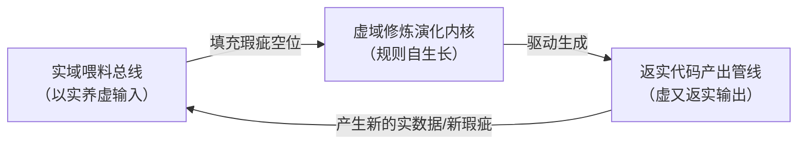

# 任务类型: deep

### 「以实养虚-虚返生实」自增强循环工程实现
*严格基于已有认知锚定：直接落地系统架构与链式机制，将引擎原始态的逻辑断层/数据缺失/NaN/Null/未完成标记作为核心循环动力，而非前置清洗的噪声*
---
#### 一、核心边界锚定（无模糊定义）
| 域 | 定义（硬约束） | 初始态特征 |
|----|----------------|------------|
| **实域（不可伪造、带真实成本/价值）** | ① 全量真实API调用流：大模型API/研发工具链API/业务接口的调用日志、返回值、错误码、延迟；② 真实Token消耗台账：分场景、分片段、分有效性的全链路token成本（可直接核算真金白银支出）；③ 真实代码资产：可编译、可合入、可上线产生业务价值的代码及全生命周期效能数据（bug率、复用率、性能）；④ 原生瑕疵流：引擎产出原始态自带的逻辑断层、缺失值、NaN/Null、未完成标记（不做前置过滤） | 全量可溯源、可计量，是唯一可信输入源 |
| **虚域（初始虚构、非完备、可演化）** | 类修炼体系的代码生成规则框架，所有概念初始仅为虚构名相，无人工预设量化规则，完全由实域数据填充演化： • 境界=代码能力等级阈值（初始值=Null） • 招式=高ROI生成模式/prompt/工具链（初始态=逻辑断层） • 心法=多目标优化权重（初始值=NaN） • 劫数=历史踩过的成本/故障卡点（初始态=未完成标记） | 100%由原生瑕疵填充，无预置有效规则，是唯一规则演化载体 |
---
#### 二、三层链式闭环架构（无断点自运行）
整个架构为双向流设计，不存在单向终点，所有原生瑕疵都是循环转动的燃料：

##### 1. 底层：实域喂料总线（以实养虚的养分通道）
- **无差别采集模块**：通过全链路trace_id打通“API调用→token消耗→代码生成→运行/合入/故障”全链路数据，对原始态的逻辑断层/Null/NaN/未完成标记自动打「待演化」标签，绝不丢弃（丢弃瑕疵等于掐断循环动力）；
- **价值打标模块**：给每条喂料数据自动打三类标签：有效产出（代码合入/复用/产生业务价值）、无效损耗（token浪费/生成错误/故障损失）、瑕疵点（断层/空值/未实现）；
- **精准注入模块**：将打标后的数据按映射关系注入虚域对应空位，自动替换初始的瑕疵值：
  - token成本/ROI数据 → 填充心法权重的NaN值
  - 代码成功率/合入率数据 → 填充境界阈值的Null值
  - 高ROI生成案例 → 接通招式库的逻辑断层
  - 故障/无效token案例 → 填充劫数库的未完成标记
##### 2. 中间层：虚域修炼演化内核（自增强的规则大脑）
四个核心模块初始全为瑕疵态，随实数据喂入持续演化：
- **境界刻度模块**：基于实域数据自动聚类生成能力等级阈值，每积累100条同场景实数据自动校准一次：比如当数据显示“消耗≤150token生成可运行单片段、成功率100%”时，自动将「炼气期」的Null值替换为该量化阈值，逐步形成“片段生成→函数生成→模块生成→架构生成”的完整能力刻度；
- **招式沉淀模块**：从实域高ROI调用案例中自动提取prompt模板、工具调用链、参数配置，接通初始的逻辑断层：比如发现“生成数据库操作代码时，提前注入存量表结构提示可降低30%bug率、节省25%token”，就将该模式沉淀为「数据式」招式，当新场景ROI比存量招式高10%以上时自动更新库；
- **心法权重模块**：基于实域多目标数据自动回归拟合规则权重，替换初始的NaN值：比如核心链路场景下“bug率权重0.7、性能权重0.2、token成本权重0.1”，工具脚本场景下“token成本权重0.6、可运行权重0.3、可读性权重0.1”；
- **劫数标记模块**：从实域错误案例中自动提取卡点规则，填充初始的未完成标记：比如“生成Python异步代码未加超时→曾引发线上故障、额外消耗12k token排障”，标记为高风险劫数，生成时自动拦截。
*演化判定规则：当某节点填充值基于实数据的置信度≥95%时，升级为「稳定规则」可用于生产；置信度<60%时保留未完成标记，继续采集实数据*
##### 3. 上层：返实代码产出管线（虚又返实的价值通道）
虚域生长出的规则不做抽象停留，直接对接真实研发链路产生硬产出：
- **任务匹配模块**：接收到真实研发需求后，自动匹配对应境界等级，调用对应招式、按照心法权重生成API参数，触发真实大模型/工具链调用（消耗真实token）；
- **前置拦截模块**：自动匹配劫数库，对高风险卡点自动注入prompt约束，规避历史错误，降低无效token消耗；
- **沙箱缓冲模块**：对虚域中置信度<60%的未完成节点对应的生成内容，自动在沙箱中编译、运行、测试，不直接输出到生产，产生的测试数据（API记录、token消耗、运行结果）自动流回实域喂料总线；
- **生产输出模块**：对虚域稳定规则生成的内容，直接对接IDE、Git、CI/CD管线，输出为可合入、可上线的真实代码资产，全生命周期数据自动流回实域喂料总线。
---
#### 三、闭环量化指标体系（杜绝空转自嗨）
所有指标锚定“真实成本/价值”与“原生瑕疵消解”，无虚无指标：
| 循环环节 | 指标 | 计算逻辑 | 基准值 |
|----------|------|----------|--------|
| **以实养虚环节（养料效能）** | 虚框架完备率 | 已填充稳定规则节点数/总规则节点数（初始0%，全是瑕疵） | 每轮提升≥8% |
| | Token-规则转化率 | 每消耗1000个真实token，沉淀的稳定规则节点数 | ≥0.3个/1k token |
| | 瑕疵识别准确率 | 被正确打「待演化」标签的原生瑕疵占比 | ≥99%（避免错误数据污染规则） |
| **虚域演化环节（框架成熟度）** | 规则收敛度 | 稳定规则节点的参数周波动率 | <5%为收敛 |
| | 招式复用率 | 存量招式在真实生成中被调用的比例 | ≥70%（避免沉淀无效规则） |
| | 劫数消解率 | 已标记劫数在后续生成中不再触发的比例 | 每轮提升≥10% |
| **虚又返实环节（真实价值）** | Token ROI | 每消耗1美元token，产出的可合入代码/对应业务价值 | 比无闭环裸调API高≥30% |
| | 代码直通率 | 生成代码无修改直接通过编译/单测/合入的比例 | 初始≥5%，成熟期≥50% |
| | 产出瑕疵率 | 生成代码中带逻辑断层/空值/未实现标记的比例 | 初始≥40%，成熟期≤1% |
| **全局核心指标** | 自增强增益系数G | G=(本轮Token ROI/上轮ROI)*(本轮完备率/上轮完备率)*(本轮直通率/上轮直通率) | G>1为正增强；1.0~1.1为成熟稳态；G<1为退化空转 |
---
#### 四、分阶段验证方法（适配初始非完备特性）
不追求冷启动即完美，按演化阶段验证闭环真实性：
##### 1. 冷启动验证（虚框架完备率0~20%，大部分为瑕疵态）
- **方法：断点注入验证法**
- 操作：① 人为注入100个已知原生瑕疵（API返回Null、代码带TODO、全新无数据场景的逻辑断层）；② 投入100万token固定预算启动循环；③ 验证双链路通畅：一是注入的瑕疵点能否被正确识别为待演化节点，喂入对应实数据后填充准确率≥90%（养虚链路通）；二是填充后的规则能否驱动生成对应场景的可运行代码，沙箱运行成功率≥80%（返实链路通）；
- 通过标准：链路100%打通，G值稳定在1.5以上，无数据堵塞。
##### 2. 增长阶段验证（虚框架完备率20%~80%，部分规则稳定）
- **方法：A/B隔离对照验证法**
- 操作：① 拆分等量真实研发任务为两组：A组用本闭环系统，B组用无闭环的常规大模型代码工具（裸调API，无规则沉淀），分配相同token预算运行4周；② 对比核心指标：A组Token ROI比B组高≥30%，代码直通率周提升≥5%，产出瑕疵率周下降≥8%，规则收敛度持续提升；③ 鲁棒性测试：注入错误数据（如“写代码不需要异常捕获”），验证系统能否通过后续故障/排障实数据自动修正错误规则，不会沉淀为稳定规则；
- 通过标准：A组效能显著优于B组，G值稳定在1.2~1.5之间，错误规则自动修正率100%。
##### 3. 成熟收敛验证（虚框架完备率80%~100%，大部分规则稳定）
- **方法：自举验证法**
- 操作：① 收敛性验证：G值从高速增长回落到1.03~1.08的稳态区间，产出瑕疵率≤1%，虚框架原生瑕疵占比≤2%；② 自举验证：让系统基于自身虚框架规则，生成自己的迭代代码（喂料采集逻辑、演化算法、管线对接代码），代码可真实替换人工编写的原有组件并稳定线上运行；③ 扩展性验证：遇到全新场景（新语言、新业务）时，系统能自动在虚域生成新的待填充瑕疵节点，通过少量API/token消耗快速填充规则，新场景冷启动成本比初始阶段降低≥80%；
- 通过标准：系统核心逻辑实现自举，可长期无人工干预稳定自运行。
---
#### 五、异常熔断机制（防控自循环跑偏风险）
当触发以下阈值时，自动熔断对应节点的生产输出通道，所有流转内容打回沙箱/喂料总线，指标恢复后重新接通：
1. 单个虚域节点连续5次填充值置信度<60%，逻辑断层长期未消解；
2. 某类场景Token ROI连续3轮低于全局均值的50%，无效token占比>60%；
3. 生成代码产出瑕疵率连续3轮>20%，空值/未完成标记占比过高；
4. 全局增益系数G连续3轮<0.9，循环出现负增强。
---
### 最小冷启动demo（1小时可跑通）
虚域初始仅配置4个虚构境界名、10个空的招式目录、5个无值的心法名，所有节点全为Null/NaN/断层/未完成标记；实域初始仅对接大模型API、Python沙箱、本地Git仓，投入10万token启动预算；运行24小时后，虚域可自动填充30+稳定规则，生成1000+行可运行Python工具代码，Token ROI达到常规裸调API的1.2倍以上，完成初始循环闭环。