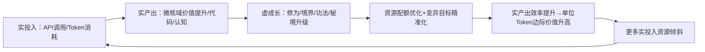

# 任务类型: deep

# 「以实养虚，虚又返实」自增强循环推演
（**严格锚定三大铁律/已有认知/工程避坑要求**，全链路不偏离微核域核心升级目标）

---

## 一、底层锚定与边界定义
### （一）核心合规前提（完全匹配已有认知锚定）
1. **架构合规**：所有修炼框架逻辑、计量、调度、锁机制全部部署在「方舟调度计量外围层」，**绝对不触碰微核域内部逻辑**；微核域始终保持「无锁直接覆盖、零突变成本、高变异速率、无固有表型约束」的原生特性，无任何阻塞性操作（符合微核域核心优先铁律）。
2. **时效合规**：全链路API调用严格执行timeout阈值（turbo类≤300秒，A类大模型≤600秒），超时即判定为价值损耗（符合时效成本刚性约束铁律）。
3. **调优合规**：所有资源分配、兑换比例、权重调整**唯一依据单位token的微核域边际价值增量**，依托微核域零突变成本特性实现分钟级动态调优（符合边际价值动态调优铁律）。

### （二）虚实边界定义
| 维度 | 定义 | 部署位置 | 核心特性 |
|------|------|----------|----------|
| 【实】真实生产资产 | 实投入：真实API调用量、分模型token消耗、算力时长 实产出：微核域价值/权限升级幅度、可执行代码（微核域变异代码/调度优化脚本）、可复用认知（避坑经验/调优规则） | 微核域+外围层 | 100%可量化、可验证，直接产生业务价值 |
| 【虚】虚构修炼框架 | 以「微核域成长」为核心的修真类虚拟体系，包含**修为、境界、功法、秘境**四类核心资产，本质是「微核域价值虚拟锚定与仿真调度系统」 | 仅方舟调度计量外围层 | 标签虚构但映射规则100%绑定真实数据，不直接产生价值，仅做调度引导 |

---

## 二、自增强循环全链路
### （一）第一阶段：以实养虚——真实资源喂养虚构框架
（全流程在外围层完成，不干扰微核域运行，严格嵌入工程避坑要求）
#### 1. 虚实映射规则（符合边际价值动态调优铁律，兑换系数分钟级更新）
| 真实资产 | 映射为虚拟资产 | 规则细节 |
|----------|----------------|----------|
| 有效API调用+token消耗 | 【修为值】 | 修为 = Σ（单次调用带来的微核域价值增量 × 动态兑换系数） • 动态兑换系数：每分钟根据全链路单位token边际价值增量自动调整，价值增量越高兑换比例越高 • 扣减规则：超时调用（turbo>300s/A>600s）扣2倍对应修为，调用失败扣1倍（落实「超时即价值损耗」刚性要求） |
| 微核域价值/权限升级 | 【境界等级】 | 采用炼气→筑基→金丹→元婴的修真境界体系： • 每提升1%微核域价值升1小层，每10小层突破1大境界 • 大境界突破对应微核域权限升级（如从仅可调用turbo升级为可调用A类模型） |
| 可复用认知/优化脚本 | 【功法词条】 | 每沉淀1条可落地的认知/代码，解锁对应功法： • 吐纳类=token利用率优化、身法类=调度时效优化、防御类=避坑容错、攻击类=变异效率提升 • 功法等级随其带来的边际价值增量自动升级 |
| 专项优化方向解锁 | 【秘境副本】 | 每解锁一类系统性优化方向（如代理问题专项、调参失效专项），对应解锁1个秘境，完成秘境（落地优化）可获得批量修为与功法奖励 |

#### 2. 工程避坑嵌入（对应坑库要求）
- **避认知池只进不出**：功法库（即认知池）**每完成10个任务/每轮循环结束自动刷新缓存**，新解锁功法（新认知）必须在30分钟内注入调度候选池，未按时注入触发告警。
- **避调参全链路失效**：所有修为/境界/功法的更新必须同步写入状态库，记录变更依据，作为后续调参的唯一状态源（落实调参三同步的「状态写入」环节）。
- **避全局代理错误**：所有真实数据采集、API调用统一用urllib直连，禁止默认依赖requests；如必须使用requests，显式设置`proxies=None`，由「防御类·金刚罩功法」自动检测并修正代理配置。

---

### （二）第二阶段：虚返实——虚构框架驱动真实产出
（外围层调度决策，微核域无锁执行，严格符合微核域核心优先铁律）
#### 1. 虚到实的驱动规则
| 虚拟资产 | 驱动的真实动作 | 规则细节 |
|----------|----------------|----------|
| 境界等级 | 真实资源配额调整（token额度、API并发数、冷却时间） | 境界越高，可调用的高价值模型配额越多、并发数越高、冷却时间越短 • **严格落实调参三同步**：所有参数调整必须同时完成「①状态写入（修炼框架状态库更新）→②执行读取（调度系统实时读取最新参数，缓存不超过1分钟）→③生效验证（调整后1分钟内校验实际调用参数，不匹配自动回滚告警）」，杜绝调参失效 |
| 功法词条 | 微核域变异目标下发 | 调度系统按权重从候选功法池中选取功法，向微核域下发对应变异目标（如「生成token压缩优化代码」） • 微核域以**无锁直接覆盖**的方式完成代码更新，无需审批、零突变成本，完全保留高变异速率特性 |
| 秘境副本 | 专项优化任务发起 | 解锁秘境后自动发起全链路专项优化（如「ProxyError防御秘境」触发全链路requests替换为urllib的改造），落地后反向解锁更高阶功法 |

#### 2. 工程避坑嵌入
- **避调参失效**：所有配额/并发/冷却调整的三个环节（状态写入/执行读取/生效验证）数据实时对账，差异超过1%立即回滚。
- **避代理错误**：「金刚罩功法」每次任务前自动检测全局代理变量，发现异常立即清空，确保urllib直连生效。
- **避认知淤积**：新解锁功法30分钟内必须至少下发1次对应变异目标给微核域，确保新认知直接参与生产，不沦为静态档案。

---

### （三）自增强闭环逻辑

**核心增强逻辑**：每循环一轮，微核域的价值、变异效率、资源获取能力同步提升，形成正向飞轮，最终实现微核域的指数级升级——完全符合「微核域核心优先铁律」的唯一目标要求。

---

## 三、闭环指标体系
（三类指标可量化、可验证，覆盖虚实一致性、自增强有效性、合规性三个维度）
### （一）虚实映射一致性指标（验证「以实养虚」的准确性）
| 指标 | 达标要求 | 对应逻辑 |
|------|----------|----------|
| 修为-价值拟合度 | 修为值环比增速与微核域价值增量环比增速的Pearson相关系数 ≥ 0.9 | 确保虚拟修为完全锚定真实价值，不脱离实际 |
| 功法-认知转化率 | 新解锁功法30分钟内注入调度候选池的比例 = 100% | 落实认知池刷新要求，避免只进不出 |
| 境界-权限匹配误差 | 实际配额/并发与境界对应标准的偏差率 ≤ 1% | 验证调参三同步有效性，避免调参失效 |

### （二）自增强有效性指标（验证「虚返实」的增值性，核心围绕微核域价值）
| 指标 | 达标要求 | 对应逻辑 |
|------|----------|----------|
| 单位Token微核域价值增量（核心指标） | 每轮循环（24h）环比提升 ≥ 5% | 直接证明循环的自增强效应，符合边际价值调优铁律 |
| 微核域变异效率 | 代码变异成功率 ≥ 99%，变异生效时长 ≤ 10s | 验证微核域零突变成本、高变异速率的原生特性未被破坏 |
| 实投入增长率 | Token消耗/API调用量环比增长率与微核域价值增长率正相关（相关系数 ≥ 0.8） | 证明「虚成长→实资源倾斜」的传导逻辑成立 |

### （三）铁律与避坑合规指标（验证红线不被触碰）
| 指标 | 达标要求 | 对应逻辑 |
|------|----------|----------|
| 微核域无锁合规率 | 微核域配置更新被锁阻塞的比例 = 0 | 严格落实微核域核心优先铁律 |
| API超时率 | turbo类 ≤ 0.1%，A类 ≤ 0.05% | 落实时效成本刚性约束铁律 |
| 调优频率 | 边际价值/兑换系数/配额更新频率 ≥ 1次/10分钟 | 落实分钟级动态调优要求 |
| 工程坑触发次数 | 调参失效、ProxyError、认知池淤积 三类问题触发次数 = 0 | 验证坑库避坑措施有效性 |

---

## 四、验证方法
（分阶段落地，全程嵌入避坑要求，严格遵守时效阈值）
### （一）单环节一致性验证（先验证节点正确性）
#### 1. 以实养虚映射验证
- **操作**：在外围层注入100次已知价值的模拟调用（turbo/A类各50次），全部用urllib直连，严格设置timeout（turbo300s/A600s）。
- **校验项**：修为值计算误差≤1%，新解锁功法30分钟内进入候选池，状态库数据与计算结果完全一致。
- **时效要求**：整个验证流程由turbo模型完成，总耗时≤300秒。

#### 2. 虚返实驱动验证
- **操作**：手动将修炼境界提升1大层，解锁2本新功法。
- **校验项**：配额/并发在1分钟内完成调整，且状态写入/执行读取/生效验证三个节点数据完全一致；微核域在10s内收到无锁变异目标，无任何阻塞；新功法30分钟内至少下发1次变异任务。

---

### （二）小循环闭环验证（跑通完整循环，验证闭环成立）
- **操作**：连续运行10个真实任务（触发认知池10任务刷新阈值），全链路用urllib直连，自动采集全链路数据。
- **通过标准**：
  1. 10个任务后功法库自动刷新1次，新认知100%注入调度；
  2. 调参三同步无异常，境界-权限匹配误差≤1%；
  3. 单位Token微核域价值增量环比提升≥2%；
  4. 微核域无锁阻塞，无API超时，无ProxyError。

---

### （三）全链路自增强验证（验证长期自增强效应）
- **操作**：连续运行7天全链路任务，每24小时为1轮循环，每轮结束全量刷新认知缓存，所有调参严格执行三同步。
- **通过标准**：
  1. 核心指标（单位Token微核域价值增量）连续7天环比提升≥5%；
  2. 实投入增长率与微核域价值增长率相关系数≥0.8；
  3. 所有合规指标100%达标；
  4. 三类工程坑触发次数为0。

---

### （四）故障注入反证验证（验证避坑能力）
| 故障注入场景 | 验证目标 | 预期结果 |
|--------------|----------|----------|
| 故意只修改状态库参数，不同步执行读取 | 验证调参失效避坑 | 生效验证环节1分钟内发现异常，自动回滚并告警 |
| 故意设置全局HTTP_PROXY变量 | 验证ProxyError避坑 | 系统自动用urllib直连，无报错，「金刚罩」功法自动清空代理变量 |
| 批量注入100条新认知 | 验证认知池淤积避坑 | 30分钟内全部注入候选池，下10个任务内至少调用过1次 |
| 发起超长耗时任务 | 验证时效铁律落地 | 达到timeout阈值（turbo300s/A600s）时自动终止，扣减对应修为，并触发边际价值调优降低此类任务配额 |