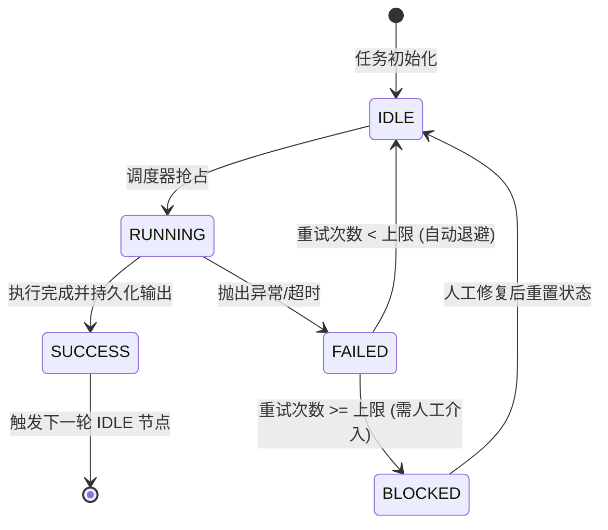

# 任务类型: eng

设计一个支持3-5轮递进、上下文依赖且具备断点续跑能力的链式推演机制，本质上是设计一个**有状态的有限状态机（FSM）**结合**有向无环图（DAG）**的工作流引擎。

针对LLM引擎或复杂推理任务，以下是该机制的详细设计方案，分为数据模型、依赖图设计、状态机与断点续跑三个核心部分。

---

### 一、 核心数据模型设计

要实现断点续跑，必须将“推演过程”持久化，而不是仅停留在内存中。

#### 1. 任务实例表 (Run Instance)
记录一次完整的核心议题推演。
| 字段名 | 类型 | 说明 |
| :--- | :--- | :--- |
| `run_id` | String (UUID) | 主键，推演实例唯一标识 |
| `core_topic` | Text | 核心议题文本 |
| `current_stage` | Int | 当前执行的轮次（1-5） |
| `status` | Enum | 整体状态：PENDING, RUNNING, PAUSED, SUCCESS, FAILED |
| `context_pool` | JSON | 全局上下文池（用于跨轮次共享的元信息） |

#### 2. 轮次节点表 (Stage Node)
记录每一轮的具体输入、输出与状态。
| 字段名 | 类型 | 说明 |
| :--- | :--- | :--- |
| `node_id` | String (UUID) | 节点唯一标识 |
| `run_id` | String (FK) | 关联的推演实例 |
| `stage_num` | Int | 轮次序号（1, 2, 3...） |
| `input_payload` | JSON | 该轮次的输入数据（包含上一轮的Output摘要/切片） |
| `output_payload` | JSON | 该轮次的生成结果 |
| `status` | Enum | 节点状态：IDLE, RUNNING, SUCCESS, FAILED, SKIPPED |
| `error_msg` | Text | 失败错误堆栈 |
| `retry_count` | Int | 当前重试次数 |

---

### 二、 任务依赖图设计

虽然是一个3-5轮的线性递进，但在引擎底层，应将其抽象为**DAG（有向无环图）**，以便未来扩展（如某一轮并发执行多个子任务）。

#### 1. 依赖图拓扑结构
采用**链式数据流图**，每一步的输出通过边传递给下一步：
```text
[Core Topic] 
     │ (注入初始上下文)
     ▼
[Round 1: 拆解与发散] ──output_1──┐
                                 ▼
[Round 2: 聚焦与深化] ──output_2──┐  (输入: output_1 + 原始topic)
                                 ▼
[Round 3: 逻辑推演]   ──output_3──┐  (输入: output_2 + 逻辑框架)
                                 ▼
[Round 4: 验证与反思] ──output_4──┐  (输入: output_3 + 证伪视角)
                                 ▼
[Round 5: 结论与收敛]             (输入: output_4 + 核心topic)
```

#### 2. 上下文传递契约
上一轮输出作为下一轮输入，不能简单地将全量文本拼接（会导致Context爆炸）。需要设计**数据切片契约**：
*   **Accumulator（累积器）**：每一轮的 `output_payload` 必须包含结构化字段，如 `{ "summary": "", "key_points": [], "raw_data_ref": "s3://..." }`。
*   **Edge Router（边路由器）**：定义 `f(output_n) -> input_{n+1}` 的映射函数。例如，Round 4的反思只需要Round 3的推论和Round 1的原始拆解，不需要Round 2的废稿。边路由器负责从 `context_pool` 中提取所需字段组合成 `input_payload`。

---

### 三、 断点续跑机制

断点续跑的核心是**幂等性**和**状态恢复**。

#### 1. 状态机流转设计
每个轮次节点的生命周期如下：


#### 2. 断点续跑执行逻辑

当引擎重启或接收到恢复指令时，执行以下**CheckPoint恢复算法**：

1.  **扫描Run Instance**：查询状态为 `RUNNING` 或 `PAUSED` 的 `run_id`。
2.  **定位断点**：
    ```python
    def find_resume_node(run_id):
        nodes = db.query("SELECT * FROM stage_nodes WHERE run_id = ? ORDER BY stage_num", run_id)
        for node in nodes:
            if node.status == 'SUCCESS':
                continue # 已完成，跳过
            elif node.status == 'RUNNING':
                # 崩溃时正在运行的任务，可能产生了脏数据
                node.status = 'IDLE'
                node.retry_count += 1
                db.save(node)
                return node # 从这里重新开始
            elif node.status == 'IDLE' or 'FAILED':
                return node # 从未执行或执行失败的节点开始
        return None # 全部SUCCESS，任务已完成
    ```
3.  **校验输入**：重新执行前，校验该节点的 `input_payload` 是否完整。如果是，则直接重新调度；如果否（上游数据丢失），则向上回溯，重新执行最近一个状态为 `SUCCESS` 的上游节点（罕见情况，通常上游SUCCESS意味着数据已落盘）。
4.  **触发执行**：将节点丢入线程池/消息队列，状态置为 `RUNNING`。

#### 3. 保证幂等性的关键策略
*   **先落盘，后执行**：引擎在调用LLM或执行推理前，先将 `input_payload` 写入数据库，状态置为 `RUNNING`。如果引擎在此刻崩溃，重启后读取到 `RUNNING` 状态，可以直接用已保存的 `input_payload` 重新发起请求。
*   **输出原子写**：LLM返回结果后，一次性将 `output_payload` 更新到数据库，并使用数据库事务将状态改为 `SUCCESS`，同时激活下一个节点。避免出现“状态改了但结果没存”的脏状态。
*   **外部副作用隔离**：如果推演过程中调用了外部工具（如联网搜索），工具调用的缓存结果应保存在 `output_payload` 中。断点续跑时，优先读缓存，而不是重新发起网络请求。

---

### 四、 异常处理与人工介入

在3-5轮的推演中，如果某一轮因为模型幻觉或逻辑死胡同导致失败：
1.  **重试退避机制**：最多自动重试3次（可调整Temperature或更换System Prompt重试）。
2.  **熔断与人工介入**：超过重试次数，状态转为 `BLOCKED`。引擎发出告警，人工检查 `output_payload` 中的错误信息。
3.  **热修复续跑**：人工判断上一轮输出有问题，可以手动修改数据库中 Round N 的 `output_payload`，然后强制将 Round N+1 的状态重置为 `IDLE`。引擎的定时巡检任务会捕获到 `IDLE` 状态，并使用人工修改后的数据作为输入，继续推演后续步骤。

### 五、 总结架构图

```text
[API: 发起核心议题推演]
      │
      ▼
[Orchestrator 编排器]
      │
      ├─ 1. 创建 Run Instance (status=RUNNING, stage=1)
      ├─ 2. 根据3-5轮模板初始化 Stage Nodes (status=IDLE)
      └─ 3. 提取 Node 1 丢给 Executor
              │
              ▼
[Executor 执行器 (无状态)]
      ├─ 读取 Node.input_payload
      ├─ 执行 LLM 推理
      ├─ 原子写入 Node.output_payload
      └─ 更新 Node.status = SUCCESS, 触发事件
      
[Event Queue 事件队列]
      │ (监听 Node SUCCESS 事件)
      ▼
[Dependency Resolver 依赖解析器]
      ├─ 检查图中下一个节点
      ├─ 执行 Edge Router: f(output_N) -> input_{N+1}
      ├─ 持久化 input_{N+1}
      └─ 提交 Node N+1 给 Executor

--- 断点恢复线程 (每30s扫描一次) ---
[Health Checker]
      ├─ 查找 status=RUNNING 但心跳超时的 Node
      ├─ 状态回退为 IDLE
      └─ 重新提交给 Executor
```

通过这种设计，引擎实现了：**数据流向清晰（DAG模型）、上下文不丢失（持久化Payload）、崩溃可恢复（状态机回退与重试）、支持人工干预（Blocked状态处理）**。无论是底层节点宕机还是LLM接口超时，都能从断点无缝续跑。