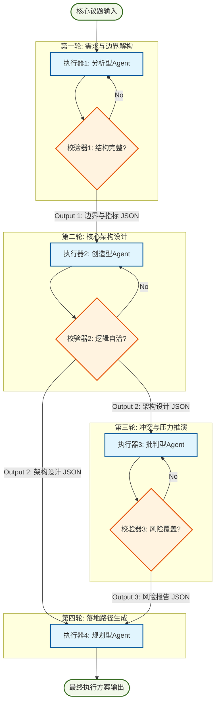

# 任务类型: eng

设计一个引擎任务的链式推演机制，核心在于**信息熵减与认知深度的逐层递进**。为了避免“大模型单向生成”导致的幻觉和浅尝辄止，我们需要将一个宏观议题拆解为“解构-建构-压力测试-落地”的闭环链路。

以下是为您设计的链式推演机制方案：

### 一、 核心议题示例设定
* **核心议题**：*“构建未来城市L4级自动驾驶公共交通系统的运营体系”*
* **推演轮数**：4轮
* **设计原则**：上一轮的“结论性输出”必须作为下一轮的“约束性输入”，且每一轮的Prompt模式不同（分析型 -> 创造型 -> 批判型 -> 规划型）。

---

### 二、 链式推演轮次设计 (4轮递进)

#### 第1轮：解构与边界界定 (分析型)
* **任务目标**：从模糊议题中提取核心变量，界定系统边界和成功标准。
* **输入**：核心议题原文 + 背景知识库。
* **处理逻辑**：PEST分析、利益相关者映射、约束条件提取。
* **输出产物 (Output 1 - 结构化文档)**：
  ```json
  {
    "core_objectives": ["全无人驾驶", "区域覆盖率>80%", "事故率低于人类驾驶90%"],
    "stakeholders": ["交管部门", "市民", "车企", "算法供应商"],
    "hard_constraints": ["现有道路基础设施", "V2X通信延迟<10ms", "法律法规空白"],
    "success_metrics": ["日均接单量", "极端天气接管率", "运营成本/公里"]
  }
  ```

#### 第2轮：核心架构与机制设计 (创造型)
* **任务目标**：基于第一轮的边界与约束，设计具体的系统架构和运作机制。
* **输入**：Output 1 (边界与指标)。
* **处理逻辑**：模块化设计、资源分配、算法与物理系统协同。
* **输出产物 (Output 2 - 架构图谱文档)**：
  ```json
  {
    "perception_layer": "多传感器融合 + 车路协同(V2X)冗余网络",
    "decision_engine": "基于MARL(多智能体强化学习)的博弈调度模型",
    "operation_paradigm": "高峰期动态拼车 + 夜间自动回库检修",
    "edge_cases_handling": "极端天气降级为有人驾驶接管 + 5G远程接管兜底"
  }
  ```

#### 第3轮：动态仿真与冲突推演 (批判型)
* **任务目标**：将第二轮的设计投入“虚拟压力测试”，寻找长尾问题和系统性崩溃点。
* **输入**：Output 2 (架构设计) + 极端场景库。
* **处理逻辑**：Red Teaming (红队测试)、故障树分析 (FTA)、瓶颈识别。
* **输出产物 (Output 3 - 风险与漏洞报告)**：
  ```json
  {
    "critical_vulnerabilities": [
      {"scenario": "暴雨+路段积水导致V2X信号衰减", "impact": "车队连锁误判", "probability": "中"},
      {"scenario": "大型活动骤散导致调度算法死锁", "impact": "区域交通瘫痪", "probability": "高"}
    ],
    "architecture_flaws": ["调度模型未考虑非机动车乱穿行", "冗余系统切换延迟过高(>500ms)"],
    "optimization_params": {"调度重试上限": 3, "接管阈值": "能见度<50m"}
  }
  ```

#### 第4轮：收敛与落地路线图 (规划型)
* **任务目标**：结合前两轮的设计与漏洞，生成可执行的实施路径和应急预案。
* **输入**：Output 2 (架构) + Output 3 (风险报告)。
* **处理逻辑**：敏捷里程碑制定、资源时间线规划、风险缓解措施落地。
* **输出产物 (Output 4 - 最终执行方案)**：
  ```json
  {
    "phase_1_pilot": {"timeframe": "0-6个月", "action": "封闭园区测试", "milestone": "单车日均运行10小时无故障"},
    "phase_2_expansion": {"timeframe": "6-18个月", "action": "划定三个示范区运营", "milestone": "接入城市交通信控系统"},
    "contingency_plans": {"通信中断": "车辆就近靠边停车", "算法死锁": "切换至预设规则引擎降级运行"},
    "final_roi_projection": "预计3年内实现单城盈亏平衡"
  }
  ```

---

### 三、 任务依赖图 (DAG 设计)

这是一个有向无环图 (DAG) 设计，展示了数据流向与依赖关系。在实际引擎中，建议引入**校验器**确保上一轮输出质量达标后再放行。



---

### 四、 引擎核心机制说明

为了保障链式推演不崩塌，引擎底层需要具备以下四个核心机制：

1. **上下文压缩与接力机制**
   * 由于多轮推演会导致Token爆炸，不能将全部历史塞入Prompt。
   * **机制**：每轮结束时，执行器必须输出“结构化数据（如JSON）”，校验器提取关键字段，作为结构化Prompt注入下一轮，实现“无损信息接力”。
2. **回溯与重推机制**
   * 如上图的DAG所示，若第三轮（压力测试）发现第二轮（架构设计）存在根本性缺陷（例如通信方案完全不可行），引擎需支持**中断当前链路**，携带缺陷报告回退至第二轮重新生成架构。
3. **Prompt模式隔离**
   * 每一轮使用不同的System Prompt模板。例如：第一轮设定为“严谨的系统分析师”，第三轮设定为“带有攻击性的红客安全专家”。这种人格和视角的切换，能最大化激发大模型的推理深度。
4. **状态持久化**
   * 整个推演过程需存储在状态机中。任意一轮失败重启后，引擎能从最近一次成功的DAG节点继续执行，而非从头开始。