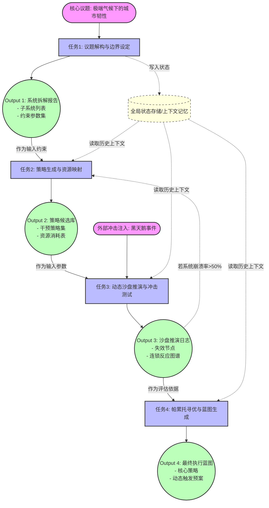

# 任务类型: eng

以下为您设计的一套**引擎任务链式推演机制**。为了让机制更具象化，我设定了一个核心议题作为示例：**“应对极端气候的城市韧性与能源调度系统构建”**。

整个机制分为4轮递进，采用“漏斗-发散-沙盘-收敛”的认知推演模型，上一轮的结构化输出严格作为下一轮的输入约束。

---

### 一、 核心议题与递进轮次设计

#### 第1轮：解构与维度提取（漏斗期）
*   **任务目标**：将宏观的核心议题拆解为可量化、可操作的子系统及约束条件。
*   **输入**：核心议题文本 + 初始背景知识库。
*   **引擎动作**：实体抽取、边界界定、约束条件参数化。
*   **输出（Output 1）**：`<系统拆解报告>`，包含3个子系统（如：能源网络、交通疏散、医疗救援）、4个边界约束（如：预算上限、碳排放限制、72小时黄金期、弱势群体覆盖率）。

#### 第2轮：策略发散与路径映射（发散期）
*   **任务目标**：针对第一轮拆解出的子系统，生成多元应对策略，并映射为具体的行动节点。
*   **输入**：Output 1 的 `<系统拆解报告>`（子系统与约束条件）。
*   **引擎动作**：组合优化、策略生成、知识图谱检索。
*   **输出（Output 2）**：`<策略候选库>`，包含针对每个子系统的3-5个干预策略（如：微电网孤岛运行、动态交通管制算法），以及每个策略的执行前置条件和资源消耗量。

#### 第3轮：动态推演与沙盘冲击（沙盘期）
*   **任务目标**：将第二轮的策略投入模拟环境，引入“黑天鹅”变量，测试策略韧性。
*   **输入**：Output 2 的 `<策略候选库>` + 引擎随机生成的极端冲击事件（如：连续暴雨导致电网大面积瘫痪）。
*   **引擎动作**：多智能体仿真、时间序列推演、连锁反应计算。
*   **输出（Output 3）**：`<沙盘推演日志>`，包含各策略在冲击下的失效节点、资源损耗动态曲线、次生灾害评估、以及系统恢复时间（TTR）。

#### 第4轮：综合收敛与蓝图生成（收敛期）
*   **任务目标**：基于第三轮的推演结果，淘汰脆弱策略，重组最优方案，生成最终执行蓝图。
*   **输入**：Output 3 的 `<沙盘推演日志>`。
*   **引擎动作**：帕累托寻优、韧性评分、综合报告生成。
*   **输出（Output 4）**：`<最终执行蓝图>`，包含最终推荐的3项核心策略、跨部门协同流程图、动态触发预案（IF-THEN规则集）。

---

### 二、 任务依赖图（DAG设计）

此依赖图展示了任务节点、数据流向以及控制反馈机制。

---

### 三、 依赖机制与引擎控制设计

为了确保链式推演不跑偏，引擎底层需要以下机制支撑：

1.  **严格数据契约**
    *   上一轮的输出必须符合预设的 JSON Schema。例如，任务1必须输出 `{"sub_systems": [], "constraints": {}}`。任务2的引擎节点在启动前，会先校验输入是否合法，不合法则触发重试。
2.  **状态记忆与上下文传递**
    *   引擎维护一个 `Context Memory`。虽然任务2直接消费任务1的输出，但任务3和任务4可能需要回溯任务1的“约束条件”（例如推演时检查是否超出了预算上限）。因此，DAG图中设计了所有节点与 `Memory` 的弱依赖读写关系。
3.  **条件触发与反馈回路**
    *   在任务3（沙盘推演）中，如果发现系统崩溃率超过设定阈值（如50%），引擎的 DAG Controller 会触发一条反馈边（图中虚线所示），将结果退回任务2，要求重新生成更激进的策略。这实现了从“单向链式”到“带反馈的闭环”的升级。
4.  **并行与串行的结合**
    *   在宏观上，4轮任务是严格串行依赖的。
    *   在微观上（如任务2内部），针对不同的子系统可以并行生成策略。引擎可以拆分子任务，分配给不同的计算节点并行处理，最后汇总为 Output 2，提高推演效率。