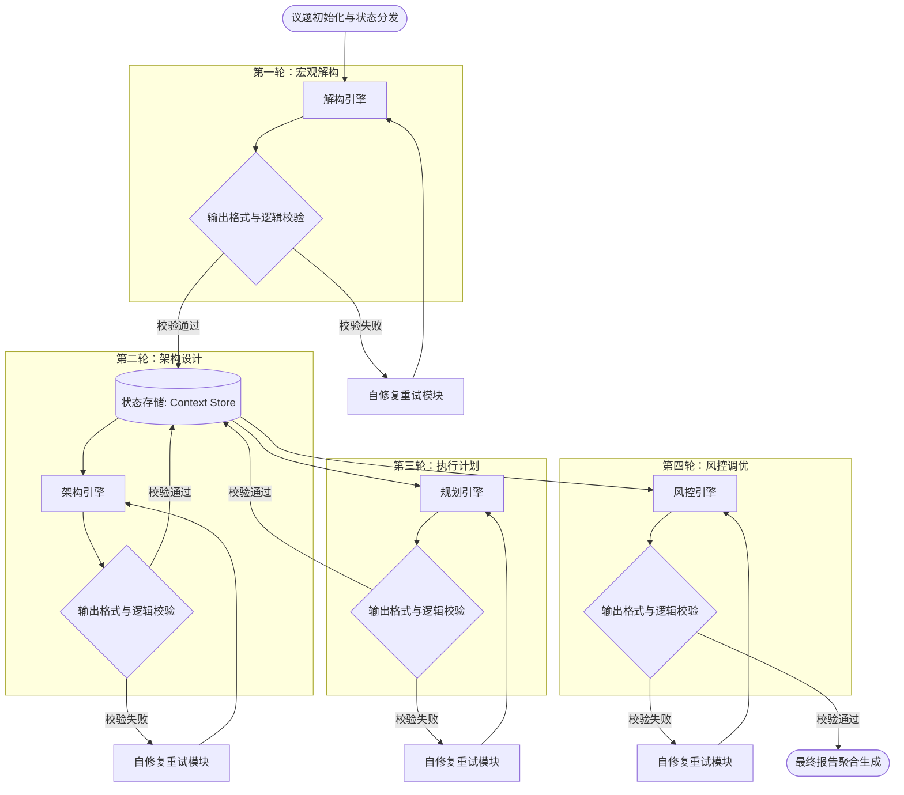

# 任务类型: eng

设计引擎任务的链式推演机制，本质上是构建一个**有状态、结构化、逐层收敛的智能体流水线**。这种机制能够将一个宏大、模糊的复杂议题，通过3-5轮的迭代演算，逐步拆解为具备高可执行性的具体方案。

以下是为您设计的链式推演机制框架：

---

### 一、 核心示例议题
**议题：** “设计一座人口100万的新能源示范城市的整体交通与能源协同规划”
**目标：** 从宏观概念推演至微观执行与风控方案。

---

### 二、 链式推演轮次设计（4轮递进）

机制要求上一轮的“结构化输出”必须作为下一轮的“上下文输入”。为了保证传递不失真，输出格式需强约束（如JSON或特定Markdown结构）。

#### 第1轮：宏观解构与边界定义
*   **任务目标：** 将模糊议题拆解为核心维度，识别关键变量与约束条件。
*   **输入：** 核心议题本身。
*   **推理动作：** 维度切割、现状分析、边界设定。
*   **结构化输出（传递给下一轮）：**
    ```json
    {
      "core_dimensions": ["能源网拓扑", "交通调度算法", "储能基础设施", "政策与碳排放"],
      "key_constraints": ["预算上限500亿", "5年内完工", "不可占用基本农田"],
      "current_gaps": ["微电网与主干电网互动机制缺失", "公交系统与充电桩布局不匹配"]
    }
    ```

#### 第2轮：架构设计与路径推演
*   **任务目标：** 基于第一轮的维度和缺口，设计具体的系统架构和解决路径。
*   **输入：** 第1轮的 `core_dimensions`, `key_constraints`, `current_gaps`。
*   **推理动作：** 架构规划、技术选型、路径拟合。
*   **结构化输出（传递给下一轮）：**
    ```json
    {
      "system_architecture": {
        "energy_layer": "源-网-荷-储协同微电网模型",
        "transport_layer": "车-路-云一体化V2X网络"
      },
      "intervention_paths": [
        {"path_id": "P1", "action": "建设分布式光伏与社区储能节点", "target_gap": "微电网互动缺失"},
        {"path_id": "P2", "action": "公交场站叠加直流快充与储能", "target_gap": "交通与能源布局不匹配"}
      ],
      "dependency_graph": "P1 -> P2 (储能节点需先于快充站建设)"
    }
    ```

#### 第3轮：执行计划与资源分配
*   **任务目标：** 将抽象的解决路径转化为时间线上的具体任务，并分配资源。
*   **输入：** 第2轮的 `system_architecture`, `intervention_paths`, `dependency_graph`。
*   **推理动作：** 任务拆解、时间排期、资源映射。
*   **结构化输出（传递给下一轮）：**
    ```json
    {
      "phased_plan": [
        {"phase": "一期(1-2年)", "tasks": ["主干电网升级", "V2X路侧单元试点"], "resource": "资金150亿, 团队A"},
        {"phase": "二期(3-5年)", "tasks": ["分布式储能全覆盖", "自动驾驶公交上线"], "resource": "资金350亿, 团队B"}
      ],
      "critical_milestones": ["第18个月：微电网并网测试", "第36个月：公交系统全绿电运行"]
    }
    ```

#### 第4轮：风险压力测试与动态调优
*   **任务目标：** 对执行计划进行红蓝对抗/沙盘推演，找出脆弱点并生成兜底策略。
*   **输入：** 第3轮的 `phased_plan`, `critical_milestones`。
*   **推理动作：** 风险识别、压力测试、Plan B生成。
*   **结构化输出（最终成果）：**
    ```json
    {
      "risk_assessment": [
        {"risk": "极端天气导致光伏出力骤降", "impact_level": "高", "trigger_condition": "连续阴雨>3天"},
        {"risk": "电池供应链断裂", "impact_level": "中", "trigger_condition": "国际关税政策变动"}
      ],
      "contingency_plans": [
        {"risk_id": 1, "action": "启动隔壁城市火电备用通道，限制非核心交通能耗"},
        {"risk_id": 2, "action": "采用钠离子电池替代方案，延长二期工期3个月"}
      ]
    }
    ```

---

### 三、 任务依赖图设计

在引擎底层，这种链式推演表现为一个**有向无环图（DAG）**。为了增加鲁棒性，设计上包含主链路和校验回路。



---

### 四、 引擎核心机制设计（保障链条不断裂）

要让上述依赖图高效运转，引擎层需要具备以下四个核心机制：

#### 1. 上下文剪枝与状态滚动
*   **痛点：** 如果将4轮的完整Prompt和输出全部带入最后一轮，会导致Token爆炸和注意力分散。
*   **机制：** 引擎维护一个 `Context Store`。下一轮只能读取上一轮的**结构化输出（JSON Schema）**，而非上一轮的冗长思维过程。这称为“状态滚动”，类似于程序调用中的传参。

#### 2. Schema 强校验与自修复回路
*   **痛点：** LLM可能输出幻觉内容或格式错乱，导致下一轮解析失败。
*   **机制：** 每一轮的输出必须通过 JSON Schema Validator。如果校验失败，引擎拦截该输出，触发 `Repair Module`。修复模块会将“报错信息+原始输出”喂给模型，要求其修正格式后重新输出，最多重试3次，否则熔断报错。

#### 3. 依赖回溯机制
*   **痛点：** 第3轮发现第2轮的架构设计存在根本性逻辑漏洞，无法继续规划。
*   **机制：** 允许当前轮次抛出 `DependencyBreakException`。引擎接收到此信号后，会自动回退到上一轮，并在Prompt中注入“修改建议”，要求上一轮引擎重新推演。例如：R3发现R2的架构成本过高，引擎回退至R2，附加条件“成本需控制在XXX以内”，重新生成R2结果。

#### 4. 异构模型路由
*   **机制：** 不同轮次对模型能力的要求不同。
    *   R1/R2（发散与创新）：路由至创造力强的大模型（如 GPT-4o / Claude 3.5 Sonnet）。
    *   R3/R4（逻辑与排期）：路由至逻辑推理能力强、严谨的模型或使用特定Agent工具（如调用MS Project API生成排期）。

### 五、 总结

这套“链式推演机制”将传统单次Prompt生成，转变为工程化的**认知流水线**。通过**强结构化输出**作为节点间的传递介质，结合DAG图中的**校验回路**与**状态滚动机制**，可以确保复杂议题在3-5轮的推演中，从宏观概念逐层下沉为微观的高质量、低风险执行方案。