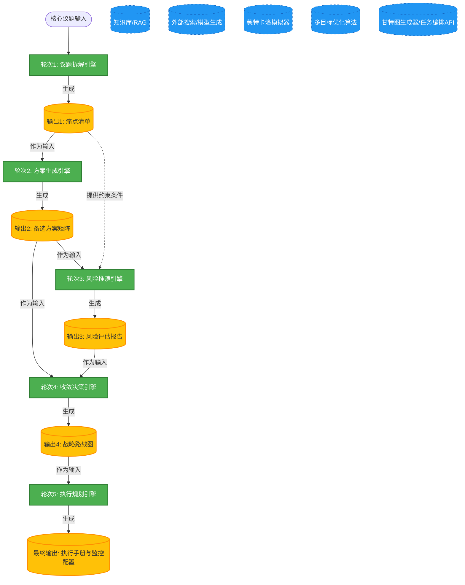

# 任务类型: eng

设计引擎任务的链式推演机制，本质上是构建一个**有向无环图（DAG）**，通过状态机驱动上一个节点的输出作为下一个节点的输入，实现认知或计算的逐层深化。

以下为您设计的一套完整的链式推演机制：

### 一、 核心示例设定
*   **核心议题**：“如何设计企业级AI大模型私有化落地的战略方案”
*   **递进轮次**：5轮
*   **链式规则**：上一轮的 `$Output_N` 作为下一轮的 `$Input_{N+1}$`，同时引擎会附带前置轮次的上下文摘要（防止信息遗失）。

---

### 二、 5轮递进推演设计

#### 第1轮：边界界定与要素拆解
*   **任务目标**：将宏观议题拆解为可控的子问题，明确现状与目标差距。
*   **输入 ($Input_1$)**：核心议题原文。
*   **处理逻辑**：执行“议题解构算法”，提取关键实体、业务场景、约束条件。
*   **输出 ($Output_1$)**：《议题拆解树与核心痛点清单》
    *   包含：4大业务场景需求、3项技术约束（数据安全/算力预算/响应延迟）、当前痛点描述。

#### 第2轮：方案空间探索
*   **任务目标**：基于痛点清单，生成多样化的解决路径。
*   **输入 ($Input_2$)**：`$Output_1$` 的痛点清单与场景需求。
*   **处理逻辑**：调用“多路生成算法”，结合知识库检索（RAG），针对每个痛点生成至少3种备选技术/业务方案。
*   **输出 ($Output_2$)**：《多维度备选方案矩阵》
    *   包含：开源微调方案、闭源API+本地向量库方案、混合云部署方案及其技术规格。

#### 第3轮：沙盘推演与风险压力测试
*   **任务目标**：对备选方案进行极端情况下的推演，暴露潜在风险。
*   **输入 ($Input_3$)**：`$Output_2$` 的备选方案矩阵。
*   **处理逻辑**：引入“红蓝对抗模拟”，模拟高并发、数据泄露、模型幻觉等极端场景，测试方案鲁棒性。
*   **输出 ($Output_3$)**：《方案风险矩阵与失效场景报告》
    *   包含：各方案在不同压力下的成功率、成本消耗曲线、致命短板。

#### 第4轮：收敛决策与路径优选
*   **任务目标**：基于风险评估，进行权衡取舍，输出最终执行路径。
*   **输入 ($Input_4$)**：`$Output_2$` (方案库) + `$Output_3$` (风险报告)。
*   **处理逻辑**：运行“多目标决策算法”，根据企业实际约束（预算、安全级别）进行打分排序，合并最优解。
*   **输出 ($Output_4$)**：《最优战略路线图》
    *   包含：选定的核心技术架构、分阶段实施计划、资源分配表。

#### 第5轮：行动计划与动态反馈机制设计
*   **任务目标**：将战略路线图转化为可执行的工程任务，并设定引擎监控指标。
*   **输入 ($Input_5$)**：`$Output_4$` 的最优战略路线图。
*   **处理逻辑**：进行“任务分解与里程碑设定”，并生成异常熔断条件。
*   **输出 ($Output_5$)**：《SOP执行手册与监控仪表盘配置》
    *   包含：具体工单任务、验收标准、动态调整触发器。

---

### 三、 任务依赖图设计

这是一个典型的数据流驱动的DAG图。每一步不仅依赖上一步，还需调用外部工具。

---

### 四、 引擎机制的底层架构设计

为了保证这套链式推演不中断、不跑偏，引擎底层需要具备四个核心模块：

#### 1. 上下文管理器
*   **滑动窗口机制**：由于5轮推演可能导致上下文超出大模型Token限制。引擎需在第3轮时，对第1、2轮的输出进行摘要压缩，仅保留核心约束。
*   **状态机存储**：记录每一轮的完整输入输出，支持断点续跑。如果第3轮推演失败，系统可修改Prompt后从第3轮重新启动，无需重跑第1、2轮。

#### 2. 结构化校验门
在每一轮输出进入下一轮之前，必须经过Schema校验。
*   例如：`$Output_1$` 必须包含 `["痛点", "场景", "约束"]` 三个JSON字段。如果模型输出了一段纯文本，校验门会拦截并要求重新生成，保证下游输入的稳定性。

#### 3. 依赖图调度器
*   **串行执行**：轮次1至5默认串行。
*   **并行微调**：在第2轮中，如果生成了4个备选方案，调度器可以将其分发到4个并行的第3轮沙盘推演节点中，最后在第4轮汇总。

#### 4. 动态终止器
*   设置置信度评分。如果第4轮输出的战略路线图综合评分低于60分（如风险过高无法收敛），调度器会触发“回滚机制”，将信息反馈给第2轮，要求重新生成方案，形成闭环迭代。