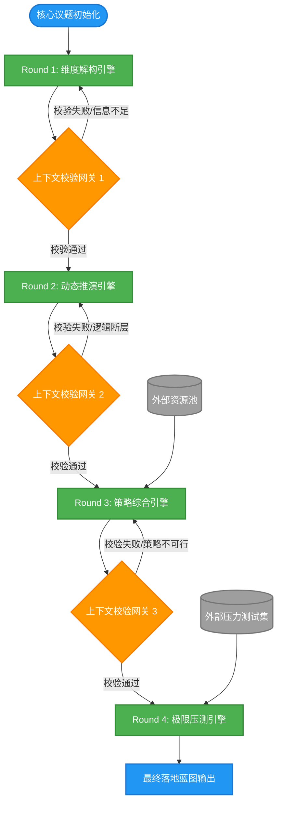

# 任务类型: eng

设计引擎任务的链式推演机制，本质上是构建一个**状态机驱动的有向无环图（DAG）**。其核心在于**“上下文的继承与演进”**——前一轮的“结论”不仅是后一轮的“前提”，更是后一轮“思考边界”的约束。

以下为您设计的链式推演机制，包含四轮递进拆解、严格的数据流转契约以及任务依赖图。

---

### 一、 核心议题拆解：4轮递进链式推演

我们以一个通用引擎任务为例：**核心议题——“评估并制定某项新技术（如大模型Agent）在企业内部的商业化落地策略”**。

整个推演被拆解为4个递进轮次，遵循 **“解构 -> 推演 -> 综合 -> 压测”** 的逻辑。

#### Round 1: 维度解构与变量提取
*   **任务目标：** 将宏观的核心议题拆解为可量化、可执行的底层变量，形成“知识地基”。
*   **输入：** `Core_Topic` (核心议题描述) + `Background_Context` (背景信息)。
*   **引擎处理：** 调用分析模型，识别技术、市场、组织、财务四个维度的关键变量。
*   **输出：** `Variable_Dictionary` (变量字典，包含变量名、定义、当前状态值)。
    *   *示例输出：* `{技术成熟度: 中等, 市场需求紧迫度: 高, 组织API改造成本: 极高...}`

#### Round 2: 动态推演与冲突识别
*   **任务目标：** 基于变量字典，推演各变量在时间轴上的相互作用，找出“系统性冲突”。
*   **输入：** `Round1_Output_Variable_Dictionary` (严格继承)。
*   **引擎处理：** 调用推演模型，进行交叉影响分析，寻找阻塞点。
*   **输出：** `Conflict_Matrix` (冲突矩阵与推演日志)。
    *   *示例输出：* `{"冲突点A": "技术迭代速度快 vs 内部API架构老旧导致集成周期长", "风险等级": "致命"}`

#### Round 3: 策略综合与路径生成
*   **任务目标：** 针对识别出的冲突，生成多条备选解决路径，并给出推荐优先级。
*   **输入：** `Round2_Output_Conflict_Matrix` (严格继承) + `Resource_Pool` (可用资源池, 外部注入)。
*   **引擎处理：** 调用规划模型，进行多目标优化求解。
*   **输出：** `Strategy_Paths` (策略路径集合)。
    *   *示例输出：* `{"路径1(激进)": "采购外部成熟方案...", "路径2(稳健-推荐)": "先重构核心API再接入..."}`

#### Round 4: 极限压测与策略固化
*   **任务目标：** 对推荐策略进行黑天鹅事件压测，输出最终可执行的鲁棒性方案。
*   **输入：** `Round3_Output_Strategy_Paths` (严格继承) + `Black_Swan_List` (压力测试场景列表)。
*   **引擎处理：** 调用沙盘模拟模型，注入极端变量，观察策略崩溃点并打补丁。
*   **输出：** `Final_Actionable_Blueprint` (最终落地蓝图与应急预案)。

---

### 二、 任务依赖图

本机制的任务依赖图采用 **DAG（有向无环图）** 设计，并引入了“校验网关”以确保上下文不漂移。



---

### 三、 机制落地的三个核心设计

为了让这个链式推演机制在引擎中真正跑通，需要设计以下底层支撑：

#### 1. 数据流转契约
前一轮的输出不能是自然语言的随意堆砌，必须转化为结构化的上下文状态对象，供下一轮消费。

```json
// 引擎上下文状态切片
{
  "current_round": 2,
  "core_topic": "大模型Agent商业化落地策略",
  "state_memory": {
    "round_1_output": {
      "variables": [
        {"name": "tech_maturity", "value": "medium", "confidence": 0.8},
        {"name": "api_cost", "value": "high", "confidence": 0.9}
      ]
    }
  },
  "dependency_pointer": "round_1_output.variables" // 下一轮必须从此指针读取数据
}
```

#### 2. 防上下文遗忘机制
在长链路推演中，大模型容易丢失最初的设定。
*   **强制注入：** 在Round 3和Round 4的System Prompt中，不仅包含上一轮的输出，还必须强制包含 `Core_Topic` 和 `Round 1` 的核心变量。
*   **注意力衰减补偿：** 随着轮次增加，Prompt中对早期关键信息的描述需从“概述”改为“硬性约束”。

#### 3. 回环与降级策略
*   **回环：** 如依赖图中的“校验网关”，如果Round 3生成的策略在Round 4压测中100%崩溃，引擎不应直接报错，而是将崩溃原因作为输入，回滚触发Round 3的重新生成（最多重试N次）。
*   **降级：** 如果3次重试均失败，引擎触发降级机制，将“高维策略生成”降级为“低维局部方案输出”，保证流水线不阻塞。