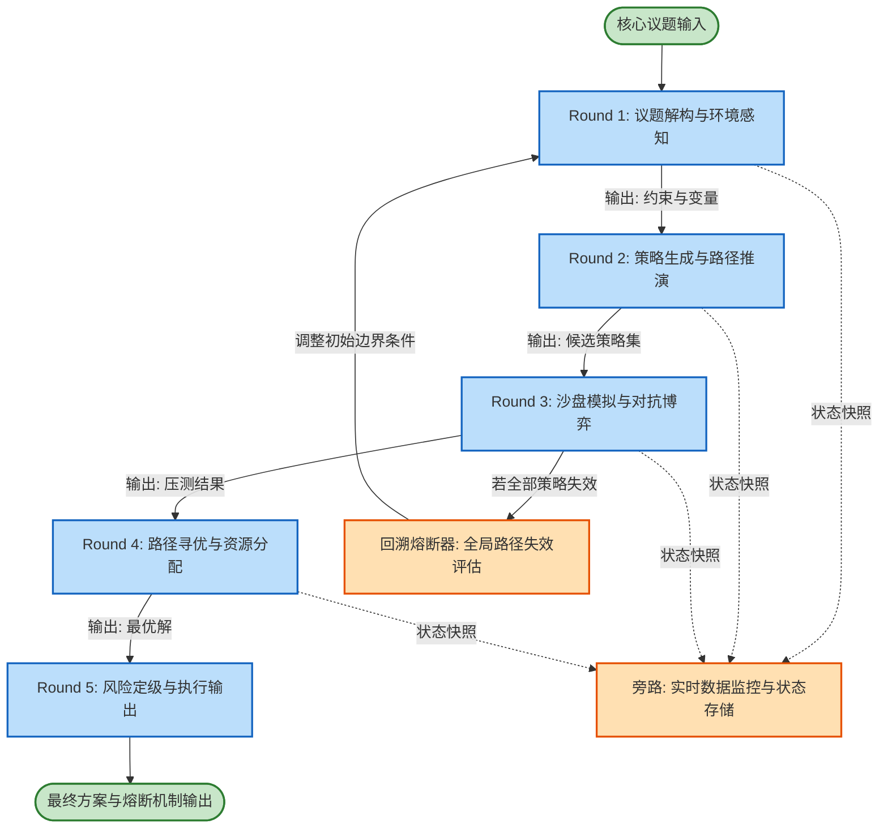

# 任务类型: eng

设计引擎任务的链式推演机制，本质上是构建一个**有向无环图（DAG）**或带有反馈回路的**状态机**。为了保证推演的深度和逻辑的严密性，我们将核心议题拆解为5轮递进过程，下一轮严格继承上一轮的结构化输出作为输入，并引入“沙盘演练”与“风控熔断”机制。

以下是以**“某新兴科技企业进入红海市场的战略推演”**为例，设计的链式推演机制与任务依赖图。

---

### 一、 链式推演机制设计（5轮递进）

#### Round 1: 议题解构与环境感知
*   **目标**：将宏观议题拆解为可量化的变量，明确初始边界条件。
*   **输入**：核心议题描述文本 + 外部知识库（行业报告/竞品数据）。
*   **引擎任务**：
    1.  提取核心议题中的关键约束条件（资金、时间、技术）。
    2.  识别市场环境中的关键变量（客户偏好、政策导向、替代品威胁）。
*   **输出（Round 1 Output Payload）**：
    ```json
    {
      "constraints": {"budget": "X亿", "timeline": "12个月"},
      "key_variables": ["价格敏感度", "技术壁垒", "供应链稳定性"],
      "market_posture": "挑战者"
    }
    ```

#### Round 2: 策略生成与路径推演
*   **目标**：基于初始条件，生成多条平行的执行路径。
*   **输入**：Round 1 的 Output Payload。
*   **引擎任务**：
    1.  结合变量与约束，生成3条候选战略路径（如：激进低价、差异化高端、垂直细分）。
    2.  为每条路径推演未来6-12个月的预期发展轨迹。
*   **输出（Round 2 Output Payload）**：
    ```json
    {
      "strategies": [
        {"id": "S1", "type": "激进低价", "resource_focus": "营销", "expected_market_share": "15%"},
        {"id": "S2", "type": "差异化", "resource_focus": "研发", "expected_market_share": "8%"}
      ]
    }
    ```

#### Round 3: 沙盘模拟与对抗博弈
*   **目标**：引入外部扰动（竞争对手反应、黑天鹅事件），测试路径鲁棒性。
*   **输入**：Round 2 的 Output Payload（候选策略集）。
*   **引擎任务**：
    1.  为每条策略分配“虚拟竞争对手”并进行对抗推演。
    2.  注入2-3个随机风险事件（如：价格战爆发、核心零件断供）。
    3.  计算每条路径在扰动下的失败概率。
*   **输出（Round 3 Output Payload）**：
    ```json
    {
      "simulation_results": [
        {"strategy_id": "S1", "stress_test_pass": false, "fatal_flaw": "资金链断裂风险极高"},
        {"strategy_id": "S2", "stress_test_pass": true, "risk_score": "中等", "survival_rate": "72%"}
      ]
    }
    ```

#### Round 4: 路径寻优与动态寻优
*   **目标**：剔除失败路径，对存活路径进行资源分配的最优化求解。
*   **输入**：Round 3 的 Output Payload（压力测试结果）。
*   **引擎任务**：
    1.  淘汰 `stress_test_pass == false` 的策略。
    2.  对存活策略应用运筹学/强化学习算法，求解最优资源分配比例。
    3.  生成执行时间表。
*   **输出（Round 4 Output Payload）**：
    ```json
    {
      "optimal_strategy": "S2",
      "resource_allocation": {"R&D": "60%", "Marketing": "30%", "SupplyChain": "10%"},
      "execution_timeline": {"Q1": "产品MVP", "Q2": "小规模商用", "Q3": "全面推广"}
    }
    ```

#### Round 5: 风险定级与执行输出
*   **目标**：形成最终可执行方案，并设定熔断阈值与应对预案。
*   **输入**：Round 4 的 Output Payload（最优解与时间表）。
*   **引擎任务**：
    1.  提取执行过程中的核心风险点（KRI）。
    2.  为每个风险点设定量化熔断阈值。
    3.  生成最终执行报告与B计划。
*   **输出（Round 5 Output Payload）**：
    ```json
    {
      "final_plan": "...",
      "KRI": [{"metric": "获客成本", "threshold": "500元", "action": "暂停投放并重新评估"}],
      "contingency_plan": "若Q2营收不达标，启动断臂止损方案"
    }
    ```

---

### 二、 任务依赖图设计

此依赖图采用 DAG（有向无环图）架构，并设计了**旁路风控机制**。如果 Round 3 的沙盘推演发现所有路径均失败，将触发回溯机制，返回 Round 1 修改约束条件。

#### 1. Mermaid 依赖图代码



#### 2. 依赖关系解析

*   **主数据流（强依赖）**：`R1 -> R2 -> R3 -> R4 -> R5`
    每一轮的处理必须等待上一轮完全输出结构化 Payload 后方可启动。这是引擎的核心执行链条。
*   **旁路存储（弱依赖）**：`R1~R4 -> Monitor`
    每一轮的输出异步写入 Monitor（状态存储库）。这用于人工干预时的状态回溯，以及为下一轮提供上下文记忆，防止长链推演中的“上下文遗忘”。
*   **回溯熔断回路**：`R3 -> Fallback -> R1`
    在 Round 3（沙盘模拟）中，如果引擎发现基于当前的约束条件，无论生成何种策略都会在沙盘中失败（例如资金严重不足无法在红海立足），则触发 Fallback 机制。引擎将中断后续推演，携带失败原因返回 Round 1，要求重新调整约束条件或重新定义议题边界。

### 三、 引擎执行保障原则

1.  **契约化接口**：每一轮的输入输出必须严格遵循 JSON Schema 定义，引擎在传递给下一轮前需进行 Schema 校验，若校验失败则由 LLM 自我修复或报错终止。
2.  **上下文压缩**：在传递给 R4 和 R5 时，不再传递 R1 的原始长文本，而是传递 R1 的结构化摘要，以控制 Token 消耗，保证推演引擎的运行效率。
3.  **幂等性**：若链式推演在 R4 崩溃，引擎重启后可从 Monitor 中拉取 R3 的 Payload 直接重跑 R4，而无需从头开始推演。