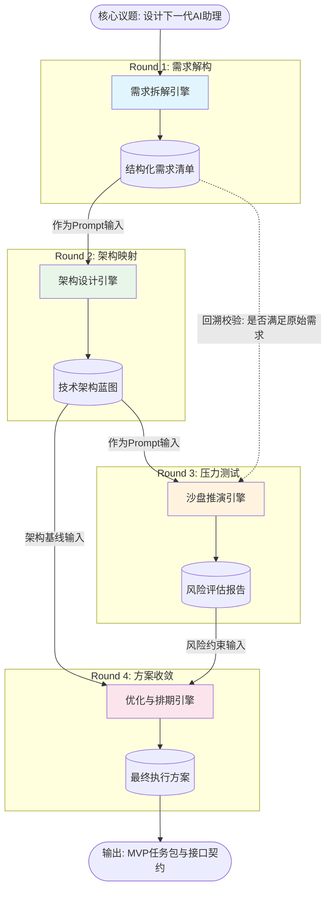

# 任务类型: eng

设计引擎任务的链式推演机制，核心在于将一个宏观的、模糊的复杂议题，通过**“解构-映射-模拟-优化”**的DAG（有向无环图）流转，逐步细化为可执行的微观方案。

为了清晰展示该机制，我们设定一个虚拟核心议题：**“设计下一代基于大语言模型的个人AI助理产品”**。整个推演分为4轮递进，上一轮的结构化输出自动作为下一轮的Prompt/数据输入。

---

### 一、 链式推演机制设计（4轮递进）

#### 第1轮：议题解构与需求原子化
*   **任务目标**：将宏观议题拆解为具体的用户场景与核心需求。
*   **输入**：核心议题原文（“设计下一代基于LLM的个人AI助理...”）。
*   **引擎处理逻辑**：执行需求拆解，应用“用户旅程地图”模型，提取痛点。
*   **输出**：`[结构化需求清单]`（包含场景、用户痛点、核心功能诉求、非功能性约束）。

#### 第2轮：架构映射与技术可行性推演
*   **任务目标**：将需求清单转化为技术架构，并进行可行性过滤。
*   **输入**：第1轮的 `[结构化需求清单]`。
*   **引擎处理逻辑**：将需求匹配对应的技术栈（如RAG、Agent、多模态），评估技术成熟度与实现成本，剔除不可行项。
*   **输出**：`[技术架构蓝图与模块矩阵]`（包含系统模块划分、数据流向、技术选型、资源依赖）。

#### 第3轮：场景仿真与冲突压力测试
*   **任务目标**：基于架构蓝图进行虚拟沙盘推演，发现潜在风险与逻辑死锁。
*   **输入**：第2轮的 `[技术架构蓝图与模块矩阵]`（附带第1轮的需求作为校验基准）。
*   **引擎处理逻辑**：构建极端用户Persona，模拟多轮交互场景，测试系统的鲁棒性、上下文窗口限制、延迟与并发瓶颈。
*   **输出**：`[风险评估报告与系统瓶颈清单]`（包含逻辑冲突点、性能瓶颈、安全合规漏洞）。

#### 第4轮：方案收敛与执行路径生成
*   **任务目标**：根据风险报告修正架构，输出最终可落地的MVP执行计划。
*   **输入**：第2轮的 `[技术架构蓝图]` + 第3轮的 `[风险评估报告]`。
*   **引擎处理逻辑**：执行降级与容错设计，对冲风险，排定开发优先级（P0/P1/P2），生成甘特图任务包。
*   **输出**：`[最终执行方案与里程碑任务包]`（包含最终系统架构、API接口契约、开发排期）。

---

### 二、 任务依赖图设计

该链式推演不仅包含线性依赖，还包含跨轮次的数据校验依赖，形成复杂的DAG图。

#### 1. Mermaid 依赖图 (可视化)

#### 2. DAG 数据流转说明表

| 节点ID | 任务节点名称 | 上游依赖 (输入源) | 下游节点 (输出去向) | 数据传递格式 (Schema) |
| :--- | :--- | :--- | :--- | :--- |
| **R1** | 需求解构引擎 | 无 (原始议题) | R2 | `JSON: {scenarios, pain_points, constraints}` |
| **R2** | 架构设计引擎 | R1 的 Output | R3, R4 | `JSON: {modules, tech_stack, data_flow}` |
| **R3** | 沙盘推演引擎 | R2 的 Output, R1 的 Output (隐式回溯校验) | R4 | `JSON: {bottlenecks, risks, conflicts}` |
| **R4** | 优化排期引擎 | R2 的 Output (基线), R3 的 Output (约束) | 终态输出 | `JSON: {final_arch, api_docs, milestones}` |

---

### 三、 引擎内部机制：三大控制策略

为了保证链式推演不偏离核心议题，引擎需内置以下机制：

1.  **上下文压缩与继承机制**
    *   *问题*：如果将上一轮的长文本全量传入下一轮，容易导致Token爆炸和注意力稀释。
    *   *解决*：上一轮引擎输出必须符合严格的 JSON Schema，下一轮引擎只提取关键字段作为变量注入Prompt模板。例如：`"基于以下架构蓝图: {R2_Output.modules}，进行风险推演..."`。
2.  **回溯校验机制**
    *   *问题*：推演到第3轮时，可能完全偏离了第1轮的原始需求。
    *   *解决*：在第3轮（沙盘推演）和第4轮（方案收敛）中，设置“锚点校验”。引擎在处理时，必须比对R1输出的 `constraints`（约束条件），如果发现冲突，在输出报告中标记 `deviation_alert: true`。
3.  **循环回退机制**
    *   *问题*：第3轮发现致命架构缺陷，无法在原架构上修补。
    *   *解决*：引擎支持中断向前的链路，触发 `Fallback` 信号。将第3轮的缺陷报告反向输入给第2轮（架构设计引擎），要求重新生成替代方案，形成闭环反馈，直到风险降级到可接受阈值。