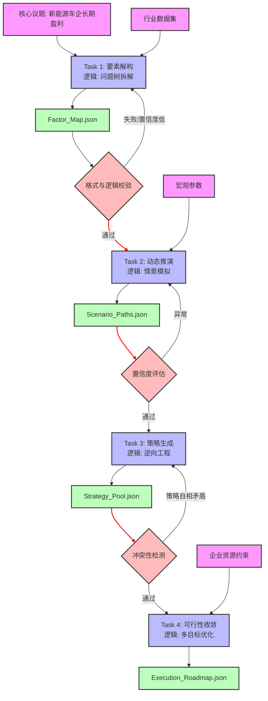

# 任务类型: eng

设计引擎任务的链式推演机制，核心在于将一个宏大的议题拆解为**“解构-预测-生成-决策”**的认知螺旋。为了使机制具体化，我们设定一个核心议题示例：**“新能源车企如何在接下来的价格战中实现长期盈利？”**

以下是该机制的4轮递进设计、I/O（输入/输出）契约以及任务依赖图的完整设计。

---

### 一、 核心机制：4轮递进推演链路

每一轮任务（节点）都包含明确的输入、处理逻辑和结构化输出。上一轮的结构化输出将直接作为下一轮的解析输入。

#### 第一轮：要素解构
*   **目标**：将核心议题拆解为可量化的基本面变量，识别当前现状与核心矛盾。
*   **输入**：核心议题文本 + 行业基础数据集。
*   **引擎处理逻辑**：使用“问题树分析法”，剥离表象，提取成本结构、市场增量、技术壁垒三个维度的关键因子。
*   **输出**：`Factor_Map.json`
    *   `cost_drivers`: [电池成本占比, 研发摊销率, 渠道营销费率...]
    *   `revenue_drivers`: [单车平均售价, 软件订阅转化率, 海外市场增量...]
    *   `core_conflict`: "单车毛利下降 vs 研发与固定成本刚性上升"

#### 第二轮：动态推演
*   **目标**：基于第一轮的要素图，推演未来1-3年内不同市场环境下的演变路径。
*   **输入**：`Factor_Map.json`（上一轮输出）+ 宏观环境参数（政策、供应链波动）。
*   **引擎处理逻辑**：引入情景规划，运行蒙特卡洛或系统动力学模拟，寻找触发“盈亏失衡”的临界点。
*   **输出**：`Scenario_Paths.json`
    *   `pessimistic_scenario`: [供应链涨价+价格战持续 -> 现金流断裂风险点: 2025年Q2]
    *   `optimistic_scenario`: [规模化效应+软件营收占比突破15% -> 毛利修复拐点: 2024年Q4]
    *   `tipping_points`: [碳酸锂价格阈值, 月销基准线]

#### 第三轮：策略生成
*   **目标**：针对第二轮推演出的危险情景和机会情景，生成具体的破局策略。
*   **输入**：`Scenario_Paths.json`（上一轮输出）。
*   **引擎处理逻辑**：采用“逆向工程法”，从期望达到的乐观情景倒推所需行动；针对悲观情景生成防御性方案。生成策略池。
*   **输出**：`Strategy_Pool.json`
    *   `defensive_strategies`: [{name: "平台化零部件通用率提升至80%", target: 降低BOM成本15%, risk: 中...}]
    *   `offensive_strategies`: [{name: "全栈自动驾驶订阅买断制", target: 提升软件单车净利, risk: 高...}]

#### 第四轮：可行性收敛
*   **目标**：对策略池进行资源约束校验，输出可落地的执行路线图。
*   **输入**：`Strategy_Pool.json`（上一轮输出）+ 企业内部资源约束参数（资金、人才、时间）。
*   **引擎处理逻辑**：建立多目标优化模型（收益最大化、风险最小化、落地周期最短），对策略进行打分排序，剔除冲突项，形成阶段性路线图。
*   **输出**：`Execution_Roadmap.json`
    *   `phase_1_quick_win`: ["砍掉冗余低配车型线", 周期: 3个月, 预期收益: 降本2%]
    *   `phase_2_core_attack`: ["L3级智驾包捆绑销售", 周期: 12个月, 预期收益: 增利5%]
    *   `discarded_strategies`: ["完全自研电池", 原因: "资金缺口过大，超出现金流承受阈值"]

---

### 二、 任务依赖图

该依赖图采用有向无环图（DAG）结构，展示任务节点、数据流向及异常重跑机制。

---

### 三、 引擎机制设计的关键保障

为了让上述链式推演在工程上真正落地，引擎需要具备以下机制：

1.  **上下文压缩与契约传递**
    *   由于大模型在长文本下容易遗忘，上一轮输出给下一轮输入时，不能直接传全量文本。
    *   **机制**：采用JSON Schema强约束输出。Task 2 解析 Task 1 的JSON时，只提取Key字段，并将JSON挂载到Task 2的系统Prompt中作为结构化上下文。
2.  **置信度门控**
    *   如果某一轮的推演结果质量太差（如幻觉、逻辑自相矛盾），直接进入下一轮会导致“错误放大”。
    *   **机制**：在每两个Task之间加入一个轻量级的评估节点（如上图Check）。如果置信度评分低于预设阈值，引擎自动触发当前Task的重新生成，最多重试3次。
3.  **状态机持久化**
    *   长链路推演可能耗时较长或中途失败。
    *   **机制**：每个Task执行完毕并校验通过后，其输出应持久化存储（如存入向量数据库或关系型数据库）。如果Task 4崩溃，引擎重启时可直接从Task 3的输出状态恢复，无需从头推演。
4.  **动态参数注入**
    *   Task 2 和 Task 4 需要外部数据（如宏观经济参数、企业财报数据）。
    *   **机制**：任务图支持并行拉取外部工具数据，在对应Task执行前作为环境变量动态注入Prompt。