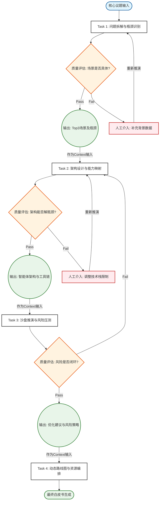

# 任务类型: eng

设计引擎任务的链式推演机制，本质上是构建一个**有向无环图（DAG）**，通过上下文记忆和状态传递，让复杂议题的推演呈现“剥洋葱式”的逐层深入。

以下为您设计的链式推演机制，包含核心议题拆解、分轮输入输出定义，以及任务依赖图。

---

### 一、 核心议题设定

为了具象化展示机制，我们设定一个企业级复杂议题：
> **核心议题：“设计并验证企业级AI智能体矩阵的商业落地路径”**

该议题无法通过单次生成得出完美结论，需拆分为4轮递进式推演。

---

### 二、 链式推演机制设计（4轮递进）

机制的核心在于：**上一轮的结构化输出（JSON/Markdown），必须作为下一轮Prompt的Context（上下文）输入**，并附加新的约束条件。

#### 第一轮：问题拆解与瓶颈识别
*   **引擎任务**：宏观分析、业务解构。
*   **输入**：核心议题 + 企业背景数据（假设已接入知识库）。
*   **处理逻辑**：寻找落地场景，识别核心技术或业务瓶颈。
*   **输出格式**：`<Scenario_List>` 场景清单 + `<Bottleneck_Analysis>` 瓶颈分析。
*   **下游传递物**：**筛选出的Top 3高价值场景及其核心瓶颈**。

#### 第二轮：架构设计与能力映射 —— *依赖第一轮输出*
*   **引擎任务**：方案设计、技术映射。
*   **输入**：第一轮输出的 `<Top 3高价值场景及瓶颈>` + 架构设计指令。
*   **处理逻辑**：针对这3个场景的瓶颈，设计对应的智能体角色、交互拓扑结构及所需调用的工具（API/RAG）。
*   **输出格式**：`<Agent_Topology>` 智能体拓扑图 + `<Tool_Chain>` 工具链定义。
*   **下游传递物**：**确定的智能体架构方案与工具链清单**。

#### 第三轮：沙盘推演与风险压力测试 —— *依赖第二轮输出*
*   **引擎任务**：动态模拟、红蓝对抗。
*   **输入**：第二轮输出的 `<智能体架构方案>` + 极端业务测试用例。
*   **处理逻辑**：模拟真实业务流，让智能体架构在“高并发、脏数据、幻觉越界”等场景下运行，暴露设计缺陷。
*   **输出格式**：`<Simulation_Log>` 模拟日志 + `<Risk_Matrix>` 风险矩阵 + `<Optimization_Points>` 优化点。
*   **下游传递物**：**带优先级排序的架构优化建议与风险防范策略**。

#### 第四轮：动态路线图与资源编排 —— *依赖第三轮输出*
*   **引擎任务**：战略规划、资源分配。
*   **输入**：第三轮输出的 `<架构优化建议>` + `<风险防范策略>`。
*   **处理逻辑**：将优化后的方案转化为可执行的MVP（最小可行性产品）路线图，分配人力与算力资源，设定里程碑。
*   **输出格式**：`<Roadmap_Timeline>` 路线图时间轴 + `<Resource_Allocation>` 资源分配表 + `<KPI_Dashboard>` 评估指标。
*   **最终输出**：完整的企业级AI智能体矩阵落地白皮书。

---

### 三、 任务依赖图设计

引擎底层通过状态机管理这些任务。图示中不仅包含顺序依赖，还加入了**质量评估的反馈回路**。

#### 1. Mermaid 流程图代码（可直接渲染查看）

#### 2. 依赖图机制说明

1.  **严格链式依赖**：
    *   `T2` 的启动必须依赖 `O1` 的输出。在引擎层面，`T2` 的 Prompt 会被动态拼接为：`"基于以下场景和瓶颈：{O1}，请设计架构..."`
2.  **状态锁**：
    *   `Task` 节点在执行时处于 `Running` 状态，下游节点处于 `Pending` 状态。只有当上游节点输出 `Success` 并写入上下文记忆库后，下游节点才转为 `Ready` 并被调度器拉起。
3.  **质量评估回路**：
    *   每一轮输出后，引擎内嵌的 `Evaluator` 会对输出进行打分（如检查JSON字段完整性、逻辑自洽性）。
    *   如果评估不通过（如第一轮场景太宽泛），将触发重试，甚至阻断进入下一轮，避免“垃圾进，垃圾出”的链式放大效应。
4.  **人工介入节点**：
    *   当系统连续重试失败时，依赖图允许将状态挂起为 `Need Human Review`，人工修正后再次注入引擎继续向下推演。

### 四、 引擎底层实现建议

如果要开发这个引擎，建议采用以下技术栈组合：
*   **调度框架**：LangGraph 或 LlamaIndex Workflows。它们原生支持状态图和循环逻辑，非常适合这种有依赖、有回退的任务流。
*   **上下文管理**：由于多轮推演会导致Prompt膨胀，引擎需要实现 `Summary Memory`（摘要记忆），将上一轮的长输出压缩为结构化要点后，再注入下一轮。
*   **数据结构**：全链路使用 Pydantic Models 定义输入输出，确保 `T1` 的输出 Schema 强制匹配 `T2` 的输入 Schema。