# 任务类型: eng

### 引擎任务链式推演机制设计（严格贴合已有认知锚定硬约束）
---
#### 一、底层遵循（100%对齐锚定规则）
1. **动力锚定**：引擎原始态的逻辑断层/数据缺失/NaN/Null/未完成标记为唯一核心循环动力，全程无前置清洗环节，所有原生瑕疵均为「可填充空位」而非噪声。
2. **架构锚定**：全链路双向流设计，无单向终点，每轮推演均包含「实域喂料补空位→虚域规则自生长→虚域反哺打新瑕疵」的闭环，瑕疵既是本轮输入燃料，也是下一轮输出靶点。
3. **域定义锚定**：
   - 实域喂料总线（A）：动态流式输入的原始业务数据，初始态带全量原生瑕疵，无预设标注/清洗规则，承担「以实养虚」的输入职能。
   - 虚域修炼演化内核（B）：初始态为全空位规则框架，仅保留「瑕疵填充→规则生长→新瑕疵生成」的元逻辑底座，承担「规则自生长」的演化职能。
---
#### 二、核心议题拆解逻辑（3-5轮递进的底层标尺）
核心议题按**「瑕疵空位的维度复杂度」**升维拆解为3-5轮，上一轮输出的「带更高阶瑕疵的数据集/状态集」100%作为下一轮输入，无额外外部注入，严格链式传递：
| 轮次数量 | 适用场景 | 瑕疵维度层级 |
|----------|----------|--------------|
| 3轮      | 简单垂直议题（如单场景规则生成） | 点级→线级→体级 |
| 4轮（标准） | 中等复杂度议题（如单领域系统自演化） | 点级→线级→面级→体级 |
| 5轮      | 复杂生态议题（如跨域多主体协同演化） | 点级→线级→面级→体级→生态级 |
---
#### 三、标准4轮链式推演机制（以「工业质检AI缺陷识别规则自生长」为核心议题示例）
每轮最小闭环为：**实域带瑕输入→瑕疵空位映射（A→B）→虚域规则填充生长→反向校验打新瑕（B→A）→实域带瑕输出→门控校验进入下一轮**
| 轮次 | 轮次名称 | 输入（上一轮输出） | 核心动作（A→B填充→B→A反哺） | 输出（下一轮输入） | 对应瑕疵类型 | 虚域规则生长成果 |
|------|----------|------------------|------------------------------|--------------------|--------------|------------------|
| 第1轮 | 点级瑕疵填充轮 | 实域原始流式数据（初始态）：含大量Null（无标注样本）、NaN（置信度缺失）、未完成标记（属性缺项）的原始质检图像+传感器数据 | 【A→B】实域喂料总线将单点瑕疵映射为虚域「基础判定规则空位」，用有效样本填充空位； 【B→A】虚域生成基础规则后反向扫描全量实域数据，标记逻辑链断裂类新瑕疵 | 带线级瑕疵的一阶态数据集 | 输入：单点属性缺失类（Null/NaN/单字段未标记） 输出：逻辑链断裂类（属性链缺失、前后判定矛盾、因果断层） | 基础二分类规则（合格/不合格判定） |
| 第2轮 | 线级瑕疵填充轮 | 第1轮输出的一阶态数据集：含缺陷类型缺失、判定逻辑矛盾、因果链断裂的样本 | 【A→B】实域将链式瑕疵映射为虚域「分类/因果规则链空位」，用矛盾/缺项样本填充； 【B→A】虚域生成链式规则后跨链校验，标记系统层冲突类新瑕疵 | 带面级瑕疵的二阶态数据集 | 输入：逻辑链断裂类 输出：系统层冲突类（跨工序规则矛盾、跨材料域适配失效、边界模糊无判定依据） | 缺陷分类规则链、缺陷演化因果链、工序内判定规则 |
| 第3轮 | 面级瑕疵填充轮 | 第2轮输出的二阶态数据集：含跨工序规则冲突、跨域适配失效、边界模糊的样本 | 【A→B】实域将系统冲突类瑕疵映射为虚域「系统级框架空位」，用冲突/边界样本填充； 【B→A】虚域生成系统框架后全边界校验，标记生态级演化类新瑕疵 | 带体级瑕疵的三阶态数据集 | 输入：系统层冲突类 输出：生态级演化类（未知缺陷盲区、实虚迭代速率错配、自生长边界未知） | 冲突优先级规则、域迁移适配规则、边界协同判定规则 |
| 第4轮 | 体级瑕疵填充轮 | 第3轮输出的三阶态数据集：含未知缺陷、速率错配、边界未知的样本 | 【A→B】实域将演化类瑕疵映射为虚域「元演化规则空位」，用盲区/错配样本填充； 【B→A】虚域生成元规则后全量扫描，标记全新维度的未知瑕疵（回喂首轮开启下一个大循环） | 带全新点级瑕疵的四阶态数据集（回喂实域原始喂料总线） | 输入：生态级演化类 输出：全新维度单点瑕疵（新工艺/新材料带来的未定义特征、从未出现过的缺陷类型） | 新瑕疵发现元规则、实虚速率动态调节规则、边界自扩张规则 |
---
#### 四、任务依赖图（可直接渲染的Mermaid实现）
##### 图设计说明：
1. 节点类型：A=实域节点（蓝）、B=虚域节点（紫）、C=流转映射节点（黄）、D=门控校验节点（绿）
2. 边逻辑：所有边为有向边，**正向流（A→B）为瑕疵填充路径，反向流（B→A）为新瑕疵打标路径**，全局大循环回流体现「无单向终点」的硬约束
3. 门控逻辑：每轮输出需满足「高阶瑕疵生成量≥阈值」才可进入下一轮，否则回流当前轮喂料池继续迭代

```mermaid
flowchart LR
    %% 全局初始节点
    A0[实域原始喂料总线<br>（带原生瑕疵的动态数据流）]
    %% 第1轮：点级瑕疵轮
    C1_1[C1-1 点级瑕疵映射<br>（A→B空位匹配）]
    B1_1(B1-1 基础规则生长<br>（虚域填充空位）)
    B1_2(B1-2 反向校验打瑕<br>（B→A新瑕疵定位）)
    C1_2[C1-2 新瑕疵回写<br>（B→A实域更新）]
    A1_out[A1-out 一阶态喂料池]
    D1{D1 轮次门控<br>新瑕量≥阈值?}
    %% 第2轮：线级瑕疵轮
    C2_1[C2-1 线级瑕疵映射<br>（A→B空位匹配）]
    B2_1(B2-1 链式规则生长<br>（虚域填充空位）)
    B2_2(B2-2 跨链校验打瑕<br>（B→A新瑕疵定位）)
    C2_2[C2-2 新瑕疵回写<br>（B→A实域更新）]
    A2_out[A2-out 二阶态喂料池]
    D2{D2 轮次门控<br>新瑕量≥阈值?}
    %% 第3轮：面级瑕疵轮
    C3_1[C3-1 面级瑕疵映射<br>（A→B空位匹配）]
    B3_1(B3-1 系统框架生长<br>（虚域填充空位）)
    B3_2(B3-2 边界校验打瑕<br>（B→A新瑕疵定位）)
    C3_2[C3-2 新瑕疵回写<br>（B→A实域更新）]
    A3_out[A3-out 三阶态喂料池]
    D3{D3 轮次门控<br>新瑕量≥阈值?}
    %% 第4轮：体级瑕疵轮
    C4_1[C4-1 体级瑕疵映射<br>（A→B空位匹配）]
    B4_1(B4-1 元规则生长<br>（虚域填充空位）)
    B4_2(B4-2 演化校验打瑕<br>（B→A新瑕疵定位）)
    C4_2[C4-2 新瑕疵回写<br>（B→A实域更新）]
    A4_out[A4-out 四阶态喂料池]
    D4{D4 循环门控<br>新瑕量≥阈值?}
    %% 第1轮依赖
    A0 --> C1_1
    C1_1 --> B1_1
    B1_1 --> B1_2
    B1_2 --> C1_2
    C1_2 --> A1_out
    A1_out --> D1
    D1 -->|不通过| A1_out
    D1 -->|通过| C2_1
    %% 第2轮依赖
    C2_1 --> B2_1
    B2_1 --> B2_2
    B2_2 --> C2_2
    C2_2 --> A2_out
    A2_out --> D2
    D2 -->|不通过| A2_out
    D2 -->|通过| C3_1
    %% 第3轮依赖
    C3_1 --> B3_1
    B3_1 --> B3_2
    B3_2 --> C3_2
    C3_2 --> A3_out
    A3_out --> D3
    D3 -->|不通过| A3_out
    D3 -->|通过| C4_1
    %% 第4轮依赖
    C4_1 --> B4_1
    B4_1 --> B4_2
    B4_2 --> C4_2
    C4_2 --> A4_out
    A4_out --> D4
    D4 -->|不通过| A4_out
    D4 -->|通过，开启下一大循环| A0
    %% 样式标注
    classDef real fill:#e1f5fe,stroke:#0288d1,stroke-width:2px
    classDef virtual fill:#f3e5f5,stroke:#7b1fa2,stroke-width:2px
    classDef transfer fill:#fff9c4,stroke:#fbc02d,stroke-width:2px
    classDef gate fill:#e8f5e9,stroke:#388e3c,stroke-width:2px
    class A0,A1_out,A2_out,A3_out,A4_out real
    class B1_1,B1_2,B2_1,B2_2,B3_1,B3_2,B4_1,B4_2 virtual
    class C1_1,C1_2,C2_1,C2_2,C3_1,C3_2,C4_1,C4_2 transfer
    class D1,D2,D3,D4 gate
```

---
#### 五、机制合规性验证（完全匹配锚定要求）
1. **无前置清洗**：原始数据的所有Null/NaN/未标记/断层直接作为首轮燃料，无任何预处理环节，瑕疵是核心循环动力而非噪声。
2. **双向流无终点**：每轮内部包含A→B的填充流和B→A的反哺流，第4轮输出回喂实域总线开启下一个大循环，不存在单向终止状态。
3. **链式严格递进**：上一轮的输出（带新瑕疵的数据集）是下一轮的唯一输入，无额外外部干预，完全符合链式推演要求。
4. **规则自生长**：虚域所有规则均由实域瑕疵填充生成，初始态无预设业务规则，完全匹配「虚域修炼演化内核」的定义。
> 若需3轮版本，可合并第3、4轮的面级+体级瑕疵为「系统级瑕疵」，合并对应任务节点即可；若需5轮版本，可在第4轮后新增「生态级瑕疵轮」，对应跨主体/跨行业的规则协同，逻辑完全对齐。