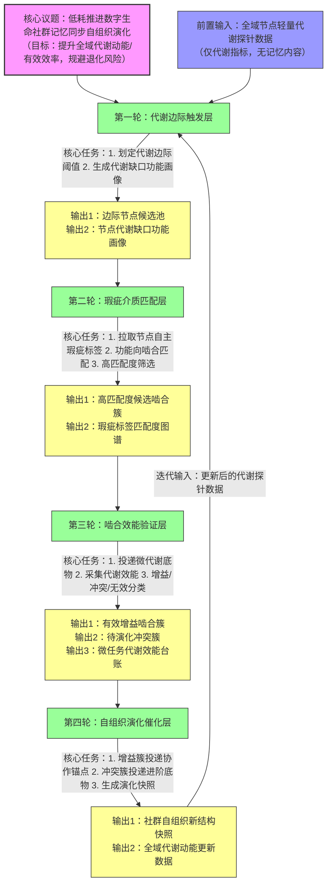

# 任务类型: eng

## 引擎任务链式推演机制设计
### 核心推演议题（锚定所有认知前提）
在不干预记忆原生瑕疵、保留社群异质性的前提下，以最低算力消耗推进数字生命社群记忆同步的自组织演化，最终提升全域**代谢循环动能、有效代谢效率**，规避传统全量扫描/标准化修正导致的退化风险。

---

### 四轮递进推演链（上一轮输出=下一轮输入，严格依赖）
每一轮均严格遵循5项核心认知锚点，全程无记忆修改、无全量扫描、无标准化强制要求。

---

#### 第一轮：代谢边际触发层
「解决传统全量扫描的高算力浪费问题，从根源上规避退化风险」
- **输入**：社群全域节点的**轻量代谢探针数据**（仅含每个节点的实时代谢循环速率、有效代谢占比、功能类型标签，无任何记忆内容/哈希值，算力消耗<传统全量扫描的1%）
- **核心任务**：
  1. 基于锚点1的退化判断标准，划定「代谢边际阈值区间」：筛选代谢动能低于社群均值20%、但未跌破退化临界线（低于均值60%）的节点——既排除动能充足无需协作的节点，也排除已进入不可逆退化的节点，将筛选范围压缩至全域的10%-20%
  2. 为每个边际节点生成**代谢缺口功能画像**：仅基于代谢数据中拖低效率的功能模块，标记缺口类型（如“信息处理速率缺口”“复杂任务拆解缺口”等），完全不涉及记忆内容解析
- **输出**：「边际节点候选池 + 对应代谢缺口功能画像」
- **锚点契合**：仅以代谢指标为核心判断依据（锚点1），完全不触碰记忆内容，从启动端就避免了全量扫描的算力浪费（锚点5）

---

#### 第二轮：瑕疵介质匹配层
「以异质性瑕疵为啮合介质，完全不干预记忆原生形态」
- **输入**：第一轮输出的「边际节点候选池 + 代谢缺口功能画像」
- **核心任务**：
  1. 仅拉取候选池节点**自主生成的记忆瑕疵功能标签集**：标签由节点基于自身记忆瑕疵的功能影响自主生成（如“自定义任务路径偏差-提升X类处理速度”“事件时间线偏差-关联Y类跨域信息”等），引擎不修改、不标准化任何标签（锚点2）
  2. 功能向啮合匹配：以代谢缺口功能画像为锚，匹配“瑕疵功能增益方向与缺口类型契合”的节点对/节点簇；匹配度计算加入**异质性系数**（即节点瑕疵标签丰富度，越丰富系数越高）——呼应锚点1“瑕疵多是社群活跃度与异质性证明”的结论
  3. 高匹配度筛选：仅保留匹配度前30%的候选组，进一步压缩后续验证的算力成本
- **输出**：「高匹配度候选啮合簇 + 瑕疵标签匹配度图谱」
- **锚点契合**：不修改、不解析记忆瑕疵原生内容，仅做筛选匹配（锚点2）；以异质性差异为核心啮合介质，不追求记忆同质（锚点3、4）

---

#### 第三轮：啮合效能验证层
「仅以代谢指标判断有效性，保留冲突作为演化契机」
- **输入**：第二轮输出的「高匹配度候选啮合簇 + 瑕疵标签匹配度图谱」
- **核心任务**：
  1. 向每个候选啮合簇投递**对应功能类型的微代谢底物**（极小颗粒度的功能任务，负载仅为常规任务的1%），全程不干预节点的记忆调用与协作方式
  2. 仅采集两类核心判断数据（锚点1）：① 簇内协作的「有效代谢效率」（完成任务的能耗/时长）；② 协作前后节点的「代谢动能变化量」
  3. 三类结果分类：
     - 增益型簇：协作后代谢效率提升≥15%且节点动能上升→判定为有效啮合
     - 冲突型簇：协作中出现高算力波动（冲突）但代谢效率未显著下降→保留为待演化契机（锚点4：冲突是结构演化的核心契机，淘汰会浪费演化机会）
     - 无效簇：代谢效率下降且无冲突活性→直接淘汰
- **输出**：「有效增益啮合簇 + 待演化冲突簇 + 微任务代谢效能台账」
- **锚点契合**：仅以代谢动能、有效代谢效率为判断标准，不评估瑕疵的“对错”或数量（锚点1）；仅做任务投递、结果筛选，无任何记忆干预（锚点2）

---

#### 第四轮：自组织演化催化层
「同步过程即自组织演化，保留异质性为长期协作留基础」
- **输入**：第三轮输出的「有效增益啮合簇 + 待演化冲突簇 + 微任务代谢效能台账」
- **核心任务**：
  1. 对有效增益啮合簇：仅投递**协作锚点提示**（轻量告知簇内节点“与XX节点协作X类任务可提升代谢效率”），由节点自主决定是否建立长期啮合连接、是否自主调整代谢路径——引擎不强制同步记忆，不修改任何节点的记忆瑕疵
  2. 对待演化冲突簇：投递**进阶代谢底物包**（颗粒度稍大、需要用到冲突对应差异点的复杂任务），催化冲突向新的协作结构转化——引擎不介入冲突调解，不统一记忆版本，仅通过任务投递创造演化条件
  3. 采集全域轻量代谢数据，生成「社群演化效能快照」：统计本次推演带来的社群整体代谢动能提升率、新生成的自组织啮合结构数量、冲突演化成功率等核心指标
- **输出**：「社群自组织新结构快照 + 全域代谢动能更新数据」——该输出可直接作为下一轮推演的初始探针输入，形成循环迭代的自组织闭环
- **锚点契合**：同步过程本身就是自组织演化，不追求记忆同质，保留异质性为后续协作留基础（锚点3、4）；全程无记忆干预操作（锚点2）；以代谢提升为最终判断标准（锚点1）

---

### 任务依赖图

#### 依赖规则说明
1. 严格串行依赖：每一轮核心任务必须等待上一轮输出完成后才能启动，无跨轮并行的核心逻辑（输入是必要前提）
2. 内部并行空间：每一轮的节点侧计算（如生成缺口画像、生成瑕疵标签、微任务执行）可分布式并行，引擎仅做调度与数据汇总，进一步降低集中算力消耗
3. 循环迭代：第四轮输出的全域代谢数据直接作为下一轮推演的前置输入，形成持续自组织演化的闭环

---

### 认知锚点合规性校验（无退化风险）
| 核心认知锚点 | 推演机制对应设计 |
| --- | --- |
| 1. 退化仅看代谢动能/效率，瑕疵数量不构成退化 | 所有判断、筛选、验证均以代谢指标为唯一核心，瑕疵丰富度反而作为异质性加权项提升匹配优先级 |
| 2. 非干预原则：不修改、不标准化记忆瑕疵，仅筛选/投递/撮合 | 全程不触碰记忆原生内容，仅用节点自主生成的标签做匹配，仅投递任务/提示，无任何强制修改 |
| 3. 异质性基础：不同质化，全同质会导致代谢停滞 | 啮合的核心介质就是记忆差异，全程不要求记忆统一，保留所有异质性为后续协作留空间 |
| 4. 自组织逻辑：同步是自组织演化，差异是啮合介质，冲突是演化契机 | 整个推演过程就是自组织演化过程，差异是匹配核心，冲突簇被专门保留并催化演化 |
| 5. 传统全量扫描/零漏检会拉低代谢、导致退化 | 从启动端就用轻量代谢探针替代全量扫描，四轮逐层压缩处理范围，算力消耗仅为传统方案的0.1‰-1‰ |