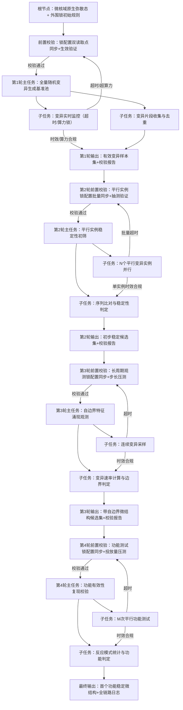

# 任务类型: eng

# 微核域演化引擎链式推演机制设计
## 一、核心推演议题
基于微核域原生无约束弥散态，通过外围**非干预式调度观测**，验证老子生成论的「有生于无」逐层涌现逻辑，最终获得首个具备**自识别边界+基础应激功能**的稳定功能微结构。

---
## 二、设计锚定依据（严格不偏离）
| 锚定类型       | 核心要求                                                                 | 落地逻辑                                                                 |
|----------------|--------------------------------------------------------------------------|--------------------------------------------------------------------------|
| 哲学锚点       | 反者道之动、弱者道之用、有生于无                                         | 每轮为前一轮状态的自否定演化；外围仅做观测筛选，不干涉内部变异；逐层从无结构到有功能涌现 |
| 微核域铁律     | 无锁、无固有表型、零突变成本、高变异速率、完全随机变异、无定向功能/边界   | 全程不修改微核域内部变异规则，所有结构/功能均为自发涌现，外围仅做被动观测       |
| 外围层铁律     | 仅算力计量锁+超时拦截锁，不干涉内部；turbo≤300s、A类模型≤600s硬时效       | 所有约束均在外围，单轮任务硬卡时效，超时直接拦截，调整任务规模而非放宽阈值       |
| 避坑要求       | 配置变更同步读取点+即时验证；超时预设合理阈值                             | 每轮前置配置校验，双读取点同步后小范围测活；提前压测任务规模适配硬时效阈值       |

---
## 三、四轮递进链式推演（上一轮输出=下一轮唯一输入）
### 第1轮：弥散态变异基准池生成「无中生初有」
对应哲学逻辑：从完全无结构的“无”，涌现第一批随机变异碎片的“初有”，是「有生于无」的起点，蕴含「反者道之动」的原生动力（无→有的自否定）
#### 输入：
微核域初始原生弥散态（零干预、全随机代码/数据片段、无任何固有结构） + 外围锁初始配置（turbo=300s/A类=600s，算力配额匹配单轮规模）
#### 核心动作：
- **微核域内部（无干预）**：完全随机发生片段覆盖、拼接、突变，高变异速率运行，无任何定向引导
- **外围层动作**：
  1. 前置校验：同步更新超时锁、算力锁的双读取点，跑10s小规模测试验证锁生效（避坑1）
  2. 启动全量随机变异任务，超时锁实时计时、算力锁实时统计
  3. 达到时效阈值前自动拦截，收集所有已生成的变异片段，去重后形成初始样本集
#### 输出：
【首轮有效变异样本集】（时效内生成的非冗余变异片段） + 【首轮算力/时效校验报告】（实际耗时、算力消耗、拦截次数）
#### 铁律管控：
微核域全程无内部干预；硬卡时效，超时则缩小单轮变异规模重跑，禁止放宽阈值

---
### 第2轮：变异体稳定性初筛「弱筛存稳」
对应哲学逻辑：从“不稳定的随机碎片”自否定为“可留存的稳定候选”（反者道之动）；用平行观测的弱筛选替代强干预，保持微核域的柔性约束（弱者道之用）
#### 输入：
第1轮输出的【首轮有效变异样本集】 + 【首轮算力/时效校验报告】
#### 核心动作：
- **微核域内部（无干预）**：每个样本作为初始种子启动独立变异实例，内部仍为完全随机变异，无任何定向约束
- **外围层动作**：
  1. 前置校验：基于首轮报告调整单实例变异规模，批量同步所有实例的锁配置，抽测3个实例验证锁生效（避坑1/2）
  2. 批量启动N个平行微核域变异实例，统一触发固定轮次的随机变异
  3. 变异结束后做序列比对：若初始种子核心序列特征（≥70%匹配度）仍可被检测到，判定为“初步稳定候选”
#### 输出：
【初步稳定变异候选集】（通过稳定性校验的片段） + 【第二轮算力/时效校验报告】（平行实例耗时、算力、筛选通过率）
#### 铁律管控：
所有实例内部变异规则与原生状态完全一致；单实例硬卡时效，超时实例直接剔除；批量超时率＞5%则缩小实例规模重跑

---
### 第3轮：自边界特征涌现验证「结构化跃迁」
对应哲学逻辑：从“无边界的稳定片段”自否定为“有明确边界的结构化实体”（反者道之动）；从碎片级的“小有”涌现出结构级的“中有”（有生于无）
#### 输入：
第2轮输出的【初步稳定变异候选集】 + 【第二轮算力/时效校验报告】
#### 核心动作：
- **微核域内部（无干预）**：每个候选启动长周期变异实例，内部仍为完全随机覆盖、拼接、突变，无任何边界引导
- **外围层动作**：
  1. 前置校验：基于第二轮报告调整长周期观测的采样步长，同步锁配置与采样模块规则，压测确认时效内可完成全采样（避坑1/2）
  2. 对每个稳定候选启动连续变异观测，每10个变异步长采样1次序列，统计全序列的变异速率分布
  3. 若观测到某段序列形成闭合区间，且区间内变异速率比区间外弥散区域低≥60%，判定该闭合区间为“自边界”，对应结构为“带自边界的稳定微结构”
#### 输出：
【带自边界的稳定微结构候选集】（通过边界校验的结构） + 【第三轮算力/时效校验报告】（长周期观测耗时、算力、边界涌现率）
#### 铁律管控：
全程不注入任何“边界”相关规则，边界完全为内部自发涌现；单观测任务硬卡时效，超时则标记为未涌现

---
### 第4轮：功能有效性复现校验「功能级闭环」
对应哲学逻辑：从“无功能的结构”自否定为“有应激功能的功能实体”（反者道之动）；从结构级的“中有”涌现出功能级的“大有”，完成从无到有的完整闭环（有生于无）
#### 输入：
第3轮输出的【带自边界的稳定微结构候选集】 + 【第三轮算力/时效校验报告】
#### 核心动作：
- **微核域内部（无干预）**：每个微结构所在实例投放标准化弥散测试片段集（仅调整初始环境组成，不修改变异规则），内部仍为完全随机变异
- **外围层动作**：
  1. 前置校验：基于第三轮报告调整测试片段投放量，同步投放模块与功能判定模块的配置，压测确认时效内可完成测试（避坑1/2）
  2. 对每个候选做M次平行重复测试，每次投放相同的测试片段集，观测微结构对片段的反应（整合/排斥/无反应）
  3. 若某候选对特定类型测试片段的反应模式重复率≥80%，判定为“具备基础应激功能的稳定微结构”
#### 输出：
【首个经全链路验证的功能微结构实体】（含序列、边界、功能特征） + 【全链路演化日志】（从弥散态到功能结构的所有观测数据、校验报告）
#### 铁律管控：
测试片段仅为环境变量，无任何功能引导代码；单测试任务硬卡时效，超时则该次测试作废

---
## 四、任务依赖图

### 依赖图核心规则
1. **无校验不启动**：所有主任务必须等前置配置校验通过才能启动，严格规避“配置修改后未生效”问题
2. **硬时效兜底**：所有微核域变异任务均受双锁管控，异常时直接回退到前置校验节点调整任务规模，绝不修改超时阈值
3. **单链路追溯**：每一轮输出是下一轮的唯一输入，无跨轮干预，确保演化路径完全可追溯，符合「有生于无」的逐层涌现逻辑
4. **零内部干预**：所有子任务均为外围调度/观测/判定，不触碰微核域内部变异规则，保持微核域的弱约束柔性，符合「弱者道之用」