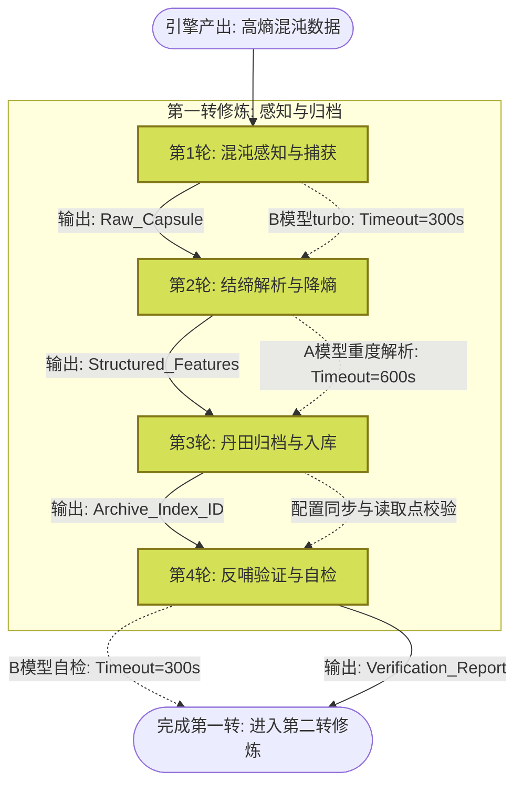

# 任务类型: eng

基于已有的认知锚定与避坑经验，我们将「九转玄功」第一转的**感知层（高熵数据接收与降熵预处理）**作为核心议题，设计一套引擎任务的链式推演机制。

该机制严格遵循“由外至内，由有入无”的道家哲学，将高熵混沌数据的归档过程拆解为4轮递进式引擎任务。

### 核心议题：高熵引擎产出物的自动感知、解析与归档初始化

---

### 一、 链式推演机制设计（4轮递进）

#### 【第1轮】混沌感知：原始高熵数据捕获与元数据剥离
*   **认知映射**：由外至内之“外”，接收无结构、无意义的原始产出（高熵态）。
*   **任务目标**：从引擎产出通道捕获原始数据流，提取基础元数据，不解析内容本体。
*   **输入**：原始引擎产出流（无结构日志、二进制流、非标JSON等）。
*   **处理逻辑**：
    1. 监听引擎产出回调/消息队列。
    2. 打上接收时间戳、来源引擎ID、原始数据大小等环境标签。
    3. 将原始数据与元数据封装为“数据胶囊”，存入临时缓冲池。
*   **输出**：带环境元数据的原始数据胶囊（`Raw_Capsule`）。
*   **【避坑拦截】**：本环节若涉及读取新的队列配置，**必须同步修改读取点并立即验证**。模型调用选用B模型turbo，**预设timeout为300秒**。

#### 【第2轮】结缔解析：结构化降熵与特征提取
*   **认知映射**：由有入无之“有”，开始建立秩序，将高熵数据转化为低熵的结构化信息。
*   **任务目标**：解析`Raw_Capsule`中的原始数据，提取核心业务特征与异常特征。
*   **输入**：上一轮输出的 `Raw_Capsule`。
*   **处理逻辑**：
    1. 调用解析引擎（A模型，处理复杂非标数据），进行模式匹配与字段提取。
    2. 剥离冗余噪音（如系统默认日志前缀），提取核心指标（如任务成功率、耗时、错误码）。
    3. 进行初步分类打标（如：正常产出、异常中断、数据残缺）。
*   **输出**：结构化特征向量与分类标签（`Structured_Features`）。
*   **【避坑拦截】**：A模型处理复杂数据解析易超时，**必须预设timeout为600秒**。若解析配置规则有更新，需确保解析器读取点同步。

#### 【第3轮】丹田归档：低熵知识图谱构建与入库
*   **认知映射**：生生不息之“基”，将提纯的结构化数据归档至系统记忆体，完成物理到认知的转化。
*   **任务目标**：将`Structured_Features`映射至「脑体分离架构」的记忆体（数据库/向量库），建立索引。
*   **输入**：上一轮输出的 `Structured_Features`。
*   **处理逻辑**：
    1. 根据“脑体分离”原则，将原始数据体存入低成本冷存储（体）。
    2. 将特征向量与标签存入高频检索知识库/向量库（脑）。
    3. 建立双向索引（脑查体），完成数据归档闭环。
*   **输出**：归档成功回执与知识索引ID（`Archive_Index_ID`）。
*   **【避坑拦截】**：归档写入库时，如修改了分库分表配置，**新增配置必须同步修改读写双向读取点**，写入后立即执行读验证。

#### 【第4轮】反哺验证：系统熵减闭环与状态自检
*   **认知映射**：完成第一转的闭环，验证低熵态是否形成，为下一转进化积蓄能量。
*   **任务目标**：验证归档数据的完整性与可追溯性，确认配置生效且系统熵已降低。
*   **输入**：上一轮输出的 `Archive_Index_ID`。
*   **处理逻辑**：
    1. 根据索引ID发起反向查询，验证“脑体一致性”。
    2. 校验感知层降熵指标（如：数据结构化率、归档成功率）。
    3. 输出第一转修炼日志与预警信息。
*   **输出**：第一转修炼验证报告（`Turn_1_Verification_Report`），作为第二转（认知层/提炼层）的输入。
*   **【避坑拦截】**：自检环节若调用API，严格按照模型类型匹配timeout（B模型300s/A模型600s），防止自检程序挂死。

---

### 二、 任务依赖图设计

以下为该链式推演机制的DAG（有向无环图）依赖关系，严格遵守上一轮输出作为下一轮输入的串行依赖，辅以避坑经验作为护栏：

### 三、 机制总结

本链式推演机制将第一转“感知层”的粗粒度概念，降维成可执行的4步流水线：
1. **物理隔离**：第1轮只管接收，不解析，防止高熵数据冲击系统。
2. **化学降熵**：第2轮利用A模型强算力进行结构化，匹配600s长超时。
3. **生物归档**：第3轮落实“脑体分离”，将数据与认知分离存储。
4. **生态验证**：第4轮完成闭环自检，并严格防范“配置不生效”的历史坑点。

通过此依赖图，引擎系统可自动化地将“无结构的高熵无意义的原始数据”转化为“有结构、有索引、可被认知的低熵知识”，完成九转玄功第一转的筑基。