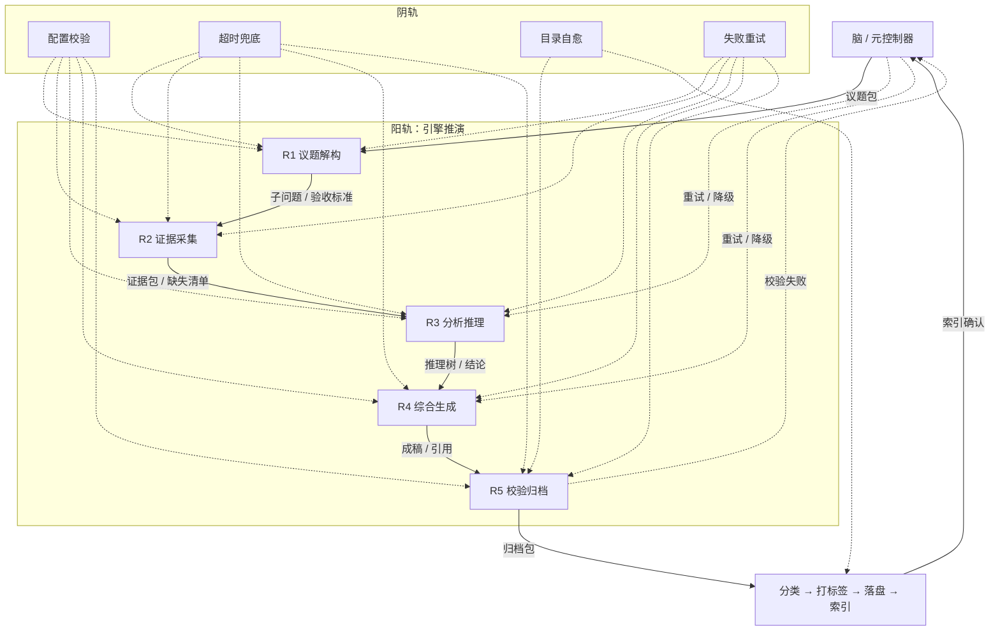

# 任务类型: eng

基于锚定，直接推演如下。

## 一、链式推演任务依赖图

默认把核心议题拆为 **5 轮递进**；简单议题可由元控制器合并为 **3 轮**，最多不超过 5 轮。

## 二、轮次与依赖关系

| 轮次 | 任务 | 输入 | 输出 | 模型 / 超时 |
|---|---|---|---|---|
| R1 | 议题解构 | 核心议题 | 子问题、范围、验收标准 | A 模型 / 600s |
| R2 | 证据采集 | 子问题、验收标准 | 证据包、缺失清单、来源 | B 模型 turbo / 300s |
| R3 | 分析推理 | 证据包、缺失清单 | 推理树、结论、置信度 | A 模型 / 600s |
| R4 | 综合生成 | 推理树、结论 | 成稿、引用、待核验项 | B 模型 turbo / 300s |
| R5 | 校验归档 | 成稿、引用、待核验项 | 校验结果、归档包、元数据 | A 模型 / 600s |

关键规则：

- 每一轮的输出必须结构化落盘，下一轮只读取上一轮的结构化输出。
- 下游任务只有在上游任务成功后才会进入 `ready` 状态。
- 元控制器掌握全局状态，可发起重试、降级、回退，不采用单线死局。

## 三、阴轨：四个可靠性保障

### 1. 配置校验

防止“配置修改后未生效”。

- 所有配置项必须登记 `readPoint`，即“这个配置在哪里被读取”。
- 新增配置时，必须同步修改读取点；没有登记读取点的配置不允许下发。
- 配置变更后，元控制器立即执行探针任务验证：读取该配置的实际生效值，与配置中心比对。
- 验证通过后，配置版本号 +1，下一轮任务启动前加载新配置；验证不通过则回滚，并阻止任务下发。

### 2. 超时兜底

防止“API 调用超时，任务未在规定时间内返回”。

- 模型注册表统一管理超时：
  - B 模型 turbo：300 秒
  - A 模型：600 秒
- 每个轮次任务启动时，根据模型类型注入对应超时。
- 超时后不静默失败，而是保存已产生的部分输出，标记为 `timeout`，交给元控制器决策：
  - 重试；
  - 降级模型；
  - 从上一轮检查点继续。

### 3. 目录自愈

防止“落盘失败导致归档中断”。

- 落盘前检查目标目录是否存在、是否可写。
- 若目录不存在，自动创建。
- 若权限不足，尝试修复权限。
- 若路径被文件占用，隔离该文件并重建目录。
- 自愈后必须重新验证可写性；验证失败则告警升级，不继续写入。

### 4. 失败重试

防止“一次失败导致整条链死锁”。

- 可重试错误：超时、5xx、限流、输出不完整。
- 不可重试错误：结构化输出不符合 schema、配置错误、提示词错误。
- 默认最多重试 3 次，退避策略为 1s / 2s / 4s。
- 重试仍失败时，元控制器根据失败类型决定：
  - 证据不足 → 回退 R3；
  - 成稿质量不达标 → 回退 R4；
  - 校验不通过且剩余轮次为 0 → 停止并人工介入。

## 四、有界循环

整个机制是“开放、有界、循环”的负熵过程：

- 开放：新的核心议题可随时进入；
- 有界：最多 5 轮，重试次数有限，避免无限循环；
- 循环：归档索引确认后回写元控制器，形成闭环。

每一轮输出都在增加有序度：议题 → 子问题 → 证据 → 推理 → 成稿 → 归档索引。这样，引擎的无序输出最终变成可检索、可复用的有序信息资产。