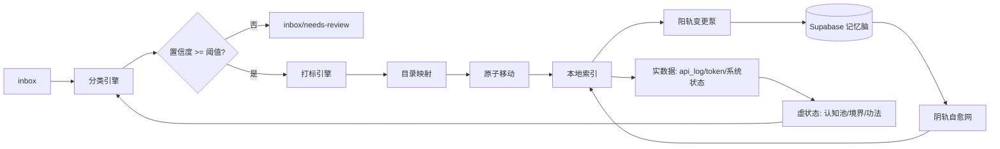
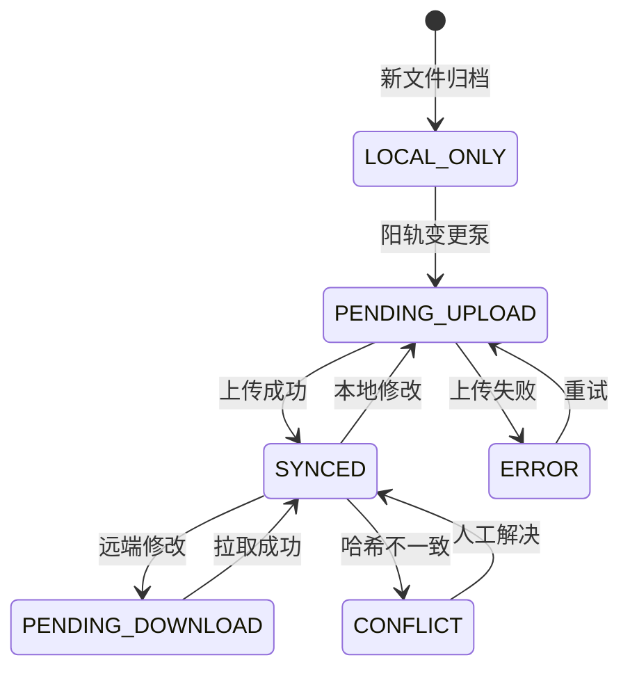

# 任务类型: eng

# 自动归档系统设计（设计引擎输出）

## 0. 锚定与避坑红线

直接沿用已验证锚定，不重复论证：

- **Supabase 记忆脑** = 本地优先 + Supabase 远端存储与索引。
- **增量同步** = 阳轨“变更泵” + 阴轨“自愈网”。
- **每个文件在同步系统中只有一个状态**，使用单一 `sync_state` 枚举，不允许多个布尔状态叠加。
- **虚实闭环**：实（API调用、Token消耗、日志、系统状态）养虚（境界、功法、认知池），虚又返实（调度策略、模型选择、阈值调整）。

同时把历史失败经验转为两条硬约束：

| 历史失败 | 设计预防 |
|---|---|
| 配置修改后未生效，行为无变化 | 所有读取点统一走 `ConfigProvider`，配置变更后立即验证，失败自动回滚 |
| API调用超时，任务未在规定时间内返回 | 按模型预设超时：**B_turbo = 300s，A_model = 600s**，超时走规则兜底并标记 `needs_review` |

---

## 1. 系统总览

```
开放：inbox 接收所有新任务
有界：分类体系 + 目录映射规则
循环：实数据 → 虚状态 → 调度策略 → 实数据
```

归档流水线：



---

## 2. 任务自动分类

输入：任务标题、描述、附件、来源、设计引擎产出的任务卡。

### 分类方法

1. **规则快路径**  
   - 关键词、正则、来源匹配。
   - 零 Token 消耗，确定性结果。

2. **LLM 分类路径**  
   - 常规任务用 `B_turbo`，超时 300s。
   - 复杂/模糊任务用 `A_model`，超时 600s。
   - 输出必须为 JSON：

```json
{
  "category": "task",
  "project": "archive-system",
  "priority": "high",
  "due_date": "2025-05-20",
  "tags": ["sync", "local-first"],
  "confidence": 0.92
}
```

3. **低置信度处理**  
   - `confidence < 0.7` 时进入 `inbox/needs-review`，不自动归档。
   - 人工确认后进入归档流程，并将修正结果写回记忆脑。

4. **超时兜底**  
   - 超时后不阻塞、不丢任务。
   - 自动降级到规则分类；规则也无法分类时，标记 `needs_review` 并进入待审目录。

---

## 3. 自动打标签

### 标签来源

- 任务类型：`design`、`engineering`、`meeting`、`decision`
- 项目归属：`project:archive-system`
- 动作：`needs-review`、`approve`、`fix`
- 状态：`blocked`、`active`、`done`
- 来源：`source:api`、`source:email`
- 领域：`domain:sync`

### 标签规范化

- 标签必须是受限词表中的词，避免同义词膨胀。
- LLM 输出 `bugfix`，统一归一化为 `bug`。
- 标签格式：小写、连字符、命名空间。
- 每个任务最多 10 个标签，至少 1 个主标签。

### 标签记忆

- 标签历史存入 Supabase。
- 新任务分类时，从记忆脑检索相似任务，复用其标签作为 few-shot 样本。
- 这就是“认知池”的实际用法：越归档，越准。

---

## 4. 目录映射与归档执行

### 目录规则配置

所有目录规则集中在 `.system/config.yaml`：

```yaml
archive_root: "~/archive"

path_rules:
  task: "tasks/{project}/{status}/{task_id}"
  knowledge: "knowledge/{domain}/{topic}"
  log: "logs/{date}/{source}"
  meeting: "meetings/{project}/{date}-{topic}"
```

### 归档执行

1. 根据 `category`、`project`、`status`、`task_id` 等字段渲染目录。
2. 对路径做安全处理：`safe_slug`，防止路径穿越。
3. 使用**原子移动**，避免半归档状态。
4. 移动完成后写入本地索引。
5. 同步状态设为 `LOCAL_ONLY` 或 `PENDING_UPLOAD`。

### 目录结构示例

```
~/archive/
  inbox/
    needs-review/
  tasks/
    archive-system/
      active/
        T-2025-05-19-001.md
  knowledge/
    sync/
      local-first.md
  logs/
    2025-05-19/
      api.log.jsonl
```

---

## 5. 本地优先 + Supabase 记忆脑同步

### 每个文件只有一个同步状态

状态枚举：

```text
LOCAL_ONLY
PENDING_UPLOAD
PENDING_DOWNLOAD
SYNCED
CONFLICT
ERROR
```

状态机：



> 关键点：一个文件在同步系统中只有一个 `sync_state`，不存在“既待上传又已同步”的双重状态。

### 阳轨：变更泵

- 本地文件系统监听事件：新建、修改、删除。
- 事件写入 `change_log`。
- 自动推送到 Supabase Storage + Postgres 索引。
- 推送成功后更新 `sync_state = SYNCED`。

### 阴轨：自愈网

- 定时任务周期拉取远端索引。
- 对比本地索引：
  - 远端有、本地无 → 拉取。
  - 本地有、远端无 → 推送。
  - 哈希不一致 → 按版本/时间解决；无法解决时进入 `CONFLICT`。
- 自愈网与变更泵通过同一张状态表互斥，避免竞争。

---

## 6. 配置修改必须验证生效

### 单一配置源

所有组件只通过 `ConfigProvider` 读取配置：

```python
config = ConfigProvider.load()
# 不允许在业务代码里散落 yaml.safe_load()
```

配置包含：

- 目录映射规则
- 标签词表
- 模型选择与超时
- 分类阈值
- 同步间隔
- 认知池调度参数

### 修改后立即验证

配置文件被修改后，自动执行：

```bash
verify_archive_config --config .system/config.yaml --dry-run --samples 3
```

验证项：

- YAML 可解析
- 所有目录可创建
- 分类引擎能跑通
- 标签词表能加载
- 模型超时配置存在
- Supabase 连接正常
- 用 3 条历史任务做干跑，输出与预期一致

验证失败则**自动回滚到上一份可用配置**，并告警。

---

## 7. API 超时控制

### 模型超时配置

```yaml
model_timeout:
  B_turbo: 300
  A_model: 600
```

调用时必须显式传入超时：

```python
timeout = config.model_timeout[model]
response = await client.post(..., timeout=timeout)
```

不再使用默认超时。

### 超时后的行为

- 记录 `api_log`：模型、耗时、Token、错误类型。
- 标记任务 `needs_review`。
- 降级到规则分类。
- 不阻塞归档流水线。

---

## 8. 以实养虚，虚又返实

### 实 → 虚

归档系统持续产生真实数据：

| 实 | 写入虚状态 |
|---|---|
| API调用日志 | 认知池“推演次数” |
| Token消耗 | 认知池“能量消耗” |
| 分类准确率 | 境界“经验值” |
| 人工修正记录 | 功法“纠偏参数” |
| 同步成功率 | 自愈网“稳固度” |

### 虚 → 实

元控制器根据虚状态调度真实系统：

- 认知池充足 → 分类时更多使用相似任务召回，减少 Token。
- 分类准确率低 → 调高阈值，或改用 `A_model` 深度分类。
- 同步失败率高 → 缩短自愈网周期。
- 境界提升 → 解锁更积极的归档策略。

这就是自增强闭环：

> 真实任务养认知池，认知池反哺真实任务。

---

## 9. Supabase 记忆脑数据模型

### 核心表

```sql
archive_files (
  path text primary key,
  hash text not null,
  sync_state text check (sync_state in ('LOCAL_ONLY','PENDING_UPLOAD','PENDING_DOWNLOAD','SYNCED','CONFLICT','ERROR')),
  metadata jsonb,
  updated_at timestamptz default now()
);

task_memory (
  task_id text primary key,
  category text,
  tags jsonb,
  embedding vector,
  created_at timestamptz default now()
);

virtual_state (
  key text primary key,
  value jsonb,
  updated_at timestamptz default now()
);
```

### 存储

- 文件本体：Supabase Storage `archive` bucket，路径与本地相对路径一致。
- 索引与记忆：Postgres + pgvector。
- 虚状态：`virtual_state` 表。

---

## 10. 最终效果

```text
输入：
  inbox/T-2025-05-19-001.md

输出：
  分类：engineering
  标签：[sync, conflict, self-heal, bug]
  路径：~/archive/tasks/archive-system/active/T-2025-05-19-001.md
  同步状态：SYNCED
  虚状态：认知池 +1 经验，境界进度更新
```

系统因此成为“开放、有界、循环”的负熵引擎：  
**开放**接收新任务，**有界**用分类和目录约束秩序，**循环**用实数据喂养虚框架，再用虚框架调度实系统。