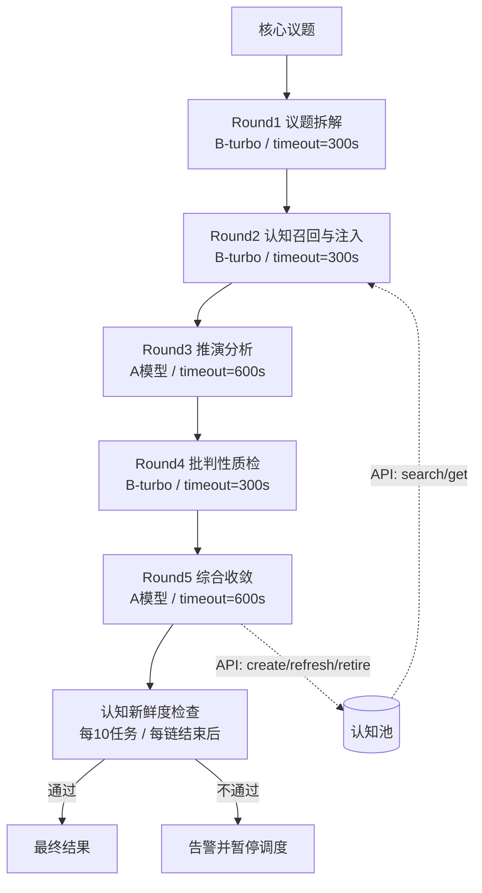

# 任务类型: eng

按你给的锚定，不再重复论证，直接把机制落到可执行设计里。

## 1. 任务依赖图（标准 5 轮链式推演）



依赖关系严格单向，链内不设回边。  
如果 Round4 发现缺认知，不回流到 Round2，而是写入 Round5 的 `open_issues`，由调度器异步发起一条“补充认知链”，避免 DAG 成环。

---

## 2. 轮次依赖与数据契约

| 上游 | 下游 | 传输内容 |
|---|---|---|
| I | R1 | `core_issue`、约束条件、`config_version` |
| R1 | R2 | `sub_questions[]`、`assumptions[]`、`success_criteria[]` |
| R2 | R3 | `cognition_refs[]`、`evidence_map{}`、`knowledge_gaps[]` |
| R3 | R4 | `draft_conclusion`、`reasoning_steps[]`、`confidence`、`cited_cognition_ids[]`、`candidate_new_cognitions[]` |
| R4 | R5 | `defect_list[]`、`correction_suggestions[]`、`missing_cognitions[]`、`original_draft` |
| R5 | OUT | `final_answer`、`action_items[]`、`open_issues[]` |
| R5 | CP | `cognition_update_ops[]`：create / refresh / retire |

每轮输出都包装成标准信封：

```json
{
  "schema_version": "1.0",
  "chain_id": "chain_xxx",
  "round": 2,
  "input": {},
  "output": {
    "cognition_refs": [
      {
        "id": "cog_123",
        "version": 3,
        "freshness_minutes": 12
      }
    ],
    "evidence_map": {
      "sub_question_1": ["cog_123"]
    },
    "knowledge_gaps": []
  },
  "meta": {
    "model": "B-turbo",
    "timeout_seconds": 300,
    "config_version": "v20260601"
  }
}
```

任务之间只认这个信封，不直连认知池表结构。

---

## 3. 每轮节点定义

| 轮次 | 职责 | 输入 | 输出 | 模型/超时 | 质检门 |
|---|---|---|---|---|---|
| R1 | 把核心议题拆成可推演的子问题 | 核心议题 | 子问题、假设、验收标准 | B-turbo / 300s | 子问题 ≥ 3；不写死表结构；`config_version` 匹配 |
| R2 | 从认知池召回最新认知，并实际注入任务 | R1 输出 | 认知引用集、证据映射、知识缺口 | B-turbo / 300s | 最近30分钟新增认知注入率必须 > 0 |
| R3 | 基于注入认知做正式推演 | R2 输出 | 草稿结论、推理链、置信度、引用认知ID | A模型 / 600s | `cited_cognition_ids ⊆ cognition_refs`；推理链完整 |
| R4 | 对抗性批判草稿，检查认知过时/矛盾/缺失 | R3 输出 | 缺陷清单、修正建议、缺失认知、保留原稿 | B-turbo / 300s | 不能自我确认；严重缺陷必须被记录 |
| R5 | 综合修正并产出最终结论，更新认知池 | R4 输出 | 最终结论、行动项、认知更新操作、开放问题 | A模型 / 600s | 严重缺陷已处理或列入 `open_issues`；`cognition_update_ops` 合法 |

---

## 4. 三个质检项如何内建

### 4.1 认知不新鲜 → 注入新鲜度检查

每完成一条链，或累计 10 个引擎任务后，执行：

```text
new_cogs = 最近30分钟内新增或更新的认知
injected_tasks = 引用过 new_cogs 中任意认知的任务数
rate = injected_tasks / 当前窗口任务数

if new_cogs 不为空 and rate == 0:
    告警并暂停调度
```

注意：**“检索到”不等于“注入”**。  
必须满足：

- `cognition_id` 出现在 R2 的 `cognition_refs`
- 并且出现在 R3 的 `cited_cognition_ids`

否则认知池仍会变成静态档案库。

### 4.2 闭环不开放 → 链尾写回 + 旧认知淘汰

R5 必须生成 `cognition_update_ops`：

```json
{
  "create": [],
  "refresh": ["cog_123"],
  "retire": ["cog_456"]
}
```

- `create`：本轮推演产生的新认知，验证后写入认知池
- `refresh`：被引用且证明有效的旧认知，更新 `last_used_at`
- `retire`：被新证据推翻或长期未被引用的旧认知，标记淘汰，不再注入后续任务

这样认知池才不会变成 1700+ 条的静态库。

### 4.3 调用不设限 → 超时熔断

所有模型调用统一走封装：

```text
if model.type == "B" and model.variant == "turbo":
    timeout = 300s
elif model.type == "A":
    timeout = 600s
else:
    timeout = 600s
```

同时设置：

- 单节点最大重试次数：2
- 链级总超时 = 各节点 timeout 之和 + 20% buffer + 重试预算
- 超时后不无限重试，直接失败并告警

---

## 5. 配置修改生效验证

针对你给的历史坑：**配置修改后未生效，行为无变化。**

新增配置项时，必须同步修改两处：

1. 配置中心里的 `ChainConfig`
2. 读取该配置的任务加载器 `TaskLoader`

禁止在任务代码里散落硬编码读取旧配置。

每次修改配置后，立即跑一条 canary 议题验证：

```text
run_canary_chain("配置验证专用议题")

断言：
- 实际轮数 == 配置轮数
- 实际模型/超时 == 配置模型/超时
- 实际注入率阈值 == 配置阈值
```

只有断言通过，配置才算真正生效。

---

## 6. 可裁剪的 3/4 轮模式

默认是标准 5 轮，也可以按议题复杂度裁剪：

- 5 轮：拆解 → 认知注入 → 推演 → 批判 → 收敛
- 4 轮：拆解 → 认知注入 → 推演与批判合并 → 收敛
- 3 轮：拆解 → 认知注入与推演合并 → 批判与收敛合并

但无论如何裁剪，必须保持：

```text
上一轮输出 -> 下一轮输入
```

且认知新鲜度检查始终保留。