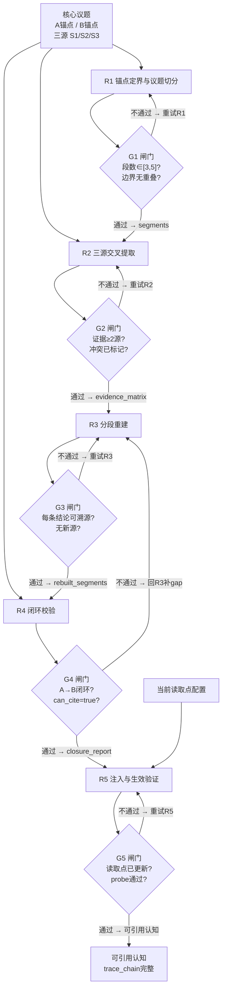

# 任务类型: eng

基于你给出的“认知锚定”与“避坑提醒”，直接给出可落地的**引擎任务链式推演机制**设计。

## 一、机制总览

核心思路：**一个核心议题不一次性求解，而是切成 3-5 轮递进任务；上一轮输出作为下一轮主输入；每轮设验证闸门；只有通过闸门才进入下一轮。**

默认采用 5 轮：

1. R1：锚点定界与议题切分  
2. R2：三源交叉提取  
3. R3：分段重建  
4. R4：闭环校验  
5. R5：注入与生效验证  

如果议题较小，可合并为 3 轮：  
- R2+R3 合并为“提取与重建”  
- R4+R5 合并为“校验与生效”

---

## 二、任务依赖图



> 图中回退边是执行期重试，不是逻辑依赖环；核心依赖方向始终是 R1→R2→R3→R4→R5。

---

## 三、轮次设计与输入输出契约

| 轮次 | 主输入 | 输出 | 验证闸门 | 模型/超时 |
|---|---|---|---|---|
| R1 | 核心议题、A/B锚点 | `segments[3..5]` | 段数合法、边界连续、锚点无歧义 | B-turbo / 300s |
| R2 | R1输出 + 三源 S1/S2/S3 | `evidence_matrix` + `conflict_list` | 每条证据至少2源命中；冲突显式标记 | A / 600s |
| R3 | R2输出 | `rebuilt_segments` + `gaps` | 每条结论可溯源；未引入新源；gap不隐藏 | A / 600s |
| R4 | R3输出 + A/B锚点 | `closure_report` | A→B可走通；`can_cite=true` 才放行 | B-turbo / 300s |
| R5 | R4输出 + 当前读取点配置 | `injection_log` + `probe_result` | 读取点已更新；probe验证通过 | B-turbo / 300s |

---

## 四、关键设计细节

### 1. 双锚点定界

- A锚点：断点前最后一个可溯源认知。
- B锚点：断点后第一个可溯源认知。
- R1 必须把核心议题映射到 A→B 区间内。
- R4 必须校验从 A 出发，经过重建段，能语义连续走到 B。

### 2. 三源交叉

三源建议为：

- S1：A锚点侧上下文/历史记录。
- S2：B锚点侧上下文/下游引用记录。
- S3：外部佐证，如日志、备份、工单、第三方文档。

规则：

- 一条证据至少被 2 个独立源支持，才能进入 `evidence_matrix`。
- 单源证据只能标记为 `pending`，不能进入 R3。
- 源间冲突必须显式记录，未消解前不能作为重建依据。

### 3. 分段重建

- R1 把 A→B 区间切成 3-5 段。
- R3 按段重建，不整段一次性生成。
- 每段重建结果必须带 `trace_chain`，即每个结论都能指向 R2 的证据 ID。
- 如果某段证据不足，标记为 `gap`，不强行补全。

### 4. 闭环校验

R4 输出：

```json
{
  "closure_path": ["A", "S1", "S2", "S3", "B"],
  "can_cite": true,
  "blockers": []
}
```

只有 `can_cite=true` 时，才允许进入 R5。  
否则必须回到 R3 补 gap，或回到 R2 补证据。

### 5. 注入与生效验证

R5 是原子操作，包含三步：

1. 写入重建后的认知。
2. 同步修改所有读取点。
3. 立即运行 probe 任务验证生效。

如果只写库但没改读取点，就会出现“配置修改后未生效”的坑。  
所以 G5 必须检查：

- `injection_log` 中读取点已更新。
- `probe_result` 能查到新认知。

---

## 五、编排与超时控制

执行器伪代码：

```python
def run_chain(task):
    state = load_cache(task.id)

    for round in [R1, R2, R3, R4, R5]:
        if state.get(round.id) and state[round.id].status == "ok":
            continue

        for attempt in range(3):
            output = call_model(
                prompt=round.prompt,
                input=round.build_input(state, task),
                timeout=round.timeout
            )

            if round.validate(output):
                output.status = "ok"
                state[round.id] = output
                save_cache(task.id, state)
                break
        else:
            raise ChainRoundError(round.id, state)
```

超时规则：

- R1 / R4 / R5 使用 B-turbo，超时 300 秒。
- R2 / R3 使用 A 模型，超时 600 秒。
- 某一轮超时后，不重跑整条链，只从当前轮断点续跑。
- 如果 R3 仍超时，把当前 segment 继续拆小，而不是无限加大 timeout。

---

## 六、避坑映射

| 历史坑 | 本机制对策 |
|---|---|
| 配置修改后未生效 | R5 强制“写库 + 改读取点 + probe验证”三合一，G5 不通过则回滚 |
| API调用超时 | 按模型设 timeout；分段重建；单轮重试；断点续跑 |
| 认知不新鲜/溯源链断 | 每轮输出强制带 `trace_chain`；R4 必须走通 A→B 闭环 |
| 无效认知注入下游 | G4 阻断 `can_cite=false`；下游只能引用已闭环的认知 |

---

这套机制的核心是：**不追求一次生成完整答案，而是通过 3-5 轮可验证的递进，把“断掉的溯源链”重新接上，并且保证每一段输出都可回溯、可验证、可生效。**