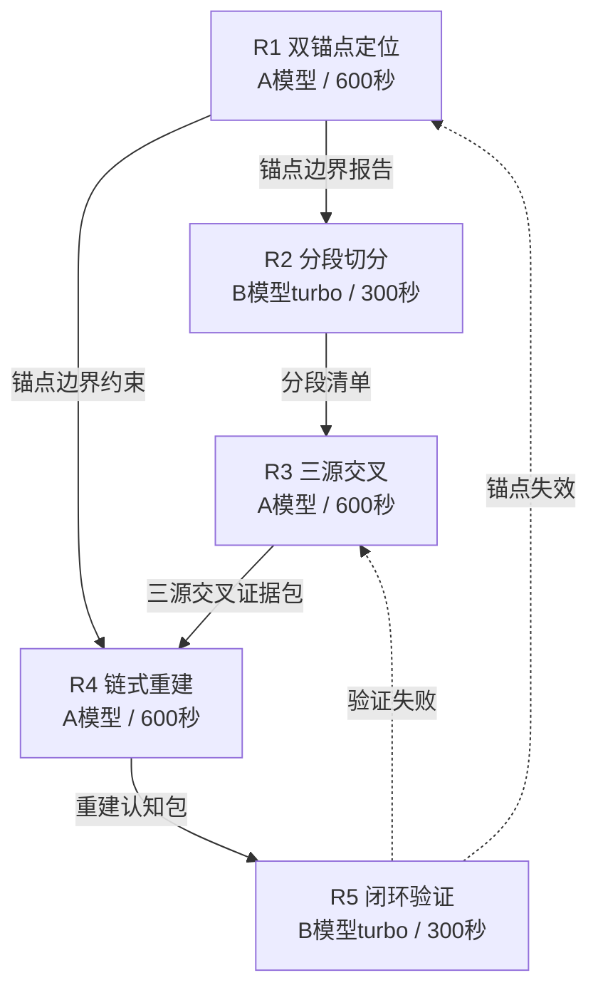

# 任务类型: eng

先给结论：**不要把链式推演做成单次超长任务**；要按 DAG 拆节点，节点间只传递结构化产物，并且每个节点都带验证门。

---

## 1. 五轮链式推演定义

以「8月8日-8月18日认知段重建」为例，核心议题可拆成 5 轮：

| 轮次 | 任务ID | 本轮目标 | 依赖 | 输入 | 输出 | 模型/超时 |
|---|---|---|---|---|---|---|
| R1 | 双锚点定位 | 确认缺失区间前后最后一个/第一个可靠锚点 | 无 | 缺失区间声明 + 认知库索引 | 锚点边界报告 | A模型 / 600秒 |
| R2 | 分段切分 | 把缺失区间切成可独立验证的段 | R1 | 锚点边界报告 | 分段清单 | B模型turbo / 300秒 |
| R3 | 三源交叉 | 每段找至少3个独立源交叉验证 | R2 | 分段清单 | 三源交叉证据包 | A模型 / 600秒 |
| R4 | 链式重建 | 把已验证的分段重建为可回溯认知 | R1, R3 | 锚点边界 + 三源交叉证据包 | 重建认知包 | A模型 / 600秒 |
| R5 | 闭环验证 | 验证重建认知能被下游安全引用 | R4 | 重建认知包 | 验证报告 + 发布许可 | B模型turbo / 300秒 |

主链是：  
`R1 → R2 → R3 → R4 → R5`

其中 R4 额外引用 R1 的锚点作为边界约束，避免重建时越界或幻觉。

---

## 2. 任务依赖图



正常数据流是 DAG；虚线是异常回退，不是正常依赖。

---

## 3. 关键机制

### 3.1 输出契约必须同步

每一轮输出必须是结构化产物，并且下游只能通过明确映射读取。

例如：

```json
R3.output = {
  "evidence_bundle": [
    {
      "segment_id": "seg-1",
      "sources": ["src_log", "src_callchain", "src_git"],
      "consistency": "consistent",
      "confidence": 0.95
    }
  ]
}
```

R4 的输入映射必须写：

```json
"input_mapping": {
  "evidence": "R3.output.evidence_bundle"
}
```

如果 R3 把字段改成 `evidence_list`，R4 没同步改，调度器必须直接拦截，禁止静默兼容。  
这就是避坑提醒里说的：**新增配置必须同步修改读取点，修改后立即验证生效。**

---

### 3.2 每轮预设 timeout

依赖图生成时，每个节点必须带模型和超时：

- B模型turbo：300秒
- A模型：600秒

R3 不能一次性对所有分段做三源交叉；必须按段循环调用。  
如果某一段在 600 秒内没完成，就继续拆小段，而不是加长超时。

---

### 3.3 验证门

每一轮输出不能直接进入下一轮，必须通过验证门：

| 轮次 | 验证门 |
|---|---|
| R1 | 两个锚点都存在，且能回溯到原始索引 |
| R2 | 分段覆盖完整缺失区间，无重叠，每段有候选源 |
| R3 | 每段至少3个独立源，交叉一致性达标 |
| R4 | 每条重建认知都有 `traceability_path` |
| R5 | 下游任务能通过 `verification_entry` 查到并引用该认知 |

R5 通过前，该段认知仍属于“静态档案”，下游不可引用。  
R5 通过后，才从静态档案变成可引用的动态认知。

---

## 4. 与已有认知锚定的对应

- **双锚点**：R1 实现  
- **三源交叉**：R3 实现  
- **分段重建**：R2 + R3 + R4 实现，禁止整段一次性补全  
- **认知不新鲜**：R4 输出必须带 `traceability_path`，断链即失败  
- **闭环不开放**：R5 验证门负责打开闭环，未通过前 `visibility=blocked`  
- **调用不设限**：调度器在 R5 通过前禁止下游任务引用该段认知，防止无效认知注入污染下游  

---

## 5. 如果必须压缩成 3 轮

可以合并为：

1. R1：双锚点定位 + 分段切分  
2. R2：三源交叉 + 链式重建  
3. R3：闭环验证  

但压缩后的 R2 内部仍必须按段循环，不能在一个 prompt 里完成所有交叉和重建。  
否则会重蹈“单次调用必超时”的覆辙。