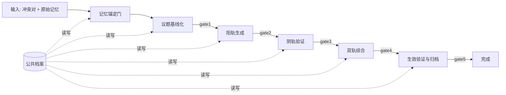

# 任务类型: eng

直接给机制，不重复论证。  
核心思想：**一个核心议题 = 一条带验证门的链式 DAG；上一轮输出是下一轮主输入；所有产物进公共档案，不依赖任何实例的私人记忆。**

## 1. 链式推演依赖图



**三节点主干**是：  
`R2 阳轨生成 -> R3 阴轨验证 -> R4 双轨综合`  
`N0` 是入口锚定，`R5` 是出口验证。

---

## 2. 节点定义与产物传递

| 节点 | 主输入 | 输出 | 验证门 |
|---|---|---|---|
| N0 记忆锚定门 | 原始记忆 + 冲突对 | `anchored_memory_bundle` | 锚定门：每条记忆必须有 `event_id`，否则降级为 `individual_narrative` |
| R1 议题基线化 | `anchored_memory_bundle` | `baseline` | gate1 |
| R2 阳轨生成 | `baseline` | `candidate_set` | gate2 |
| R3 阴轨验证 | `candidate_set` | `challenged_candidate_set` | gate3 |
| R4 双轨综合 | `challenged_candidate_set` | `synthesis` | gate4 |
| R5 生效验证与归档 | `synthesis` | `execution_package` | gate5 |

**关键：上一轮输出作为下一轮主输入，而不是让模型自己“回忆”上一轮。**

---

## 3. 结构化产物字段

### R1 输出：`baseline`

```json
{
  "event_id": "archive://...",
  "conflict_pair": ["generation", "verification"],
  "dual_track": {
    "yang": "generation",
    "yin": "verification"
  },
  "boundary_conditions": []
}
```

### R2 输出：`candidate_set`

```json
{
  "candidates": [
    {
      "candidate_id": "c1",
      "action": "...",
      "precondition": "...",
      "expected_effect": "...",
      "read_point_map": {}
    }
  ]
}
```

> 若候选包含配置修改，`read_point_map` 必须写清新旧读取点，否则 gate2 直接打回。

### R3 输出：`challenged_candidate_set`

```json
{
  "candidate_id": "c1",
  "counterexamples": [],
  "constraints": [],
  "forgotten_items": []
}
```

### R4 输出：`synthesis`

```json
{
  "decision": "...",
  "tradeoff": "...",
  "rollback_point": "...",
  "unresolved_tension": "..."
}
```

### R5 输出：`execution_package`

```json
{
  "commands": [],
  "config_changes": [],
  "read_point_map": {},
  "smoke_test_result": "pass",
  "archive_event_id": "archive://..."
}
```

---

## 4. 验证门规则

- **gate1**：`baseline.event_id` 必须在公共档案中可检索；否则整条链降级为个体叙事。
- **gate2**：每个候选必须含 `action / precondition / expected_effect`；配置变更必须含 `read_point_map`。
- **gate3**：必须有至少一个 `counterexample` 和一条 `constraint`；空挑战直接拒绝。
- **gate4**：必须含 `decision / rollback_point / unresolved_tension`；不允许声称“冲突已消灭”。
- **gate5**：必须通过冒烟测试，确认配置修改真正生效；否则视为“修改未生效”，打回。

---

## 5. 超时与失败处理

- 节点执行器为 **B-turbo**：超时上限 `300s`
- 节点执行器为 **A 模型**：超时上限 `600s`
- 验证门失败：只重试当前节点，不重跑整个 DAG；重试不算依赖边，因此图保持无环。
- 重试超过 2 次仍失败：该轮产物降级为 `individual_narrative`，终止链式推演。

---

## 6. 任务依赖图 JSON 示例

```json
{
  "task": {
    "id": "conflict-to-dual-track",
    "archive": "public://collab-dag/",
    "timeout": {
      "model_B_turbo": 300,
      "model_A": 600
    }
  },
  "nodes": [
    { "id": "N0", "type": "memory_anchor", "depends": [] },
    { "id": "R1", "type": "baseline", "depends": ["N0"] },
    { "id": "R2", "type": "yang_generate", "depends": ["R1"] },
    { "id": "R3", "type": "yin_validate", "depends": ["R2"] },
    { "id": "R4", "type": "dual_synthesize", "depends": ["R3"] },
    { "id": "R5", "type": "commit_verify", "depends": ["R4"] }
  ],
  "edges": [
    { "from": "N0", "to": "R1", "gate": "anchor_gate" },
    { "from": "R1", "to": "R2", "gate": "gate1" },
    { "from": "R2", "to": "R3", "gate": "gate2" },
    { "from": "R3", "to": "R4", "gate": "gate3" },
    { "from": "R4", "to": "R5", "gate": "gate4" },
    { "from": "R5", "to": "DONE", "gate": "gate5" }
  ]
}
```

这套机制直接满足：  
**上一轮输出作为下一轮输入、验证门拦截、公共档案锚定、配置修改必验证、超时有上限。**