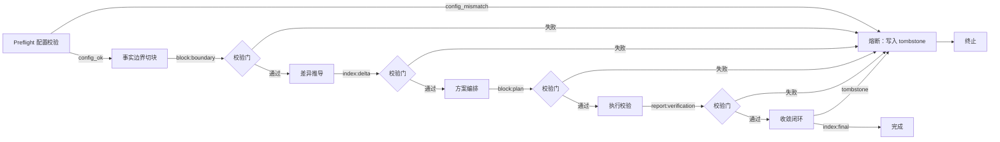

# 任务类型: eng

下面直接给机制，默认你给的锚定为真，不重复论证。

## 1. 链式推演的单位

- 一个“核心议题” = 一次需要被记忆脑接受的事实变更。
- 一个“轮” = 一个可独立提交、可校验的推理任务。
- 任务依赖图 = 由不可变块之间的 `refs` 组成的 DAG，不是进程实例。
- 轮与轮之间只传“块引用 / index”，不传整个文件。

---

## 2. 标准 5 轮链

| 轮 | 名称 | 输入 | 输出 |
|---|---|---|---|
| R1 | 事实边界切块 | 核心议题 + 当前 DAG 索引 | `block:boundary` |
| R2 | 差异推导 | R1 输出 + 远端索引 | `index:delta` |
| R3 | 方案编排 | R2 输出 + 约束 | `block:plan` |
| R4 | 执行校验 | R3 输出 + 执行通道 | `report:verification` |
| R5 | 收敛闭环 | R4 输出 + 超时/冲突记录 | `index:final` 或 `tombstone` |

每轮内部仍然走既有流程：

```text
Detect -> Diff -> Commit
```

也就是每个轮内部不是黑盒，而是完整的“检测 → 比较 → 提交”三节点流程。

---

## 3. 任务依赖图



其中：

- 每个节点是一个“轮”。
- 边表示上一轮输出作为下一轮输入。
- 校验门不是额外任务，而是每轮 `Commit` 的最后一步。
- `Abort` 不是进程，而是一个不可变的 `tombstone` 顶点。

---

## 4. 压缩与扩展

- 简单议题可压缩为 3 轮：

```text
Detect 轮 = R1 + R2
Diff 轮   = R3
Commit 轮 = R4 + R5
```

- 复杂议题用标准 5 轮。
- 超过 5 轮说明切块粒度不对，应该回到 R1 重新切块，而不是无限加长链条。

---

## 5. 避坑落地

### 配置修改后未生效

新增配置必须同步修改读取点。因此在 R1 前加 `R0 Preflight`：

- 每个轮声明自己依赖的配置键。
- 新增配置后，必须同步更新相关读取点，否则 R0 报 `config_mismatch`。
- 修改配置后，先跑一个 canary 小任务，验证行为确实变化；验证通过后才允许正式链启动。

### API 调用超时

每个轮执行前设置 `timeout_budget`：

- 使用 B 模型 turbo：300 秒。
- 使用 A 模型：600 秒。

超时后不重试，不写部分块，只写 `tombstone:timeout`，后续轮全部跳过。  
这是负熵输入的保险丝：不能把混乱固化进记忆脑。

### 校验机制

每轮提交前必须通过三道校验：

1. 哈希校验：块 ID 是否等于内容哈希。
2. 结构校验：输出是否符合 `block / index / tombstone` 的 schema。
3. 来源校验：`refs` 是否只指向已验证的上游块。

校验失败即冲突，按熔断处理。