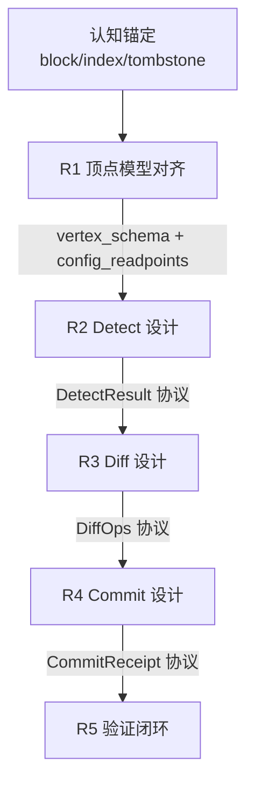

# 任务类型: eng

## 链式推演机制：Supabase 记忆脑增量同步方案

以下直接基于锚定推演，不重复论证。

### 0. 推演输入

- 同步单位是 `block`，不是 `file`
- 文件只是「有序 block id 列表」的索引
- 不存同步任务记录，只存 `block / index / tombstone` 顶点
- 运行期流程固定：`Detect → Diff → Commit`，每节点三转，共九转
- 避坑约束：
  - 新增配置必须同步修改读取点，修改后立即验证生效
  - API 调用按模型预设 timeout：B-turbo 用 300 秒，A 模型用 600 秒

---

### 1. 设计期任务依赖图

将核心议题拆成 5 轮递进，上一轮输出作为下一轮输入。

---

### 2. 五轮递进设计表

| 轮次 | 核心问题 | 输入 | 输出 | 验证点 |
|---|---|---|---|---|
| R1 | 顶点模型和配置读取点是什么 | 锚定 1-4 | `vertex` schema、`config_readpoints` 清单 | 用 3 个 block 的最小 fixture 验证「文件只是 index」 |
| R2 | Detect 如何发现变化 | R1 输出 | `DetectResult` 协议 | 构造新增/删除/索引顺序变化，只检出 block 级变化 |
| R3 | Diff 如何生成最小 patch | R2 输出 | `DiffOps` 协议 | 验证无悬空 block_id，tombstone 覆盖正确 |
| R4 | Commit 如何原子写入 | R3 输出 | Commit 协议 | 事务内写 `block/index/tombstone`，读回一致 |
| R5 | 如何验证生效和闭环 | R4 输出 | 验证清单 + 健康指标 | 配置修改后立即验证生效，超时策略生效 |

---

### 3. 运行期九转设计

运行期固定为 `Detect → Diff → Commit`，每节点三转。

#### Detect 节点

| 转 | 任务 | 产物 |
|---|---|---|
| D1 | 读取本地/远程的 `block/index/tombstone` 顶点版本 | 顶点版本快照 |
| D2 | 比对版本，生成候选变更集合 | pending vertices |
| D3 | 验证候选集合是 block 级，且无文件级漏检 | `DetectResult` |

#### Diff 节点

| 转 | 任务 | 产物 |
|---|---|---|
| F1 | 加载候选顶点内容 | 内容快照 |
| F2 | 生成 diff 操作 | `upsert_block` / `update_index` / `add_tombstone` |
| F3 | 验证 diff 与 `DetectResult` 一致，且索引无悬空 | `DiffOps` |

#### Commit 节点

| 转 | 任务 | 产物 |
|---|---|---|
| C1 | 开启 Supabase 事务，锁定相关顶点 | 事务快照 |
| C2 | 写入 `block/index/tombstone` 顶点并更新版本 | 顶点变更 |
| C3 | 读回已提交顶点验证一致；失败回滚 | `CommitReceipt` |

> 运行期不写 `sync_tasks` 表，也不写同步任务记录。  
> 状态只体现在 `block / index / tombstone` 顶点的版本上。

---

### 4. 避坑映射

| 历史失败 | 预防机制 |
|---|---|
| 配置修改后未生效 | 每个配置项必须登记 `config_readpoint`；修改后立即跑 smoke test，验证行为确实变化 |
| API 调用超时 | 所有模型/API 调用节点预设 timeout：B-turbo = 300s，A 模型 = 600s；超时不无限等待，按预设策略失败或重试 |

---

### 5. 设计引擎通用规则

1. 每个核心议题先对齐已有认知锚定。
2. 拆成 3-5 轮递进，每轮输出是下一轮输入。
3. 每轮内部遵循「读状态 → 计算变换 → 验证写回」三转。
4. 输出是一张任务依赖图 DAG，边代表输出工件依赖。
5. 运行期只落 `block/index/tombstone` 顶点，不落任务记录。