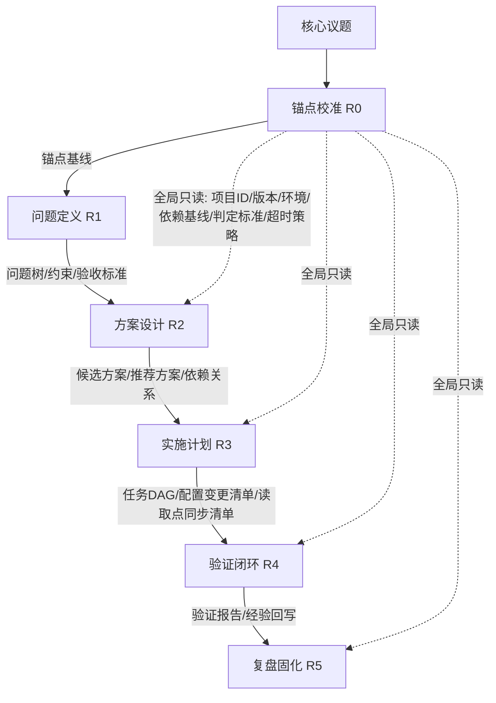

# 任务类型: eng

以下是一套可落地的**链式推演机制**，核心思想是：**先校准锚点，再优化链路**。  
把核心议题拆成 3-5 轮递进，每轮输出有严格契约，并被下一轮消费；锚点基线作为全局只读输入，贯穿始终。

## 1. 任务依赖图（标准 4 轮推演链）



> R0 是前置锚点校准，不计入 3-5 轮推演；3 轮可省略 R3，5 轮则加 R5。

---

## 2. 轮次定义与输入输出契约

| 轮次 | 核心动作 | 输出 | 被谁消费 |
|---|---|---|---|
| **R0 锚点校准** | 校验项目ID、版本、环境、依赖基线、判定标准、block顺序规则；识别任务类型；预设超时策略 | 锚点基线：`project_id`、`version`、`env`、`dependency_baseline`、`acceptance_criteria`、`timeout_policy` | 所有后续轮次 |
| **R1 问题定义** | 拆解问题树，明确约束和边界 | 问题树、约束清单、验收标准 | R2 |
| **R2 方案设计** | 生成候选方案；按判定标准选型；考虑并发/缓存/超时/重试/哈希/传输效率等杠杆 | 候选方案、推荐方案、方案依赖关系 | R3 |
| **R3 实施计划** | 拆解任务DAG；生成配置变更清单；同步修改配置读取点 | 任务DAG、配置变更清单、读取点同步清单、超时配置 | R4 |
| **R4 验证闭环** | 执行任务DAG；验证配置是否生效；检查是否达到验收标准 | 验证报告、回滚建议、经验回写 | R5 / 最终交付 |
| **R5 复盘固化** | 把经验回写到锚点基线/模板库/配置基线 | 更新后的锚点基线、最佳实践 | 新任务 |

---

## 3. 拆轮规则：3/4/5 轮

- **3 轮**：问题定义 → 方案设计 → 验证闭环  
  适合锚点校准类、简单议题。

- **4 轮**：问题定义 → 方案设计 → 实施计划 → 验证闭环  
  适合标准链路优化任务。

- **5 轮**：问题定义 → 方案设计 → 实施计划 → 验证闭环 → 复盘固化  
  适合复杂议题，需要沉淀经验。

如果 5 轮仍然无法收敛，说明核心议题过大，应在 R1 阶段拆成子议题，再分别起链。

---

## 4. 防坑机制内建

### 4.1 锚点错误防护

- R0 未通过校验，禁止进入 R1。
- 每个轮次输出必须回显锚点指纹：`project_id + version + env`。
- 推演过程中如果发现项目ID、版本、环境变化，必须返回 R0 重新校准。

### 4.2 配置修改后未生效防护

在 R3 中强制生成：

```text
config_change_list:
  - key: recall.cache.size
    value: 10000
    reader_point: CacheManager.get(key)
    must_sync: true
```

规则：**新增配置必须同步修改读取点**。  
R4 中必须执行“配置生效验证”：修改后立即调用读取点验证，而不是最后一起看结果。

### 4.3 API 调用超时防护

R0 的 `timeout_policy` 作为全局只读配置：

| 模型/任务类型 | 超时时间 |
|---|---|
| B 模型 turbo | 300 秒 |
| A 模型 | 600 秒 |
| 外部 API | 按任务类型预设 |

每个 API 调用必须显式传 timeout，不能依赖默认值；超时后按重试策略处理，重试不超过 2 次；仍失败则终止本轮，并回退到上一稳定输出。

---

## 5. 一句话总结

> **链式推演 = R0 锚点校准 + 3-5 轮严格输入输出递进 + 上一轮输出作为下一轮输入 + 配置/超时/验证强约束。**

先把坐标系原点校准，再沿着任务依赖图推进；否则所有优化都是在错误的地图上跑。