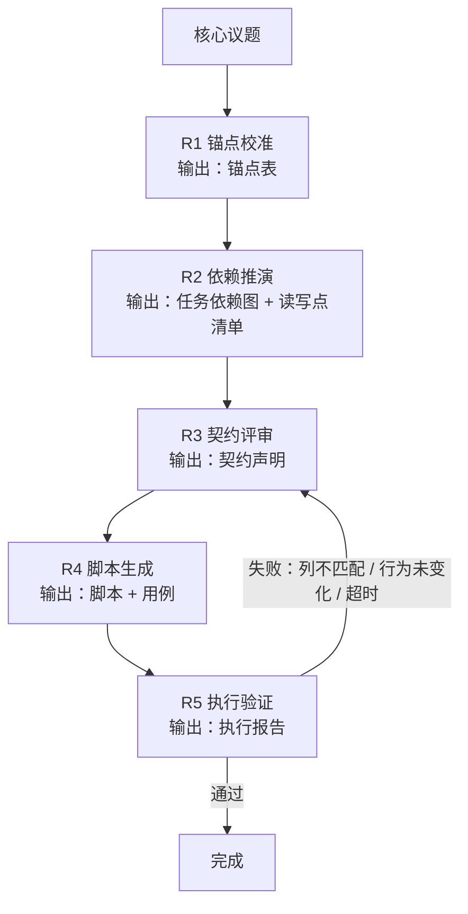
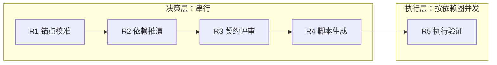
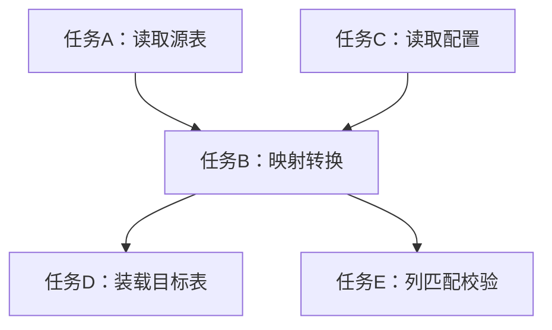

# 任务类型: eng

## 链式推演机制：5轮递进

核心原则：**决策串行，执行并发；先校准锚点，再优化链路。**

一个核心议题拆成 5 轮，每轮输出作为下一轮输入：

---

### 五轮定义

| 轮次 | 名称 | 输入 | 输出 | 关键校验点 |
|---|---|---|---|---|
| R1 | 锚点校准 | 核心议题 | 列契约锚点表 | 所有涉及的表、列、关联键必须有明确来源，不允许“执行层再猜” |
| R2 | 依赖推演 | 锚点表 | 任务依赖图 + 读写点清单 | 依赖图无环；每个任务都有明确读点和写点；配置修改必须同步修改读取点 |
| R3 | 契约评审 | 任务依赖图 + 读写点清单 | 契约声明 | 每条任务的输入列、输出列、关联键、过滤条件、超时策略全部拍板 |
| R4 | 脚本生成 | 契约声明 | 可执行脚本 + 自测用例 | 严格按契约翻译，禁止自行简化；列名与契约一致 |
| R5 | 执行验证 | 脚本 + 任务依赖图 | 执行报告 | 列匹配通过；行为变化真实发生；耗时不超过预设 timeout |

---

## 轮次依赖图

---

## 任务依赖图（R2 产物）

R2 生成的任务依赖图是 R5 并发调度的依据：

任务级依赖示例：

- 同一层无依赖的任务可并行：例如 TaskA、TaskC 可并行。
- 有依赖的任务必须等上游完成：例如 TaskB 必须等 TaskA/TaskC 完成。
- 并行只发生在契约确定之后，不允许提前并发执行。

---

## 防坑映射

| 历史失败经验 | 本机制的拦截方式 |
|---|---|
| 配置修改后未生效 | R2 强制维护“读写点清单”；R5 验证“行为是否真的变化”；未变化则回炉 |
| API 调用超时 | R3 契约声明中预设 timeout；R4/R5 按模型类型执行：B 模型 turbo 用 300 秒，A 模型用 600 秒；超时即失败，不无限等待 |
| 简化版 SQL 导致列不匹配 | R1 锚点表锁定列契约；R3 契约声明明确输入/输出列；R4 禁止自行简化；R5 做列匹配校验 |
| 列映射被推给执行层 | R3 在决策层完成所有列映射；R4 执行层只负责翻译契约，不做业务决策 |

---

## 使用规则

1. **先校准锚点，再优化链路**  
   R1 未完成前，不进入 R2；锚点不清晰时，不讨论任务依赖优化。

2. **决策串行，执行并发**  
   R1 → R2 → R3 → R4 严格串行；R5 内任务按依赖图并发。

3. **禁止自行简化**  
   脚本必须严格按契约生成；如果契约冗余，只能回 R3 修改契约，不允许在脚本中省略。

4. **修改即验证**  
   任何配置或契约修改，必须同步更新所有读取点，并在下一轮执行后立即验证生效。

5. **超时即失败**  
   所有模型调用和任务执行都预设 timeout，超时后按失败处理，避免长时间挂起。