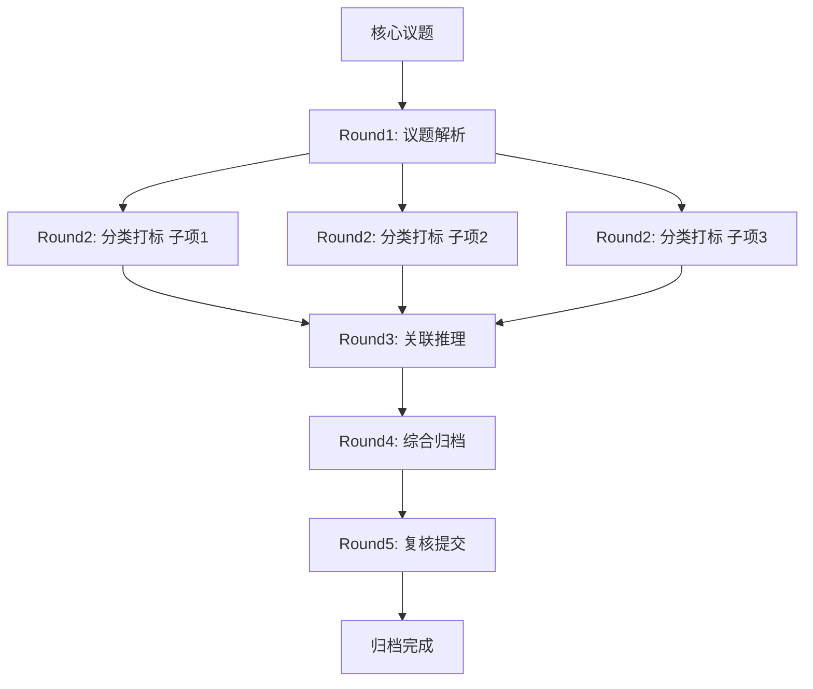

# 任务类型: eng

下面直接给出一套可落地的“自动归档系统”设计，不再重复论证已知结论。

## 1. 总体边界

- **并发只发生在 API 调用层**：分类、打标、推理等模型调用可并发。
- **后处理只有一个逻辑消费者**：状态推进、结果聚合、子任务创建都串行。
- **API 调用层只写 `classification_results`**：不直接改 `tasks` 状态。
- **任务状态变更必须原子化**：用版本号做乐观锁。
- **配置变更必须版本化，且修改后立即验证**：避免“改了没生效”。

```
并发 API 调用层
   │
   │ 只 insert
   ▼
classification_results
   │
   │ 单消费者轮询
   ▼
Orchestrator（后处理/状态机）
   │
   │ 原子更新 + 版本仲裁
   ▼
tasks / 下一轮任务 / 归档 outbox
```

---

## 2. 核心表结构

### `tasks`

```sql
CREATE TABLE tasks (
  task_id            BIGSERIAL PRIMARY KEY,
  core_topic         TEXT NOT NULL,
  status             TEXT NOT NULL,
  -- pending / running / awaiting_result / archiving / archived / failed
  version            BIGINT NOT NULL DEFAULT 0,
  current_round      INT NOT NULL DEFAULT 1,
  config_snapshot_id BIGINT NOT NULL,
  created_at         TIMESTAMPTZ NOT NULL DEFAULT now(),
  updated_at         TIMESTAMPTZ NOT NULL DEFAULT now()
);
```

### `classification_results`

只追加，不修改。

```sql
CREATE TABLE classification_results (
  result_id       BIGSERIAL PRIMARY KEY,
  task_id         BIGINT NOT NULL,
  round_no        INT NOT NULL,
  parent_result_id BIGINT,
  request_id      UUID NOT NULL UNIQUE,
  task_version    BIGINT NOT NULL,
  model_code      TEXT NOT NULL,
  timeout_ms      INT NOT NULL,
  status          TEXT NOT NULL,
  -- success / failed_timeout / failed_error / late_duplicate
  output          JSONB,
  cost_units      NUMERIC,
  created_at      TIMESTAMPTZ NOT NULL DEFAULT now()
);
```

### `task_dependencies`

记录上一轮输出到下一轮任务的依赖边。

```sql
CREATE TABLE task_dependencies (
  task_id             BIGINT NOT NULL,
  depends_on_result_id BIGINT NOT NULL,
  round_no            INT NOT NULL,
  PRIMARY KEY (task_id, depends_on_result_id)
);
```

### `model_profiles`

```sql
CREATE TABLE model_profiles (
  model_code      TEXT PRIMARY KEY,
  timeout_seconds INT NOT NULL,
  base_price      NUMERIC NOT NULL,
  gamma_A         NUMERIC NOT NULL DEFAULT 1
);
```

- `B_turbo`：timeout 300s，base_price = 1
- `A`：timeout 600s，base_price = `gamma_A * 1`

计价公式：

\[
\text{cost}(A) = \gamma_A \cdot \text{cost}(B\_turbo)
\]

A 更贵不是因为它更快，而是因为它占用稀缺的紧急调度资源；如果 A 计算更重，则：

\[
\gamma_A = \gamma_{\text{reserve}} \cdot \gamma_{\text{compute}}
\]

---

## 3. 并发 API 调用层

职责：

1. 从 `tasks` 读取待执行轮次。
2. 根据 `model_profiles` 设置 timeout。
3. 并发调用分类/打标 API。
4. 无论成功、超时、失败，都往 `classification_results` 插入一条结果。
5. **不修改任何任务状态**。

伪代码：

```text
for each sub_item in round_items:
    request_id = uuid()
    timeout = model_profiles[model_code].timeout_seconds

    go func() {
        resp, err = call_api(sub_item, timeout)

        if err != nil:
            insert classification_results(
                task_id, round_no, request_id,
                task_version, model_code, timeout_ms,
                status = "failed_timeout"
            )
        else:
            insert classification_results(
                task_id, round_no, request_id,
                task_version, model_code, timeout_ms,
                status = "success",
                output = resp
            )
    }()
```

注意：

- 用 `request_id` 做幂等键。
- 超时后如果响应迟到，写入 `late_duplicate`，不参与后续处理。
- API 调用层的数据库账号只授予 `classification_results` 的 INSERT 权限。

---

## 4. 单消费者后处理 Orchestrator

Orchestrator 是唯一的任务状态推进者。

它按 `result_id` 顺序消费 `classification_results`，处理逻辑：

```text
for each unprocessed result:

    task = SELECT * FROM tasks WHERE task_id = result.task_id

    if result.task_version != task.version:
        mark result as stale
        continue

    if result.status != "success":
        handle failure / retry
        continue

    append result to round_accumulator

    if round_accumulator.complete(round_no):

        BEGIN TRANSACTION

        UPDATE tasks
        SET status = 'running',
            current_round = current_round + 1,
            version = version + 1
        WHERE task_id = task.task_id
          AND version = task.version;

        if rowcount == 0:
            ROLLBACK
            return conflict

        INSERT INTO task_dependencies(...)
        INSERT INTO next_round_tasks(...)

        COMMIT
```

### 原子化状态变更

所有状态更新都带版本仲裁：

```sql
UPDATE tasks
SET status = 'archived',
    version = version + 1
WHERE task_id = ?
  AND version = ?
```

如果 `rowcount = 0`，说明有冲突，重新读取任务，重新仲裁。

---

## 5. 配置同步与避坑

### 配置版本化

配置不直接用本地静态文件，而是通过 `ConfigService` 读取：

```text
config_key, config_value, config_version
```

业务代码必须显式读取配置：

```text
timeout = ConfigService.Get("model.B_turbo.timeout").value
```

### 新增配置必须同步修改读取点

如果只往配置中心加配置，但业务代码没有读取点，等于没配。

所以每次加配置时，必须同时满足：

1. 配置中心新增配置项。
2. 相关代码路径增加 `ConfigService.Get(...)`。
3. 发布后立即跑一次 smoke test。
4. smoke test 必须输出 `config_version`，确认读取到的是新版本。

### 修改后立即验证

```text
ConfigService.Publish("model.A.timeout", 600)
SmokeTester.Run("test_task")
```

如果 smoke test 没有体现新配置，则回滚配置版本。

---

## 6. 链式推演机制

一个核心议题拆成 3-5 轮递进：

- 上一轮输出写入 `classification_results`。
- 下一轮任务通过 `task_dependencies` 依赖上一轮结果。
- 后处理消费者在上一轮结果提交后，创建下一轮任务。

默认 5 轮：

```text
Round 1: 议题解析
Round 2: 分类打标（可并发）
Round 3: 关联推理
Round 4: 综合归档
Round 5: 复核提交
```

### 计划模板示例

```json
{
  "plan": "archive_chain_v1",
  "rounds": [
    {
      "round": 1,
      "name": "decompose",
      "model": "B_turbo",
      "timeout": 300,
      "fan_out": 1
    },
    {
      "round": 2,
      "name": "classify",
      "model": "B_turbo",
      "timeout": 300,
      "fan_out": "from_round_1.items"
    },
    {
      "round": 3,
      "name": "reason",
      "model": "A",
      "timeout": 600,
      "fan_in": "all_round_2"
    },
    {
      "round": 4,
      "name": "archive_decision",
      "model": "A",
      "timeout": 600,
      "fan_out": 1
    },
    {
      "round": 5,
      "name": "review",
      "model": "B_turbo",
      "timeout": 300,
      "fan_out": 1
    }
  ]
}
```

---

## 7. 任务依赖图



依赖图特点：

- 有向无环图。
- 边表示“上一轮输出结果 → 下一轮任务输入”。
- 每一轮的输出结果都先写入 `classification_results`。
- 下一轮任务只有在依赖结果全部提交后才会创建。
- 同一个任务的所有状态推进都由单消费者 Orchestrator 完成。

---

## 8. 外部归档同步的版本仲裁

最终归档时，不能无脑写外部存储。

用同一个版本号做仲裁：

```text
ArchiveSyncWorker.read(outbox)

response = archive_storage.put(
    key = task_id,
    body = archive_package,
    if_match = task.version
)

if response.conflict:
    remote_version = archive_storage.get_version(task_id)
    if remote_version > task.version:
        # 外部已有更新版本，人工/规则仲裁
        task.status = "failed_conflict"
    else:
        # 可以覆盖
        retry
```

---

## 9. 落地检查清单

- [ ] API 调用层只有 `classification_results` 的写权限。
- [ ] 任务状态更新全部走版本号乐观锁。
- [ ] 后处理只有一个逻辑消费者。
- [ ] B_turbo 超时 300s，A 超时 600s。
- [ ] A 模型计价为 `gamma_A * base_price`。
- [ ] 配置发布后立即跑 smoke test。
- [ ] 每个新增配置都确认有读取点。
- [ ] 链式推演每一轮都写入 `classification_results`。
- [ ] 外部归档同步带 `if_match` 版本仲裁。