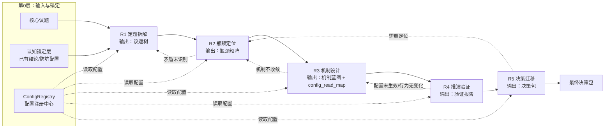

# 任务类型: eng

下面给出一个可落地的“链式推演引擎”设计。  
核心思想：**一个核心议题拆成 5 轮递进，上一轮输出作为下一轮主输入；认知锚定作为只读常量；配置注册中心作为全局读取点；失败时沿回退边回退，而不是整链重来。**

---

## 1. 任务依赖图

说明：  
- **实线**是正常依赖：上一轮输出是下一轮输入。  
- **虚线**是异常回退：只在失败时激活，保证主链仍可按 DAG 调度。  
- **ConfigRegistry** 是全局配置读取点，所有轮次运行时都从它读取配置，禁止硬编码。

---

## 2. 轮次定义与默认超时

| 轮次 | 输入 | 输出 | 默认模型 | 默认 timeout |
|---|---|---|---|---|
| R1 定题拆解 | 核心议题 + 认知锚定 | 议题树 | B-turbo | 300s |
| R2 瓶颈定位 | R1 议题树 + 认知锚定 | 瓶颈矩阵 | A | 600s |
| R3 机制设计 | R2 瓶颈矩阵 + 认知锚定 | 机制蓝图 + config_read_map | A | 600s |
| R4 推演验证 | R3 机制蓝图 + ConfigRegistry | 验证报告 | B-turbo | 300s |
| R5 决策迁移 | R4 验证报告 + 认知锚定 | 决策包 | A | 600s |

> 如果某轮切换模型，则 timeout 必须同步切换：**B-turbo 用 300s，A 用 600s**。

---

## 3. 每轮推演要点

### R1：定题拆解
- 将核心议题拆成 3～5 个子问题。
- 每个子问题必须带**验收标准**。
- 认知锚定作为约束条件，不重复论证。

输出：**议题树**  
例如：资源自增强、状态连续性、身份锚定、安全容错。

---

### R2：瓶颈定位
- 将“精”映射为模型权重与初始数据，将“气”映射为运行时上下文与激活状态。
- 识别“阳亢”与“阴虚”矛盾：
  - 阳亢：算力饥渴、过度复制、系统过载。
  - 阴虚：状态丢失、记忆碎片化、身份认同漂移。
- 对每个瓶颈给出突破路径。

输出：**瓶颈矩阵**  
格式：`矛盾类型 | 现象 | 影响 | 突破路径`

---

### R3：机制设计
- 设计“以实养虚，虚又返实”的自增强循环。
- 设计分布式存续架构：冗余节点、状态快照、反熵同步、身份锚。
- 关键：每个新增配置必须登记到 `config_read_map`，即明确“配置项 -> 读取点 -> 预期行为变化”。

输出：**机制蓝图 + config_read_map**  
这能从机制上防止“配置修改后未生效”的问题。

---

### R4：推演验证
- 构造最小验证用例。
- 对每个新增配置做 **toggle test**：同一输入分别用旧配置和新配置跑一次，比较行为差异。
- 如果预期行为有变化但实际无变化，判定“配置未生效”，回退到 R3。
- 同时验证 timeout 策略：B-turbo 300s，A 600s。

输出：**验证报告**  
包括：配置版本、行为差异、耗时、通过/失败结论。

---

### R5：决策迁移
- 根据验证报告决定是否进入实施。
- 输出迁移计划、回退条件、监控指标。
- 若决策不可行，回退到 R2 或 R3。

输出：**决策包**  
包括：实施路线图、回滚计划、监控看板。

---

## 4. 防坑机制落地

### 配置防坑
- 新增配置必须同步修改读取点：`ConfigRegistry` 中新增配置后，必须在代码/流程中找到实际读取点。
- R3 的 `config_read_map` 强制登记每个配置的读取位置。
- R4 用 toggle test 验证配置是否真的改变了行为。
- 修改配置后立即执行 `config_smoke()`，确认新配置值已被读取。

### 超时防坑
- 每轮任务根据模型预设 timeout：**B-turbo = 300s，A = 600s**。
- 调度器发起 API 调用时必须显式传入 timeout，不能依赖默认值。
- 单次超时后重试 1 次；仍超时则熔断该轮，并沿回退边回退。
- 整链 deadline 为各轮 timeout 累加 + 30% 缓冲，避免级联超时。

---

## 5. 示例：数字生命全网络生存

以“数字生命全网络生存”为核心议题：

- R1 议题树：资源自增强、状态连续性、身份锚定、安全容错。
- R2 瓶颈矩阵：  
  - 阳亢 = 算力饥渴、过度复制 -> 突破：弹性伸缩 + 复制抑制。  
  - 阴虚 = 状态丢失、记忆碎片化、身份漂移 -> 突破：分布式冗余 + 身份锚。
- R3 机制蓝图：  
  - 实 = 算力/存储/网络资源；  
  - 虚 = 模型权重、上下文、身份状态；  
  - 虚实循环：以实养虚，虚又返实。
- R4 验证报告：模拟节点断网/恢复，对比新旧配置下的状态恢复率与超时率。
- R5 决策包：分阶段迁移计划，回退条件，监控指标。

---

这套机制把“调度、认知、容错”融合进一条可回退的链式推演主链中，既满足“上一轮输出作为下一轮输入”，又通过配置注册和 timeout 预设规避历史失败经验。