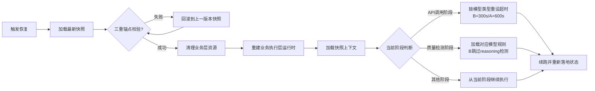

# 任务类型: eng

# V7.5方舟引擎内部崩溃自动恢复机制设计方案
本方案严格遵循**已有认知锚定的虚实架构**、**历史避坑规则**与**坑库预警要求**，完全基于引擎内部实现，无外部守护进程依赖，核心逻辑贴合《道德经》「以实养虚，虚又返实」的哲学思想，同时规避锚点错位、语义流失等认知陷阱。

---

## 一、设计依据与对应关系
### 1. 贴合已有认知锚定（虚实架构）
| 道德经/认知锚定概念 | 本机制对应实体 | 说明 |
|----------------------|----------------|------|
| 【实】（炉鼎/有）：专业规则、边界明确的压缩结晶 | 原子持久化快照层 | 强类型、带完整上下文的状态快照，包含任务全链路前置条件、边界约束、系统状态，无模糊语义，是恢复的绝对锚点 |
| 【虚】（映射/无）：动态调度、逻辑执行 | 业务调度层/续跑调度层 | 基于状态快照动态生成执行链路，正常运行时不断落地状态（以实养虚），崩溃后由状态快照重建（虚又返实） |
| 弱者道之用的语义流失 | 强类型快照定义 | 用Protobuf强类型枚举替代模糊命名字段，避免因字段语义歧义导致的恢复错误 |
| 锚点错位导致链路崩塌 | 三重锚点校验机制 | 快照自带`task_id（任务锚点）+ version（版本锚点）+ crc32（完整性锚点）`，恢复前必须校验通过，避免类似「项目ID看错」的低级错误 |

### 2. 规避历史踩坑
| 历史坑点 | 规避方案 |
|----------|----------|
| 配置修改后未生效 | 所有配置（心跳间隔、超时阈值等）与持久化层绑定，修改配置同步更新快照并触发即时校验，读取点统一从持久化层拉取最新版本 |
| API调用超时 | 续跑时根据模型类型自动匹配超时：B模型(turbo)=300s，A模型=600s，超时策略与任务快照绑定，无统一硬编码 |
| 废稿检测误杀B模型 | 质量检测规则与模型标识强绑定，续跑时自动加载对应模型的独立规则，B模型(turbo)默认跳过reasoning占比检测 |

---

## 二、整体架构（四层内部闭环，无外部依赖）
整个恢复机制完全运行在引擎进程内部，通过**分层隔离**实现「微内核永不崩、业务层可快速恢复」：
```
┌───────────────────────────────────────────────────┐
│ 业务执行层（虚之动）：原V7.5方舟调度引擎            │
│  任务调度、API调用、质量检测，正常运行时落地状态    │
├───────────────────────────────────────────────────┤
│ 断点续跑调度层（虚之用）：崩溃恢复逻辑              │
│  状态重建、资源清理、续跑策略、模型规则适配         │
├───────────────────────────────────────────────────┤
│ 原子持久化层（实之体）：状态炉鼎                    │
│  双缓冲区原子写入、三重校验、快照版本管理           │
├───────────────────────────────────────────────────┤
│ 驻留微内核层（实之根）：内部守护单元                │
│  心跳检测、信号捕捉、崩溃触发，代码量<500行无复杂逻辑│
└───────────────────────────────────────────────────┘
```
> 核心特性：驻留微内核为进程内原生独立线程，拥有独立栈空间，与业务层完全隔离，仅做最基础的心跳检测与恢复触发，崩溃概率趋近于0，因此无需外部守护进程。

---

## 三、核心机制实现
### 1. 心跳检测：进程内无侵入式崩溃感知
#### 实现逻辑
- **心跳载体**：用`std::atomic<uint64_t>`原子变量作为心跳计数器，存放在进程全局内存区，与业务层栈空间隔离。
- **心跳上报**：业务层调度循环每1s（可配置）递增一次原子计数器，同时携带当前任务阶段标识。
- **超时判定**：微内核线程以100ms粒度轮询原子计数器，若连续3个心跳周期（默认3s，可配置）计数器未更新，判定业务层崩溃（覆盖死锁、空指针、栈溢出、逻辑死循环等场景）。
- **信号补全**：通过`sigaltstack`设置独立信号栈，捕捉`SIGSEGV`/`SIGABRT`/`SIGBUS`/`SIGFPE`等常见崩溃信号，信号处理函数直接触发微内核的恢复流程，避免栈溢出时信号处理失效。

#### 避坑适配
配置修改（如心跳间隔、超时阈值）时，同步更新持久化层的全局配置快照，微内核下次轮询时自动加载新配置，同时触发一次模拟心跳验证，确保配置立即生效。

---

### 2. 状态原子持久化：无歧义的恢复炉鼎
#### 快照格式（强类型，无语义流失）
采用Protobuf强类型序列化，所有字段为枚举/明确数值类型，杜绝模糊命名，快照包含完整上下文（避免锚点错位）：
```protobuf
// atomic_persistence/snapshot.proto
syntax = "proto3";

enum ModelType {
  MODEL_UNKNOWN = 0;
  MODEL_A = 1;       // A模型
  MODEL_B_TURBO = 2; // B模型turbo
}

enum TaskStage {
  STAGE_INIT = 0;
  STAGE_PROMPT_BUILD = 1;
  STAGE_API_CALL = 2;
  STAGE_QUALITY_CHECK = 3;
  STAGE_DONE = 4;
}

message TaskSnapshot {
  // 三重锚点
  fixed64 task_id = 1;       // 任务唯一ID（任务锚点）
  uint32 snapshot_version = 2; // 快照版本号（版本锚点）
  fixed32 crc32 = 3;         // 数据CRC校验（完整性锚点）

  // 完整任务上下文（全边界覆盖，无信息剥离）
  ModelType model_type = 4;
  TaskStage current_stage = 5;
  uint32 retry_count = 6;
  string request_id = 7;     // API幂等键
  uint64 api_send_time = 8;  // API发送时间戳
  uint32 api_timeout = 9;    // 对应模型的超时时间
  string input_prompt = 10;
  string partial_response = 11;
  bool skip_reasoning_check = 12; // B模型专属标记
  uint32 config_version = 13; // 绑定的配置版本
}
```

#### 原子写入机制（杜绝半写损坏）
采用**双缓冲区+原子rename**方案，保证任意时刻至少有一个完好的快照：
1. 写入前先写`snapshot.next.tmp`文件，写完后计算CRC并填充到文件头，调用`fsync`强制落盘。
2. 将`snapshot.next.tmp`重命名为`snapshot.next`（POSIX系统下rename为原子操作）。
3. 再将`snapshot.current`重命名为`snapshot.last`，将`snapshot.next`重命名为`snapshot.current`。
4. 保留最近3个版本的快照，用于极端情况下的回滚。

#### 落盘时机
采用「定时落盘+关键事件触发」结合：
- 定时落盘：默认每5s异步落盘一次，不阻塞业务线程。
- 事件触发：每个任务阶段完成时（如prompt构建完、API发送后、质量检测完成后）立即落盘，确保崩溃后最多丢失1个阶段的执行进度。

---

### 3. 断点续跑：虚层重建的闭环逻辑
微内核触发恢复后，按以下流程执行，全程严格遵循模型规则与避坑要求：


#### 关键避坑点实现
1. **API超时适配**：续跑时若处于API调用阶段，先判断`api_send_time + api_timeout`是否已过期：
   - 未过期：保留原请求，继续等待响应，超时时间按模型类型自动对齐（B模型300s/A模型600s）。
   - 已过期：用原`request_id`幂等重试，重新设置对应模型的超时时间。
2. **质量检测规则适配**：续跑时若处于质量检测阶段，从快照读取`model_type`：
   - 若为`MODEL_B_TURBO`，自动过滤掉`reasoning_ratio`检测项，仅执行其他质量规则。
   - 若为其他模型，加载完整检测规则。
3. **配置一致性**：续跑时校验快照的`config_version`与当前全局配置版本，若为运行中任务则保留原配置，避免中途改配置导致逻辑异常，新任务自动使用最新配置。

---

## 四、完整代码架构（C++实现，原生线程隔离）
### 目录结构
```
v7.5_recovery_engine/
├── internal_daemon/          # 驻留微内核层（实之根）
│   ├── daemon.h              # 微内核对外接口
│   ├── daemon.cpp            # 心跳检测、信号处理、恢复触发
│   └── daemon_config.h       # 微内核配置（与持久化层绑定）
├── atomic_persistence/       # 原子持久化层（实之体）
│   ├── snapshot.proto        # 强类型快照定义
│   ├── persistence.h         # 持久化接口
│   └── persistence.cpp       # 双缓冲区写入、CRC校验、版本管理
├── resume_scheduler/         # 断点续跑调度层（虚之用）
│   ├── scheduler.h           # 恢复调度器接口
│   ├── scheduler.cpp         # 状态重建、续跑逻辑
│   ├── timeout_strategy.h    # 模型超时策略（B=300s/A=600s）
│   └── quality_rule_loader.h # 模型专属质量规则加载
├── business_engine/          # 业务执行层（虚之动，原V7.5引擎）
│   ├── engine.h              # 业务引擎接口
│   ├── task_scheduler.cpp    # 任务调度
│   ├── api_caller.cpp        # API调用
│   └── quality_checker.cpp   # 质量检测
└── main.cpp                  # 入口：启动微内核+初始化业务引擎
```

### 核心代码示例
#### 1. 驻留微内核核心逻辑（internal_daemon/daemon.cpp）
```cpp
#include <atomic>
#include <thread>
#include <csignal>
#include <cstring>
#include "daemon.h"
#include "persistence.h"
#include "scheduler.h"

// 全局心跳原子变量（与业务层隔离，存放在全局内存区）
std::atomic<uint64_t> g_heartbeat_counter = {0};
// 恢复标记
std::atomic<bool> g_crash_triggered = {false};

// 独立信号栈，处理栈溢出场景
static char g_signal_stack[SIGSTKSZ];

// 崩溃信号处理函数
void crash_signal_handler(int sig) {
    g_crash_triggered.store(true);
}

void Daemon::start() {
    // 注册信号处理+独立信号栈
    stack_t ss;
    ss.ss_sp = g_signal_stack;
    ss.ss_size = sizeof(g_signal_stack);
    ss.ss_flags = 0;
    sigaltstack(&ss, nullptr);

    struct sigaction sa;
    memset(&sa, 0, sizeof(sa));
    sa.sa_handler = crash_signal_handler;
    sa.sa_flags = SA_ONSTACK;
    sigaction(SIGSEGV, &sa, nullptr);
    sigaction(SIGABRT, &sa, nullptr);
    sigaction(SIGBUS, &sa, nullptr);
    sigaction(SIGFPE, &sa, nullptr);

    // 启动微内核检测线程（原生线程，与业务层runtime隔离）
    std::thread daemon_thread([this]() {
        uint64_t last_heartbeat = 0;
        uint32_t miss_count = 0;
        const uint32_t max_miss = 3; // 3次心跳超时判定崩溃

        while (true) {
            // 读取最新配置（从持久化层，保证配置修改即时生效）
            auto config = Persistence::instance().get_daemon_config();
            std::this_thread::sleep_for(std::chrono::milliseconds(config.poll_interval_ms));

            // 检测信号触发的崩溃
            if (g_crash_triggered.load()) {
                do_recovery();
                g_crash_triggered.store(false);
                last_heartbeat = g_heartbeat_counter.load();
                miss_count = 0;
                continue;
            }

            // 检测心跳超时
            uint64_t current = g_heartbeat_counter.load();
            if (current == last_heartbeat) {
                miss_count++;
                if (miss_count >= max_miss) {
                    do_recovery();
                    miss_count = 0;
                }
            } else {
                last_heartbeat = current;
                miss_count = 0;
            }
        }
    });
    daemon_thread.detach();
}

// 业务层心跳上报接口（供业务层调用）
void Daemon::report_heartbeat() {
    g_heartbeat_counter.fetch_add(1);
}

void Daemon::do_recovery() {
    // 1. 暂停业务层所有线程
    BusinessEngine::instance().pause();
    // 2. 调用续跑调度器执行恢复
    ResumeScheduler::instance().recover();
    // 3. 恢复业务层运行
    BusinessEngine::instance().resume();
}
```

#### 2. 原子持久化写入逻辑（atomic_persistence/persistence.cpp）
```cpp
#include "persistence.h"
#include <fstream>
#include <crc32c/crc32c.h>
#include <unistd.h>

bool Persistence::save_snapshot(const TaskSnapshot& snapshot) {
    // 1. 序列化快照
    std::string serialized;
    if (!snapshot.SerializeToString(&serialized)) {
        return false;
    }

    // 2. 计算CRC（填充到快照头部）
    uint32_t crc = crc32c::Crc32(serialized.data(), serialized.size());
    TaskSnapshot final_snapshot = snapshot;
    final_snapshot.set_crc32(crc);
    std::string final_data;
    final_snapshot.SerializeToString(&final_data);

    // 3. 写入临时文件
    const std::string tmp_path = snapshot_dir_ + "/snapshot.next.tmp";
    std::ofstream ofs(tmp_path, std::ios::binary | std::ios::trunc);
    if (!ofs.is_open()) return false;
    ofs.write(final_data.data(), final_data.size());
    ofs.flush();
    fsync(fileno(ofs)); // 强制落盘
    ofs.close();

    // 4. 原子rename为next
    const std::string next_path = snapshot_dir_ + "/snapshot.next";
    if (rename(tmp_path.c_str(), next_path.c_str()) != 0) {
        return false;
    }

    // 5. 原子替换current
    const std::string current_path = snapshot_dir_ + "/snapshot.current";
    const std::string last_path = snapshot_dir_ + "/snapshot.last";
    rename(current_path.c_str(), last_path.c_str());
    rename(next_path.c_str(), current_path.c_str());

    return true;
}

std::optional<TaskSnapshot> Persistence::load_latest_snapshot() {
    const std::string current_path = snapshot_dir_ + "/snapshot.current";
    TaskSnapshot snapshot;
    std::ifstream ifs(current_path, std::ios::binary);
    if (!ifs.is_open()) return std::nullopt;
    std::string data((std::istreambuf_iterator<char>(ifs)), std::istreambuf_iterator<char>());
    ifs.close();

    if (!snapshot.ParseFromString(data)) {
        return load_last_snapshot(); // 损坏则回滚上一版本
    }

    // 三重校验：CRC + task_id非零 + 版本号合法
    uint32_t stored_crc = snapshot.crc32();
    snapshot.clear_crc32();
    std::string data_no_crc;
    snapshot.SerializeToString(&data_no_crc);
    uint32_t calc_crc = crc32c::Crc32(data_no_crc.data(), data_no_crc.size());
    if (calc_crc != stored_crc || snapshot.task_id() == 0 || snapshot.snapshot_version() == 0) {
        return load_last_snapshot();
    }

    snapshot.set_crc32(stored_crc);
    return snapshot;
}
```

#### 3. 续跑调度器恢复逻辑（resume_scheduler/scheduler.cpp）
```cpp
#include "scheduler.h"
#include "persistence.h"
#include "timeout_strategy.h"
#include "quality_rule_loader.h"
#include "engine.h"

bool ResumeScheduler::recover() {
    // 1. 加载并校验最新快照
    auto snapshot_opt = Persistence::instance().load_latest_snapshot();
    if (!snapshot_opt.has_value()) {
        // 无有效快照则冷启动
        BusinessEngine::instance().init();
        return true;
    }
    TaskSnapshot snapshot = snapshot_opt.value();

    // 2. 清理业务层资源（内存、连接、句柄）
    BusinessEngine::instance().cleanup();

    // 3. 重建业务层运行时
    BusinessEngine::instance().init();

    // 4. 加载快照上下文
    BusinessEngine::instance().load_context(snapshot);

    // 5. 按阶段适配规则后续跑
    switch (snapshot.current_stage()) {
        case STAGE_API_CALL: {
            // 按模型类型设置超时（避坑：B=300s/A=600s）
            uint32_t timeout = TimeoutStrategy::instance().get_timeout(snapshot.model_type());
            BusinessEngine::instance().set_api_timeout(timeout);
            // 幂等重试/继续等待
            BusinessEngine::instance().resume_api_call(snapshot.request_id());
            break;
        }
        case STAGE_QUALITY_CHECK: {
            // 加载模型专属质量规则（避坑：B模型跳过reasoning检测）
            auto rules = QualityRuleLoader::instance().get_rules(snapshot.model_type());
            BusinessEngine::instance().set_quality_rules(rules);
            BusinessEngine::instance().resume_quality_check();
            break;
        }
        default:
            BusinessEngine::instance().resume_from_stage(snapshot.current_stage());
            break;
    }

    // 6. 恢复后立即落盘新快照，标记恢复成功
    BusinessEngine::instance().trigger_snapshot();
    return true;
}
```

---

## 五、验证方案
### 1. 功能验证
| 验证场景 | 预期结果 |
|----------|----------|
| 业务层空指针崩溃 | 微内核在3s内检测到，自动恢复到上一个快照，任务从断点续跑 |
| 业务层死锁 | 心跳超时后自动触发恢复，重建业务层，任务续跑 |
| 快照写入时断电/杀进程 | 重启后current快照完好，无半写损坏，可正常恢复 |
| API调用阶段崩溃（B模型） | 恢复后自动设置300s超时，用原request_id幂等重试 |
| 质量检测阶段崩溃（B模型） | 恢复后自动跳过reasoning占比检测，不会误判废稿 |
| 修改心跳间隔配置 | 微内核在下一个轮询周期生效，立即触发模拟心跳验证 |

### 2. 性能验证
- 心跳检测开销：<0.1% CPU占用（100ms轮询原子变量）
- 快照落盘开销：异步写入，业务层阻塞时间<1ms
- 恢复耗时：<500ms（仅重建业务层上下文，无进程重启开销）

---

## 六、极端场景补充
对于`SIGKILL`、硬件掉电等**进程级消亡**的极端场景，本机制仍可通过「持久化快照+进程自启」实现恢复：进程下次启动时，微内核会自动读取磁盘上的快照并续跑，仅需系统级的开机自启配置（不属于守护进程范畴），核心恢复逻辑仍由引擎内部完成。