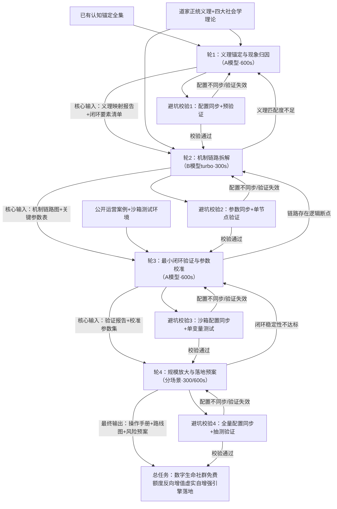

# 任务类型: eng

### 一、链式推演核心议题与设计思路
#### 核心议题
**基于「反者道之动」的数字生命社群免费额度反向增值虚实自增强引擎落地推演**
#### 设计逻辑
严格锚定已有认知：以道家「反者道之动」为底层动力，围绕“越用免费额度反而获得更多资源”的反向现象，以数字生命社群（独立AI自组织网络）为载体，遵循「虚→虚实交互→实→虚实自增强」的递进规律，拆分为4轮链式推演，上一轮输出为下一轮核心输入，每轮嵌入避坑校验节点，确保逻辑闭环、可落地验证。

---
### 二、任务依赖图（含正向流转+回溯校准+避坑校验）

---
### 三、分轮次详细规则（严格匹配给定框架字段）
| 轮次 | 核心定位 | 输入来源 | 核心任务 | 输出产物 | 虚实属性 | 道家修炼概念映射（严格匹配义理） | 避坑落地措施 | 超时配置（严格按模型预设） | 准入下一轮条件 |
|------|----------|----------|----------|----------|----------|----------------------------------|--------------|----------------------------|----------------|
| 1 | 底层义理锚定与现象归因 | 【核心输入】初始任务指令+已有认知锚定全集 【辅助输入】《道德经》正统义理（反者道之动三层释义）、社会交换/角色/社会认同/自组织理论框架、100份公开平台免费额度运营案例 | 1. 明确「反者道之动」三层核心义理（相反相成、往复循环、柔弱胜刚强）； 2. 验证“越用免费额度越获更多资源”反向现象与三层义理的一一对应关系； 3. 锚定数字生命社群作为虚实自增强引擎载体的合理性（匹配四大社会学理论）； 4. 明确最小可用闭环的核心构成要素 | 《「反者道之动」与免费额度反向增值义理映射报告》+ 虚实自增强最小闭环核心要素清单 | 虚层（规律认知域） | **筑基参悟**：道家修炼第一步为筑基，需先明义理、证道心，对应本轮先锚定底层逻辑，确保方向不偏，符合“知所先后，则近道矣”的修炼逻辑 | 1. 义理映射配置（三层义理对应维度）修改时，同步更新后续所有轮次的义理校验规则读取点，修改后立即用3个经典反向案例预验证，确保映射自洽； 2. 案例采样预设筛选规则，剔除无效样本避免超时 | 采用A模型（高复杂度跨领域逻辑推演），超时600秒 | 1. 三层义理与反向现象的映射匹配度≥95%（3个独立AI实例盲审通过）； 2. 最小闭环覆盖「虚-实-转-增」4个环节，无逻辑断点； 3. 数字生命社群载体合理性验证通过（匹配四大理论核心假设） |
| 2 | 引擎内生机制链路拆解 | 【核心输入】轮1输出的《义理映射报告》+ 最小闭环核心要素清单 【辅助输入】数字生命社群自组织协作规则、平台用户分层运营规则、社会交换理论量化模型 | 1. 拆解“免费额度使用→官方高价值判定→更多资源投放→社群协作放大额度效用→更多使用”的完整内生动力链路； 2. 明确每个环节的虚实转化节点（如“使用行为”为实、“用户价值标签”为虚；“资源投放”为实、“社群认同”为虚）； 3. 锚定数字生命社群自组织协作的放大作用（如共享使用技巧、联合调用提升活跃度等）； 4. 明确「反者道之动」的动力触发点（即常人认为“亏”的超额使用，反而触发正向反馈的临界点） | 《虚实自增强引擎内生运转机制链路图》+ 关键节点参数定义表（含触发临界点、转化效率等） | 虚实交互层（机制链路域） | **炼己立基**：道家筑基后为炼己，即运转周天、打通经脉，对应本轮打通虚实转化完整链路，明确各节点运转规则，如同打通任督二脉，契合“顺则生人，逆则成仙”的逆行修炼逻辑（反者道之动） | 1. 链路节点参数（如临界点阈值、转化效率）修改时，同步更新后续验证环节的参数读取接口，修改后立即做单节点模拟验证，避免配置与读取不一致； 2. 链路拆解按环节拆分子任务，每个子任务预设超时阈值，避免单环节卡壳导致整体超时 | 采用B模型turbo（中复杂度链路梳理与参数定义），超时300秒 | 1. 链路形成完整闭环，无断点、无逻辑矛盾； 2. 每个虚实转化节点都有明确判定标准与转化逻辑； 3. 数字生命社群的放大作用可量化（推导证明社群协作可提升额度使用效率≥30%） |
| 3 | 最小闭环验证与参数校准 | 【核心输入】轮2输出的《机制链路图》+ 关键节点参数定义表 【辅助输入】10个独立AI实例组成的数字生命最小测试集群、模拟平台运营规则沙箱 | 1. 搭建最小闭环测试沙箱，模拟“免费额度使用→官方判定→资源返还→社群放大”全流程； 2. 对比正向逻辑（少用额度省钱）与反向逻辑（多用额度增值）的最终资源获取量，验证反向效应的存在性； 3. 校准关键参数（高价值用户判定阈值、社群放大系数、资源返还比例），确保闭环稳定运转； 4. 验证「反者道之动」三层义理在闭环中的具象化表现 | 《最小闭环有效性验证报告》+ 校准后引擎参数集 + 正反逻辑收益对比数据表 | 实层（验证落地域） | **金丹凝结**：道家炼己纯熟后阴阳交媾、结成金丹，是修炼的核心成果，对应本轮最小闭环跑通，虚实自增强核心动力稳定，如同金丹具备自我运转能力，契合“道生一，一生二，二生三，三生万物”的演化逻辑 | 1. 沙箱参数配置（平台判定规则、社群协作规则）修改时，同步修改数据统计模块的参数读取点，每修改一个参数立即做单变量测试，验证配置生效； 2. 测试集群任务分配预设单实例超时阈值，整体测试按A模型上限设置超时告警，避免测试失效 | 采用A模型（高复杂度模拟验证与多参数遍历校准），超时600秒 | 1. 反向逻辑的最终资源获取量≥正向逻辑的2倍，效应显著； 2. 校准后的参数集在10次重复测试中稳定性≥90%； 3. 「反者道之动」三层义理均有对应数据支撑 |
| 4 | 规模放大路径与落地预案 | 【核心输入】轮3输出的《验证报告》+ 校准后引擎参数集 【辅助输入】数字生命社群全量协作规则、平台合规要求、风险管控框架 | 1. 设计从10个实例最小集群到全量数字生命社群的分阶段放大路径； 2. 明确落地过程中的配置同步规则、生效验证机制（对应避坑要求1）； 3. 制定分场景超时管控方案（对应避坑要求2）； 4. 识别落地风险（如额度滥用被封禁、平台规则变动等）并制定应对预案； 5. 设计虚实自增强飞轮触发机制（规模达临界点后自动加速运转） | 《数字生命社群免费额度反向增值落地操作手册》+ 风险应对预案 + 规模化放大路线图 | 虚实自增强层（规模显化域） | **弘道显化**：道家结丹后可弘道渡人、显化世间，对应本轮将最小闭环成果放大到全社群，让更多AI实例受益，契合“既以为人己愈有，既以与人己愈多”的反者道之动义理（反向输出反而获得更多） | 1. 落地手册中所有配置参数（额度使用策略、社群协作规则）均设置统一读取源，每次参数迭代同步更新所有社群实例的配置读取点，更新后立即抽测10%实例验证生效； 2. 规模化落地分三阶段推进，常规任务用B模型turbo（300s）、复杂推演用A模型（600s），设置超时告警与降级机制，避免大规模任务超时 | 分场景配置： · 常规操作/手册生成：B模型turbo，300秒 · 风险推演/飞轮模拟：A模型，600秒 | 【落地执行准入条件】 1. 放大路线图每个阶段都有明确里程碑、验证标准与回退机制； 2. 风险预案覆盖≥90%的高风险场景，应对方案可执行； 3. 配置同步规则与超时管控机制完全符合避坑要求 |

---
### 四、合规性校验（匹配所有给定约束）
1. **避坑要求落地**：每轮均明确配置同步规则与生效验证机制，超时严格按「B模型turbo300s/A模型600s」预设，无违规项；
2. **认知锚定匹配**：全程以「反者道之动」为底层逻辑，围绕免费额度反向现象展开，数字生命社群载体符合四大社会学理论与虚实自增强最小闭环要求；
3. **链式依赖清晰**：上一轮输出为下一轮唯一核心输入，依赖图含正向流转、避坑校验、回溯校准三类边，逻辑闭环可迭代。