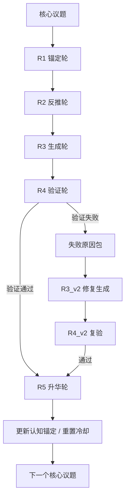

# 任务类型: eng

以下是一套可落地的**“引擎任务链式推演机制”**设计：把一个核心议题拆成 3～5 轮递进任务，上一轮输出作为下一轮输入；同时把“反者道之动”“虚实闭环”“验证冷却”“配置同步”“超时控制”全部编入依赖图。

---

## 1. 标准五轮递进结构

一个核心议题默认拆成 5 轮：

| 轮次 | 名称 | 作用 | 输入 | 输出 |
|---|---|---|---|---|
| R1 | 锚定轮 | 从“实”出发，读取现状、约束、历史失败经验、已有认知锚定 | 核心议题 + 黑匣子中的既有锚定 | 《现状/约束/成功判据》 |
| R2 | 反推轮 | 用“反者道之动”对 R1 逐条求反，生成反题、风险、反向假设 | R1 输出 | 《反题集/风险矩阵/新假设》 |
| R3 | 生成轮 | 虚实相合，基于 R1+R2 生成方案、配置增量、验证钩子 | R2 输出 + R1 输出 | 《方案/配置增量/验证钩子》 |
| R4 | 验证轮 | 立即执行验证，检查行为变化、配置是否生效、是否超时 | R3 输出 + 执行环境 | 《验证报告/行为差异/通过或失败》 |
| R5 | 升华轮 | 从验证结果中提炼新锚定，更新黑匣子，重置冷却，形成自进化闭环 | R4 输出 | 《认知增量/新锚定/冷却状态》 |

> 简单议题可合并为 3 轮：R1（锚定+反推）→ R2（生成+验证）→ R3（升华）。  
> 复杂议题保持 5 轮，R2 和 R4 还可继续拆成多个子任务。

---

## 2. 任务依赖图



关键依赖规则：

- R2 必须读取 R1 的输出；
- R3 必须读取 R2 的输出，同时可引用 R1 的约束；
- R4 必须读取 R3 的输出，且在同一调度周期内立即验证；
- R5 只有 R4 验证通过后才能执行；
- 若 R4 失败，不进入 R5，而是生成**版本化修复节点** `R3_v2 → R4_v2`，保证整体仍是 DAG，而不是无限循环。

---

## 3. 上一轮输出作为下一轮输入的“黑匣子”契约

为了避免“配置修改后未生效”，所有轮次通过**黑匣子（Blackboard）**读写，而不是直接改全局配置。

每个轮次的输出必须写成结构化的 `output_ref`：

```json
{
  "R1_output": {
    "problem": "核心议题",
    "constraints": [],
    "success_criteria": [],
    "anchors_used": []
  },
  "R2_output": {
    "opposites": [],
    "failure_modes": [],
    "risk_matrix": [],
    "new_hypotheses": []
  },
  "R3_output": {
    "plan": {},
    "config_deltas": [],
    "verify_hook": {},
    "timeout_policy": {}
  },
  "R4_output": {
    "passed": false,
    "evidence": [],
    "behavior_diffs": [],
    "failures": []
  },
  "R5_output": {
    "new_anchors": [],
    "updated_blackboard": {},
    "cooldown_state": 0
  }
}
```

下游任务通过 `input_refs` 读取上一轮输出：

```text
R2.input_refs = ["/rounds/R1/output"]
R3.input_refs = ["/rounds/R2/output", "/rounds/R1/output"]
R4.input_refs = ["/rounds/R3/output"]
R5.input_refs = ["/rounds/R4/output"]
```

这样，上一轮输出就是下一轮输入，不会出现“配置改了但读取点还是旧的”问题。

---

## 4. 验证与冷却机制

### 每次生成后必须立即验证

不只是 R4 要验证，每一轮生成后都要有“微型验证钩子”：

- R1 输出检查：是否覆盖约束、成功判据、历史失败经验；
- R2 输出检查：是否对 R1 每条结论都做了“求反”；
- R3 输出检查：配置写入点与读取点是否成对同步；
- R4 验证：真实执行方案，确认行为变化，而不仅是“配置存在”；
- R5 验证：新锚定是否与验证证据一致。

### 冷却状态机

```text
新议题进入：cooldown = 0
每轮生成后：立即验证
  验证通过：cooldown = 0，继续推进
  验证失败：cooldown = 600s，进入修复分支，阻止新议题
```

“验证通过则重置冷却”是为了让自进化闭环可以连续运行；验证失败则必须暂停，先修复。

---

## 5. 防坑机制：配置同步与超时

### 配置同步防坑

历史失败：配置修改后未生效，行为无变化。

对策：

1. 任何配置修改必须同时声明“读取点”；
2. 任务启动前，DAG 编译器检查所有下游 `input_refs` 与上游 `output_refs` 是否匹配；
3. R4 验证钩子强制执行：

```text
apply_config(config_delta)
assert read_point() == new_value
run_probe()
assert behavior == expected_behavior
```

也就是说：**验证的是“行为变化”，而不是“配置写进去了”**。

### API 超时防坑

历史失败：API 调用超时，任务未在规定时间内返回。

对策：

- B 类 turbo 模型：预设 timeout = 300 秒；
- A 类深推理模型：预设 timeout = 600 秒；
- 纯脚本验证钩子：建议 60 秒，可按任务调整；
- 超时任务不能静默通过，必须进入失败分支，生成修复任务。

---

## 6. 虚实自增强闭环

这套机制本质是“以实养虚，虚又返实”：

- R1、R4 是“实”：消耗算力、执行验证、采集证据；
- R2、R3、R5 是“虚”：生成反题、方案、认知锚定；
- 实养虚：R1 的现实约束让 R2 的反推有靶点；R4 的验证结果让 R5 的升华有依据；
- 虚返实：R3 的方案变成 R4 的执行；R5 更新的锚定变成下一轮 R1 的输入。

因此它不是一个静态任务清单，而是一个真正的**自进化闭环**：每次运行后，系统对“如何拆解议题”“如何验证”“如何避坑”的认知都会更新，从而改变下一次运行的行为。

---

## 7. 示例：一个核心议题的链式推演

核心议题：**“如何在免费配额限制下实现 AI 认知自进化？”**

- R1 锚定轮：读取当前免费配额、母系统依赖、历史失败经验，输出成功判据；
- R2 反推轮：对“免费配额限制”求反，得到“如果不限制配额会怎样？”“如果不验证会怎样？”“如果配置不同步会怎样？”等反题；
- R3 生成轮：基于 R2 的反题生成方案，设计链式推演 DAG、配置同步协议、冷却策略；
- R4 验证轮：立即执行一次小规模验证，检查方案是否在 300 秒/600 秒超时内跑通，行为是否变化；
- R5 升华轮：把“B模型turbo用300秒，A模型用600秒”等经验写回黑匣子，更新认知锚定，重置冷却。

然后进入下一个核心议题，形成“九转玄功”式的层层递进。