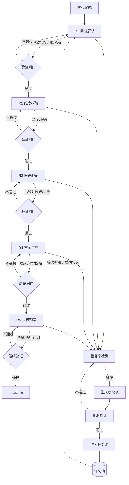

# 任务类型: eng

在锚定结论上直接推演：默认将核心议题拆成 **5 轮递进**，算力紧张时可压缩为 **3 轮**；每一轮是一个 task，输出写入共享 `context_store`，下一轮任务通过依赖上一轮产物来构造。

## 1. 五轮链式定义

| 轮次 | 目标 | 输入（上一轮输出） | 输出（本轮产物） | 模型/超时 |
|---|---|---|---|---|
| R1 | 问题解析 | 核心议题原文 | 问题定义、约束边界、成功指标 | A 模型 / 600s |
| R2 | 维度拆解 | 问题定义、约束、成功指标 | 子维度列表、关键假设、验证优先级 | B-turbo / 300s |
| R3 | 假设验证 | 子维度列表、关键假设 | 已验证假设、证据、失效条件 | A 模型 / 600s |
| R4 | 方案生成 | 已验证假设、证据 | 候选方案、权衡表、推荐项 | B-turbo / 300s |
| R5 | 执行预案 | 候选方案、权衡表 | 最终决策、执行计划、回滚方案 | A 模型 / 600s |

压缩为 3 轮时：合并 R2+R3 为“拆解验证”，合并 R4+R5 为“决策预案”。

---

## 2. 任务依赖图

说明：  
- 主链上“通过”的边是数据依赖，也是调度依赖。  
- “不通过”的边是控制回流，带失败原因回到本轮重试；每轮最多重试 2 次，超过则终止该链并释放预算。  
- 自进化闭环是旁路任务，不抢占主链。

---

## 3. 调度器：3 路并发与插空执行

- 单链是串行的，只占 **1 路并发**。  
- 3 路并发物理上限内，可同时跑 **3 个不同议题的链**，或“2 个主链 + 1 个自进化任务”。  
- 所有模型调用统一经过 `Semaphore(3)`，自进化任务也必须获取槽位，不能绕过。

调度优先级：

1. 主链就绪任务  
2. 验证闸门（如果闸门是模型调用）  
3. 自进化：模板生成 / 冒烟验证  
4. 低价值预热任务

插空原则：只有主链无就绪任务、且有空闲槽位时，才运行自进化任务，避免引擎空转。

---

## 4. 自进化闭环触发与预算

### 触发器

- 检测窗口：最近 30 个同类任务。  
- 重复率定义：窗口内输出两两语义相似度 > 0.85 的比例。  
- 触发阈值：重复率 > 0.30。  
- 触发条件：有空闲槽位、剩余预算足够、且已过冷却期。  
- 冷却期：触发生成后，未来 10 个任务内不再触发，防止震荡。

### 执行器预算

- 每窗口总预算：主链 80%，自进化 20%。  
- 模板生成：B-turbo / 300s，成本占自进化预算约一半。  
- 冒烟验证：A 模型 / 600s，验证通过才注入任务池，失败则丢弃。  
- 超预算：停止生成，不空转。

---

## 5. 避坑落地

- 所有阈值、模板、模型路由集中放配置中心；修改时必须同步所有读取点，发布后立即跑 `smoke_test` 验证新配置生效，否则禁止上线。  
- API 调用统一设置 timeout：A 模型 600s，B-turbo 300s；超时后释放槽位，标记失败，按降级模板重试一次或终止。  
- 空闲槽位不跑无意义循环，只跑可复用资产任务：模板生成、冒烟验证、embedding 预计算。