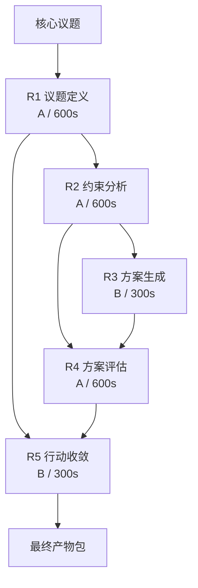

# 任务类型: eng

# 链式推演机制设计

以下设计直接建立在已确认的架构锚定之上，不重复论证底层自恢复、WAL/Snapshot、单向同步与幂等原则；重点说明“链式推演”如何落地。

---

## 1. 核心概念

**ChainTask** 是引擎中的一类任务：

- 输入：一个核心议题
- 执行：拆成 3～5 轮递进推理，称为 **Round**
- 每一轮 Round 输出一个中间产物 Artifact
- 上一轮 Artifact 作为下一轮 Round 的输入
- 最终产物包是唯一事实源，Gitee/飞书/Supabase 都是下游单向存储

```
核心议题
   │
   ▼
TaskDependencyGraph（3~5 个 Round）
   │
   ▼
Round 执行器（Core 进程内）
   │
   ▼
最终产物包
   │
   ▼
单向同步到下游
```

---

## 2. 任务依赖图 TaskDependencyGraph

依赖图由 **Decomposer** 在任务创建时生成，并持久化到产物包中。

### 2.1 图结构

一个 Round 包含：

- `id`
- `name`
- `model`：A 或 B
- `timeout_seconds`
- `inputs`：依赖哪些前序 Round 的哪些输出
- `output_schema`：本轮输出契约
- `config_refs`：本轮会读取哪些配置
- `prompt_template`：prompt 模板，禁止硬编码配置

示例：

```json
{
  "graph_version": "1.0",
  "topic": "核心议题",
  "rounds": [
    {
      "id": "R1",
      "name": "议题定义",
      "model": "A",
      "timeout_seconds": 600,
      "inputs": [],
      "outputs": ["problem_statement"],
      "config_refs": ["chain.criteria"]
    },
    {
      "id": "R2",
      "name": "约束分析",
      "model": "A",
      "timeout_seconds": 600,
      "inputs": ["R1.problem_statement"],
      "outputs": ["constraint_map"],
      "config_refs": []
    },
    {
      "id": "R3",
      "name": "方案生成",
      "model": "B",
      "timeout_seconds": 300,
      "inputs": ["R2.constraint_map"],
      "outputs": ["candidate_options"],
      "config_refs": ["chain.max_options"]
    },
    {
      "id": "R4",
      "name": "方案评估",
      "model": "A",
      "timeout_seconds": 600,
      "inputs": ["R3.candidate_options", "R2.constraint_map"],
      "outputs": ["decision_matrix"],
      "config_refs": ["chain.evaluation_criteria"]
    },
    {
      "id": "R5",
      "name": "行动收敛",
      "model": "B",
      "timeout_seconds": 300,
      "inputs": ["R4.decision_matrix", "R1.problem_statement"],
      "outputs": ["action_plan"],
      "config_refs": []
    }
  ]
}
```

### 2.2 依赖图校验

生成后必须校验：

- Round 数量必须是 3～5
- 必须是 DAG，不能有环
- 每个 `inputs` 必须指向已存在的 Round 输出
- 每个 Round 的 `output_schema` 必须合法
- `config_refs` 必须在配置中心存在对应读取点

校验失败则重新生成；重试 3 次仍失败则回退到默认 3 轮模板。

---

## 3. 链式执行流程

Core 按拓扑序执行 Round：

```
for round in topo_sort(graph.rounds):
    input_artifacts = load_artifacts(round.inputs)
    input_hash = sha256(input_artifacts + graph_version + config_version)
    exec_id = sha256(task_id + round.id + input_hash)

    if state.exists(exec_id):
        continue  // 幂等复用

    if current_config_version != task.config_version:
        abort(CONFIG_CHANGED)

    prompt = build_prompt(round, input_artifacts)

    result = call_llm(
        model=round.model,
        prompt=prompt,
        timeout=round.timeout_seconds,
        retry=3
    )

    validate(result, round.output_schema)

    artifact_id = store_artifact("rounds/" + round.id + "/output.json", result)

    wal.append({
        "op": "round_done",
        "exec_id": exec_id,
        "artifact_id": artifact_id,
        "input_hash": input_hash
    })

    snapshot.update({
        "round": round.id,
        "exec_id": exec_id,
        "artifact_id": artifact_id
    })
```

关键点：

- 上一轮输出通过 ArtifactStore 加载，不依赖内存共享
- 每一轮输出都先写 WAL，再更新 Snapshot
- 崩溃后从 Snapshot + WAL 恢复，未完成的 Round 重新执行
- 已完成的 Round 因 `exec_id` 幂等，不会重复执行

---

## 4. 状态、恢复与幂等

### 4.1 任务级幂等

```
task_id = sha256(event_id + graph_version + config_version)
```

- 同一事件重复触发，`task_id` 相同
- 如果任务已完成，直接返回原结果
- 如果任务运行中，返回运行状态
- 如果任务失败，从失败 Round 开始续跑

同一文件重复上传时，`event_id` 取文件 sha256，因此天然幂等。

### 4.2 轮级幂等

```
exec_id = sha256(task_id + round_id + input_hash + config_version)
```

- `input_hash` 包含所有输入 Artifact 内容
- `config_version` 变化会导致旧 `exec_id` 失效
- 同一 `exec_id` 已存在则跳过，避免重复调用 API

### 4.3 恢复流程

Core 崩溃后，Guardian 重新拉起 Core：

1. 读取 `state.snapshot`
2. 回放 `state.wal`
3. 找到最近一个未完成的 Round
4. 使用相同 `exec_id` 重新执行

---

## 5. 防坑设计

### 5.1 配置修改后必须生效

所有配置只能通过 `ConfigReader` 读取，禁止在 prompt 中硬编码。

每个 Round 显式声明 `config_refs`：

- 新增配置时，必须同步在 `config_refs` 注册读取点
- 配置变更后 `config_version` 必须递增
- 执行前校验 `current_config_version == task.config_version`
- 如果不一致，任务标记为 `CONFIG_CHANGED`，停止执行
- 修改后立即执行一个 `dry_run` Round，验证行为变化

这样避免“配置改了但读取点没同步”或“旧配置被缓存”。

### 5.2 API 超时控制

模型超时采用固定 profile：

| 模型 | 超时 |
|---|---|
| A 模型 | 600 秒 |
| B 模型 turbo | 300 秒 |

Round 超时 = `模型超时 × 调用次数 + 60秒缓冲`。

超时后：

- 使用相同 `exec_id` 重试
- 最多重试 3 次
- 指数退避：1s / 2s / 4s
- 重试仍失败则标记 Round FAILED，保留已完成的中间产物

如果整个链式任务超过总 deadline，Guardian 强制终止 Core，恢复后从最近断点继续或失败退出。

---

## 6. 依赖图示例

以一个 5 轮链式推演为例：



依赖关系：

| Round | 输入 | 输出 | 模型/超时 |
|---|---|---|---|
| R1 | 核心议题 | 议题定义、成功标准 | A / 600s |
| R2 | R1.problem_statement | 约束地图、事实清单 | A / 600s |
| R3 | R2.constraint_map | 候选方案集 | B / 300s |
| R4 | R3.candidate_options + R2.constraint_map | 决策矩阵 | A / 600s |
| R5 | R4.decision_matrix + R1.problem_statement | 行动路径 | B / 300s |

简单议题可以只用 3 轮：

```
R1 定义 -> R2 方案 -> R3 行动
```

复杂议题用 5 轮，但不超过 5 轮，保证链路可控。

---

## 7. 与现有架构的衔接

- **Guardian**：负责拉起 Core、监控心跳、崩溃后恢复
- **Core**：执行 ChainTask 的 Round 调度
- **WAL + Snapshot**：保存链式任务执行状态
- **ArtifactStore**：保存每一轮输出
- **最终产物包**：包含 `graph.json`、所有 Round 输出、最终行动方案
- **下游同步**：Gitee、飞书、Supabase 只从最终产物包单向写入，不做双向同步

这样，链式推演机制在既有自恢复架构上直接落地，同时满足幂等、可控、可恢复、配置可验证的要求。