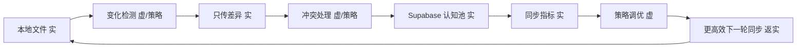

# 任务类型: eng

基于锚定，以下只推演“增量同步”这条 **ChainTask** 链，不重述底层自恢复机制。

---

## 1. ChainTask 总链



自动归档系统最终表现为：

> 新文件/任务进入后 → 自动分类 → 打标签 → 存入对应目录 → 同步到 Supabase 认知池 → 记录指标 → 调优策略 → 下一轮更快更准。

---

## 2. 核心对象与配置

### ArchiveTask

```json
{
  "task_id": "uuid",
  "op_id": "hash(source_path + mtime + size)",
  "source_path": "/inbox/xxx.pdf",
  "file_hash": "sha256",
  "category": null,
  "tags": [],
  "target_dir": null,
  "state": "PENDING"
}
```

### WAL + Snapshot

- 本地文件变化先写 WAL，再执行任务。
- Snapshot 保存当前目录 manifest 和 chunk 索引。
- 崩溃恢复时从 Snapshot + WAL 回放，回放操作幂等。

### ConfigCenter

配置修改必须立即生效：

```python
class ConfigCenter:
    def get(self, key):
        mtime = os.stat(self.path).st_mtime_ns
        if mtime != self._mtime:
            self._data = yaml.safe_load(open(self.path))
            self._mtime = mtime
        return self._data[key]
```

每次读取都检查 mtime，不缓存旧配置值。

### StrategyTuner

写配置后必须验证：

```python
def set(self, key, value):
    data = self.config.get_all()
    data[key] = value

    tmp = self.path + ".tmp"
    yaml.safe_dump(data, open(tmp, "w"))
    os.replace(tmp, self.path)

    assert self.config.get(key) == value, "配置未生效"
```

### API 超时

按模型独立设置：

```python
MODEL_TIMEOUT = {
    "B_turbo": 300,
    "A_model": 600,
}

def call_llm(model, prompt):
    return client.chat.completions.create(
        model=model,
        prompt=prompt,
        timeout=MODEL_TIMEOUT[model],
    )
```

超时后不阻塞主链路，降级到规则分类或保留旧策略，并写入指标。

---

## 3. ChainTask 各阶段推演

### 3.1 本地文件（实）

- 监听 inbox 目录。
- 文件到达后计算 `hash + mtime + size`，生成 `op_id`。
- 追加 WAL 事件：
  - `file_created`
  - `file_modified`
  - `file_moved`
- 更新 Snapshot 目录清单。

### 3.2 变化检测（虚/策略）

消费 WAL，生成 `ArchiveTask`：

1. 先查 Supabase 认知池中相似历史文件：
   - 向量相似度高 → 直接复用分类和标签。
   - 避免重复调用模型。
2. 低相似度或新类型任务 → 调用 B turbo 分类打标。
   - 超时：300 秒。
   - 输出：`category`, `tags`, `confidence`。
3. 规则兜底：
   - 正则/关键词命中已知类别 → 不调模型。
   - 模型超时/失败 → `category=uncategorized`，`tags=["needs_review"]`。

打标签后生成对应目录：

```text
target_dir = dir_map[category] / date / tags[:3]
```

例如：

```text
dir_map:
  invoice: finance/invoices
  contract: legal/contracts
  report: operations/reports
  uncategorized: review/uncategorized
```

### 3.3 只传差异（实）

对文件做 chunk 化：

- 内容定义分块。
- 计算每个 chunk 的 hash。
- 查询 Supabase `archive_chunks`，只上传不存在的 chunk。
- 上传幂等键使用 `op_id + chunk_hash`。

本地归档操作：

- 远程上传成功后，再把本地文件从 inbox 移动到 `target_dir`。
- 如果移动前崩溃，恢复后重放 WAL：
  - 远程 chunk 已存在 → 跳过。
  - 本地移动未完成 → 重做移动。

### 3.4 冲突处理（虚/策略）

检查目标目录中是否已有同名/同路径文件：

| 情况 | 策略 |
|---|---|
| 相同 hash | 去重，合并 tags，不重复上传 |
| 不同 hash | 默认 `keep_both`，追加 `_conflict_{hash[:8]}` |
| 策略无法确定 | 调用 A model 决策，超时 600 秒 |

冲突处理是策略层，不反向拉取远端数据，保持单向同步。

### 3.5 Supabase 认知池（实）

最终落库到 Supabase：

```text
Storage:
  archives/{category}/{date}/{tags}/{filename}
```

表结构：

```sql
archive_files(
  id uuid primary key,
  op_id text unique,
  path text,
  hash text,
  category text,
  tags jsonb,
  target_dir text,
  status text
);

archive_chunks(
  file_id uuid,
  chunk_index int,
  chunk_hash text,
  storage_path text
);

sync_metrics(
  task_id uuid,
  model text,
  timeout_ms int,
  duration_ms int,
  bytes_diff int,
  chunks_uploaded int,
  confidence float,
  config_version text
);

cognition_vectors(
  chunk_id uuid,
  file_id uuid,
  embedding vector,
  content text
);
```

这就是“认知池”：
- 文件内容进 Storage。
- 元数据进 Postgres。
- 语义向量进 pgvector。
- 后续相似任务可直接复用。

### 3.6 同步指标（实）

每个任务完成后写一行 `sync_metrics`：

- 用了哪个模型
- 超时时间
- 实际耗时
- 传输了多少差异字节
- 冲突次数
- 分类置信度
- 配置版本

这些指标是策略调优的输入。

### 3.7 策略调优（虚）→ 更高效下一轮同步（返实）

StrategyTuner 读取指标后，自动调整：

- 分类置信度低 → 增加规则词条。
- 标签命中率低 → 更新 tag_dict。
- 重复 chunk 多 → 调整分块大小。
- 冲突多 → 修改冲突策略。
- 模型超时多 → 触发降级/重试策略。

需要深度分析时，异步调用 A model，超时 600 秒。

写配置后立即验证：

```python
strategy_tuner.set("dir_map", new_dir_map)
assert config_center.get("dir_map") == new_dir_map
```

下一轮任务会立刻使用新配置，并且复用 Snapshot、chunk 索引、向量缓存，因此更高效。

---

## 4. 避坑落实

### 配置修改后未生效

- `ConfigCenter` 每次 `get` 都 stat 文件 mtime。
- `StrategyTuner` 写入后立即 `assert get() == set()`。
- 配置不依赖重启，下一任务自动生效。

### API 调用超时

- B turbo 分类/打标：超时 300 秒。
- A model 冲突决策/策略调优：超时 600 秒。
- 超时后走规则降级，不卡住归档主链路。
- 超时事件写入 `sync_metrics`，驱动后续策略调优。

---

## 5. 验收标准

1. 新文件进入 inbox 后，自动完成分类、打标签、移入对应目录。
2. Supabase 认知池中出现对应文件、chunk、向量、指标。
3. 修改配置后，下一个任务立即按新配置执行。
4. B turbo 调用超过 300 秒触发降级；A model 调用超过 600 秒触发降级。
5. 任意阶段崩溃，由 Guardian 拉起 Core，从 WAL + Snapshot 恢复，不重复上传。