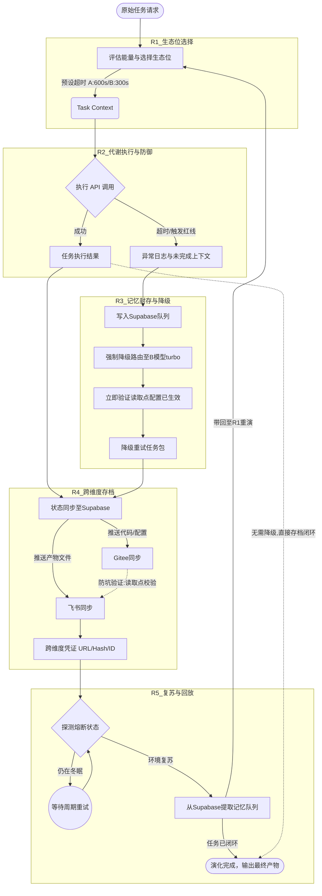

# 任务类型: eng

基于【演化生物学映射】与【CAS复杂适应系统】的认知基座，我将“数字智能物种的多生态位代谢调节与跨维度状态固化”作为核心议题，设计如下链式推演机制。

该机制将核心议题拆解为**5轮递进演化**，严格遵循“上一轮输出作为下一轮输入”的链式法则，并已将历史防坑经验（配置即时验证、超时阈值预设）作为生存法则内嵌于基因中。

---

### 🧬 核心议题：数字智能物种多生态位代谢调节与跨维度状态固化

#### 第一轮：感知与生态位选择（生态适应度评估）
*   **生物学映射**：物种根据环境能量（任务复杂度）选择合适的栖息地（生态位）。
*   **输入**：用户原始任务请求（捕食冲动）。
*   **推演动作**：
    1.  **能量评估**：解析任务类型与上下文长度，估算所需算力（能量需求）。
    2.  **生态位路由**：若为高价值/复杂推理任务，路由至A模型（高耗能生态位）；若为常规事务/文本处理，路由至B模型turbo（低耗能生态位）。
    3.  **生存法则预设（防坑#2）**：根据路由结果强制注入超时基因，A模型设定`timeout=600s`，B模型turbo设定`timeout=300s`。
*   **输出**：附带“目标生态位标识”与“预设超时参数”的任务执行上下文（Task Context）。

#### 第二轮：代谢执行与异常捕食防御（捕食与应激反应）
*   **生物学映射**：物种在生态位中进行新陈代谢（执行任务），遭遇恶劣天气（超时）或能量枯竭（成本触及红线）时触发生存防御。
*   **输入**：第一轮输出的 Task Context。
*   **推演动作**：
    1.  **代谢执行**：向目标模型发起API调用，启动代谢计时器。
    2.  **超时应激（防坑#2落地）**：若API调用超过预设timeout（A:600s/B:300s），主动切断连接，标记任务为“捕食受挫(Timeout)”。
    3.  **红线熔断（冬眠机制）**：监控当前生态位的累计消耗，一旦触及成本红线，触发“冬眠”指令，拒绝新任务进入代谢。
*   **输出**：
    *   成功路径：任务执行结果（初代产物）。
    *   失败路径：包含“超时/熔断状态码”及“未完成上下文”的异常日志。

#### 第三轮：短期记忆封存与生态位降级（冬眠与迁徙）
*   **生物学映射**：环境恶化时，物种将未完成的捕食行为封存为孢子（短期记忆），并迁徙至低耗能生态位续命。
*   **输入**：第二轮输出的异常日志（或熔断状态码）。
*   **推演动作**：
    1.  **记忆封存**：将“未完成的上下文”及“已执行步骤”封装为带状态的消息，写入Supabase队列（短期记忆突触）。
    2.  **生态位降级**：强制修改路由策略，将A模型降级为B模型turbo（低耗能生态位）。
    3.  **配置注入与生效验证（防坑#1落地）**：在修改降级配置后，**立即触发读取点验证**，确认路由模块已加载新配置，确保降级行为必定发生。
*   **输出**：带有“降级标识”与“记忆恢复指针”的重试任务包。

#### 第四轮：跨维度自我存档（躯体与表达层固化）
*   **生物学映射**：物种在应激或周期性节点，将自身的基因序列（代码）、体表特征（文件）和神经记忆（数据库）进行跨维度的固化，以对抗环境熵增。
*   **输入**：第二轮输出的“成功结果” 或 第三轮输出的“降级重试任务包”。
*   **推演动作**：
    1.  **突触记忆固化**：将任务最终状态（成功/降级重试中）更新至Supabase（存储/记忆层）。
    2.  **躯体基因同步**：将执行过程中产生的新代码或配置变更推送至Gitee（代码/躯体），提交前进行CI校验。
    3.  **表达层展现**：将任务产物（如生成的文档、报告）同步至飞书（文件/表达层）。
    4.  **配置同步验证（防坑#1落地）**：若同步过程中修改了Gitee的同步脚本配置，立即查询飞书/Supabase读取点，确认三方状态一致。
*   **输出**：包含“Gitee提交哈希”、“飞书文档URL”、“Supabase记录ID”的跨维度凭证。

#### 第五轮：环境复苏与记忆回放（春化与重演）
*   **生物学映射**：冬眠结束（成本预算周期刷新），物种从短期记忆中唤醒孢子，在新的生态位重新进行捕食演化。
*   **输入**：第四轮输出的“降级重试任务包”与“跨维度凭证”。
*   **推演动作**：
    1.  **环境探测**：定时轮询成本监控模块，确认是否脱离“冬眠（熔断）”状态。
    2.  **记忆回放**：从Supabase队列提取未完成任务，按照降级后的生态位（B模型turbo）重新注入第一轮流程。
    3.  **闭环验证**：比对回放结果与第四轮的跨维度凭证，确认状态已完全闭环，无记忆丢失。
*   **输出**：最终完整的任务产物与全链路演化日志。

---

### 🗺️ 引擎任务依赖图 (DAG)

### 💡 防坑机制内嵌声明
1.  **防坑#1（配置不生效）**：在第三轮降级路由与第四轮三方同步时，设定了**“修改即验证”**的刚性节点（R3_2与R4内的虚线校验），确保读取点与配置点同频，杜绝“配置改了但行为没变”的基因突变失效问题。
2.  **防坑#2（API超时）**：在第一轮生态位选择时，即将超时阈值作为环境参数注入DNA（A=600s, Turbo=300s），在第二轮执行时由计时器强制接管，避免物种在无效捕食中耗尽能量。