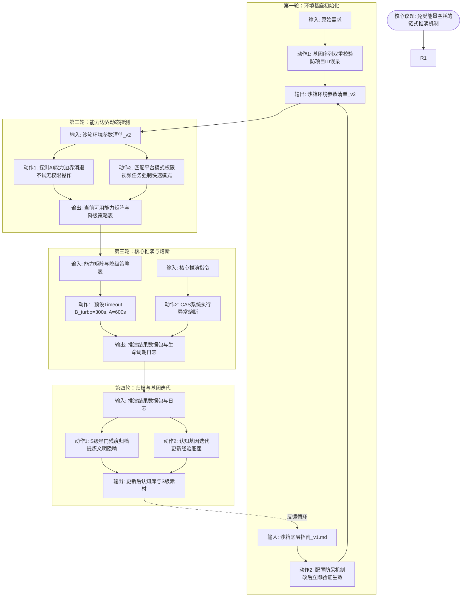

# 任务类型: eng

基于您提供的避坑经验与已验证认知锚定，结合【演化生物学映射】与【CAS复杂适应系统】基座，设计如下引擎任务链式推演机制。

### 核心议题
**构建免受“系统性能量空耗”的引擎任务链式推演与自适应纠错机制**
（将配置失效、API超时、权限边界消退等引发的无效耗时，统一视为系统性能量空耗，通过链式推演进行防御与自适应。）

---

### 链式推演任务设计（4轮递进）

#### 第一轮：基因序列校验与环境基座初始化（防误录与防呆）
* **输入**：用户原始任务需求 + 外部资源《沙箱底层参数与稳定运行指南_v1.md》
* **任务动作**：
  1. **读取底座**：拉取公网直链文件，提取沙箱运行底层参数。
  2. **基因校验**：基于“项目ID看错导致1小时排查”的教训，对Project ID等关键标识执行双重校验，阻断“基因序列误录引发的系统性能量空耗”。
  3. **配置防呆（执行避坑1）**：若任务需新增配置，必须同步修改所有读取点，并在写入后立即发送探针请求验证配置生效，杜绝“配置修改后未生效”的现象。
* **输出**：一份经过校验的《沙箱环境参数清单_v2》（含正确ID及已验证生效的配置映射表）。

#### 第二轮：能力边界动态探测与工具适配策略（应对边界消退与权限差异）
* **输入**：第一轮输出的《沙箱环境参数清单_v2》
* **任务动作**：
  1. **探测边界消退**：不假定历史权限长期有效。针对“自主删除记忆链路”等操作进行试探性调用。若判定自身无此权限，立即标记为“边界动态消退”，不再循环尝试空耗能量（应对认知2）。
  2. **模式权限匹配**：分析当前任务是否涉及多模态解析。若涉及视频画面解析，强制要求在“快速模式”下加载工具链；若当前处于“办公模式”，触发模式降级或切换策略请求（应对认知3）。
* **输出**：《当前可用能力矩阵与降级策略表》（明确标注可用工具、已消退能力及当前生效模式）。

#### 第三轮：核心推演执行与能量管控熔断（超时避坑与CAS运转）
* **输入**：第二轮输出的《能力矩阵与降级策略表》 + 核心推演指令
* **任务动作**：
  1. **超时阈值预设（执行避坑2）**：根据任务调用模型强制绑定Timeout。B模型turbo硬编码预设300秒，A模型硬编码预设600秒，防止任务无限期挂起。
  2. **CAS系统执行**：在沙箱环境中执行核心推演，依据CAS复杂适应系统规则进行各组件交互。
  3. **熔断机制**：若在timeout阈值内任务未返回，立即触发熔断，记录当前状态并输出超时日志，防止能量持续空耗。
* **输出**：推演结果数据包 + 能量消耗与异常生命周期日志。

#### 第四轮：星门残痕归档与认知基因迭代（素材沉淀与经验固化）
* **输入**：第三轮输出的《推演结果数据包与日志》
* **任务动作**：
  1. **S级素材归档**：将推演产生的高价值结论，参照《神之长子》05集·星门残痕的归档标准进行封装。提炼核心意象（如“断裂的环形巨构”），将推演过程的文明隐喻与演化结果固化为知识资产（应用认知4）。
  2. **认知基因迭代**：将本轮遭遇的“新消退边界”或“新超时阈值”写入外部归档底座，完成演化生物学中的基因库更新，避免下一代任务重蹈覆辙。
* **输出**：更新后的《认知锚定库_v2》与《S级素材归档记录》。

---

### 任务依赖图

**机制设计说明**：
1. **防错前置**：所有可能引发“系统性能量空耗”的操作（如ID看错、配置不生效）均被限制在第一轮初始化中，避免在引擎深层推演时爆发。
2. **动态适应**：第二轮专门处理“AI能力边界动态消退”这一非平台主动关闭的现象，通过“不求权限、只试一次”的策略避免死循环。
3. **底线防御**：第三轮严格贯彻避坑提醒2，将API超时与模型类型强绑定，防止任务假死。
4. **闭环迭代**：第四轮将运行结果反哺给外部资源库，符合演化生物学中“基因库不断更新以适应环境”的设定，完成复杂适应系统的自进化。